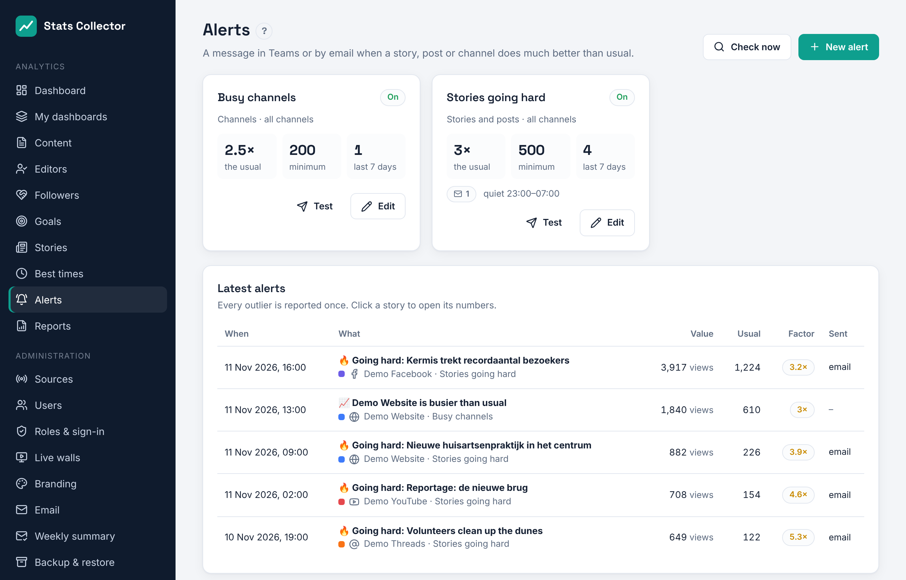
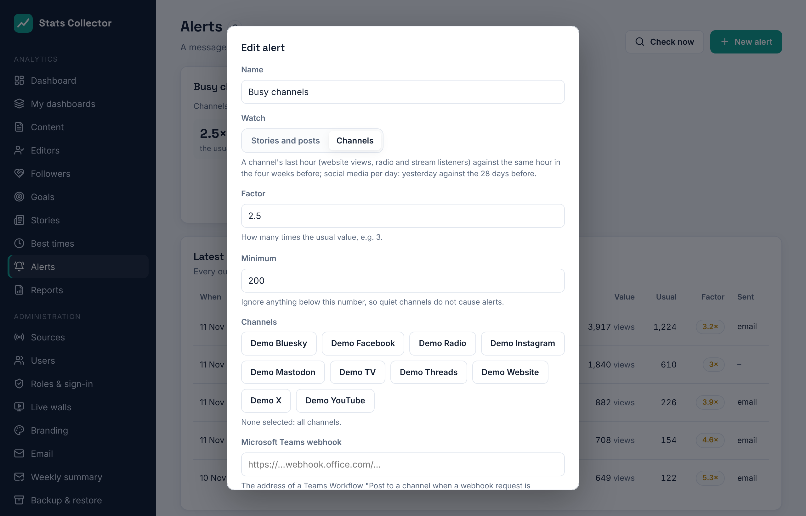

# Alerts

**Analytics → Alerts** sends a message to Microsoft Teams and/or by email when a story, post or channel suddenly does much better than usual. Editors can see the alerts; the **editor-in-chief** and **administrators** set them up.

## Two kinds of alert

| Watch | An alert goes out when |
| --- | --- |
| **Stories and posts** | an article, post or video published in the last three days has reached more than *factor* times what that channel's items usually reach. "Usually" is the median of the channel's items of the last 30 days (at least five). Views count; on Bluesky and Mastodon, which give no views, interactions count. |
| **Channels** | a channel's last full hour is *factor* times the same hour in the four weeks before: website views, or the average number of listeners and viewers of a radio or live stream. Social media report per day, so for them yesterday is compared with the 28 days before. |

The **minimum** keeps quiet channels from causing alerts: anything below it is ignored, however many times the usual it is.

Every outlier is reported **once**. The worker looks every 15 minutes. **Check now** looks straight away.

## Setting up an alert

1. **New alert**: a name, what to watch, the factor (e.g. 3 = three times the usual) and the minimum.
2. Pick channels, or none for all channels.
3. Where to send it:
   - **Microsoft Teams webhook**: see below. The address is stored encrypted; leave the field empty to keep it.
   - **Email to**: one or more addresses. Email goes out through **Administration → Email**.
4. The **language** of the messages and optional **quiet hours** (e.g. 23:00 – 07:00): nothing is sent in that time.
5. Save, and press **Test** to send a test message.

The list **Latest alerts** shows every outlier with its value, what is usual, the factor and where it was sent. Click a story to open its numbers.

## The Teams address

Teams receives the alerts through a **Workflow** (Power Automate):

1. In Teams, open the channel, choose **⋯ → Workflows**.
2. Pick the template **Post to a channel when a webhook request is received**, give it a name and choose the team and channel.
3. Copy the address Teams shows at the end and paste it under **Microsoft Teams webhook**.

An older **Incoming webhook** address (`…webhook.office.com/…`) works too. The message is an Adaptive Card with the title, the numbers and an **Open** button to the story.
