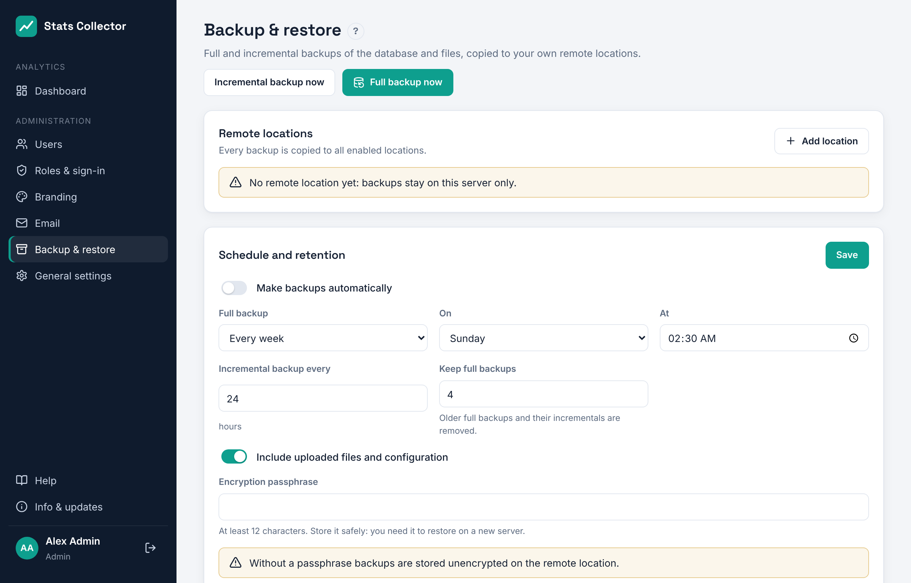

# Backup and restore

**Administration → Backup & restore** makes full and incremental backups of the database and the files (uploaded logos and the configuration file) and copies them to one or more remote locations.

## How it works

- The database is backed up with **pgBackRest**. A *full* backup contains everything; an *incremental* backup only what changed since the previous backup. PostgreSQL archives its transaction log continuously, so backups are consistent while the app keeps running.
- Files are packed with `tar` in incremental mode.
- After each backup the complete local backup folder (`/var/lib/stats-collector/backup`) is synchronised with **rclone** to every enabled remote location.
- With an encryption passphrase the copies on the remote location are encrypted (rclone *crypt*: XSalsa20-Poly1305). Without the passphrase nobody can read them, including you, so store it in your password manager.

## Remote locations

Click **Add location** and choose a protocol:

| Protocol | When to use | Notes |
| --- | --- | --- |
| SCP / SFTP (SSH) | NAS, Linux server, hosting with SSH | Password or private key (OpenSSH or PEM format). On the first **Test** the server's host key is stored and checked from then on. |
| FTPS | NAS or hosting with FTP over TLS | *Explicit* (port 21, AUTH TLS) is most common; *implicit* uses port 990. |
| FTP | Only on a trusted network | The password is sent unencrypted. |

**Folder** is the path on the remote server; it is created automatically. Click **Test** to check the connection: the log shows each step and the backups already stored there.

## Schedule and retention

- **Make backups automatically**: on or off.
- **Full backup** every day, week (choose the day) or month, at the chosen time (time zone from General settings).
- **Incremental backup every** N hours in between.
- **Keep full backups**: how many full backups (with their incrementals) are kept. Older ones are removed locally and on the remote locations.

**Full backup now** and **Incremental backup now** start one immediately. The log appears on the page.

## Restore

1. Under **Restore** choose a location and click **Show backups**. The list comes from the remote location itself, so this also works on a brand new server.
2. Click **Restore** next to the moment you want to go back to. Choosing an incremental backup restores the full backup plus all incrementals up to that point.
3. Type `RESTORE` and confirm. The application stops, the database and files are replaced, and the application starts again. Sign in again afterwards.

### Disaster recovery on a new server

1. Install Stats Collector on the new server with the installer.
2. Create a temporary administrator through the setup link.
3. Under **Backup & restore** set the **same encryption passphrase** and add the remote location.
4. Show the backups and restore the newest one. The restored configuration contains the original secret key, so stored passwords keep working.

## Before every update

Updates from the interface make an extra database dump in `/var/lib/stats-collector/backup/pre-update/` first and use it to roll back automatically if the update fails.
