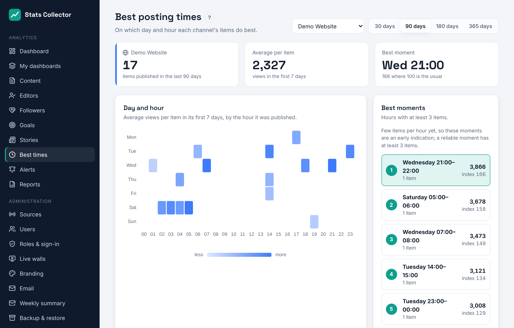

# Best posting times

**Analytics → Best times** shows, per channel, on which weekday and hour its articles, posts and videos do best. Everyone can open it.

1. Pick a channel (website or social media) and a period: 30, 90, 180 or 365 days.
2. The **heat map** has a row per weekday and a column per hour. The darker a square, the more an item published in that hour reached on average.
3. **Best moments** lists the five best hours of the week that have at least three items, with their average and an index: 100 is the channel's usual, 180 is 80% better.
4. **By weekday** and **By hour** add the hours up per day and per hour of the day. Bars above the dashed line (100) do better than usual.

How it is counted:

- Every item counts once, in the hour it was published (organisation time zone, **Administration → General settings**).
- An item's score is what it reached in its **first seven days**: views, or interactions on Bluesky and Mastodon. Older items do not win by having had more time.
- Items younger than two days are left out, because their numbers are not complete yet.

Radio and live streams have no posts and are not in the list; their busiest hours are on the [Dashboard](dashboard.md).
