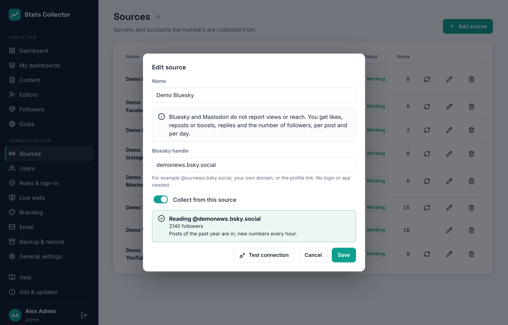

# Bluesky and Mastodon

Stats Collector reads public **Bluesky** and **Mastodon** accounts through their open APIs. There is no developer app, no app review and no cost: you only enter the account. Each account is its own source, so you can add several.

## What is collected

| | Per day for the account | Per post |
| --- | --- | --- |
| Bluesky | Likes, reposts, replies, quotes, new followers (net), followers | Likes, reposts, replies, quotes |
| Mastodon | Favourites, boosts, replies, new followers (net), followers | Favourites, boosts, replies |

Good to know:

- **Neither platform reports views or reach.** Bluesky and Mastodon therefore count towards the *interactions* and *followers* goals and dashboard measures, not towards views or reach.
- Posts only have running totals. Stats Collector stores what a post gained per day; a post that is new to Stats Collector gets its whole total on the day it was published.
- **New followers (net)** is the change in the follower count from one day to the next: people who followed minus people who left. The follower count per day starts on the day you add the account and becomes a full history from then on.
- Right after adding an account the posts of the **past year** are read, a few pages per run. After that the numbers are updated **every hour**, and posts of the last 30 days are read again every time.
- Reposts of other people's posts and replies to other accounts are left out; your own threads are included.
- Both platforms work in whole days: in the dashboard's **24 hours** view they show *daily numbers only*.
- Links in a post (and the link card) are used to link the post to the website article it points to, just like Facebook posts (see [Content](content.md)).

## Add a Bluesky account

1. Go to **Administration → Sources → Add source** and pick **Bluesky (account)**.
2. Give it a name, e.g. *Bluesky*.
3. Fill in the **Bluesky handle**: `@ournews.bsky.social`, your own domain if the account uses one (`@ournews.nl`), or the profile link `https://bsky.app/profile/…`.
4. Click **Test connection**: you see the handle and the number of followers.
5. Click **Save**. The first numbers come in within a few minutes.

## Add a Mastodon account

1. Go to **Administration → Sources → Add source** and pick **Mastodon (account)**.
2. Fill in the **Mastodon account** as `@ournews@mastodon.social` or as the profile link `https://mastodon.social/@ournews`. The **Server** is filled in for you.
3. Click **Test connection**.
4. If the test says the server only answers with an access token, make one on the Mastodon account itself: **Preferences → Development → New application**, name *Stats Collector*, tick only the scope **read** (untick write and follow), save, open the application and copy **Your access token** into **Access token**. The token is stored encrypted.
5. Click **Save**.

## Problems

| Message | What to do |
| --- | --- |
| The account was not found | Check the handle (Bluesky) or the account and server (Mastodon). A Bluesky handle always has a dot in it. |
| This Mastodon server only answers with an access token | Make an access token as in step 4 above. |
| The platform asks us to slow down | Nothing: the next hourly sync tries again. |
