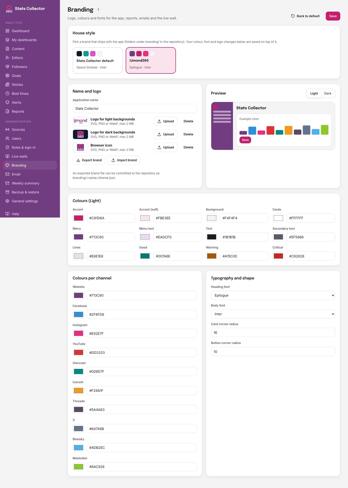

# Branding

**Administration → Branding** sets the look of the application, reports, emails and the live wall.

- **House style**: pick one of the brands that ship with the app. Each folder under `branding/` in the repository is a choice: **IJmond360** (purple and pink, Epilogue headings, the IJmond360 logo; the default) and **Stats Collector default**. Picking one fills in the colours, fonts and logos below; click Save to apply it. Logos you upload yourself replace the logos of the house style.

- **Name and logo**: application name, a logo for light backgrounds, a logo for dark backgrounds (used in the dark menu) and the browser icon. SVG, PNG, WebP or ICO up to 2 MB. SVG files that contain scripts are refused.
- **Colours**: accent, background, cards, menu, text, lines and the status colours, separately for light and dark mode. The preview updates while you change them. Text on the accent colour switches between black and white automatically for readability.
- **Colours per channel**: the colour of each platform in charts (website, Facebook, Instagram, YouTube, Owncast, Icecast).
- **Typography and shape**: heading and body font, corner radius of cards and buttons.

Click **Save** to apply the brand for everyone. **Back to default** restores the colours and fonts of the chosen house style (for example `branding/ijmond360/theme.json`).

## Export, import and the repository

**Export brand** downloads a `theme.json`. Commit it to the project repository as `branding/<name>/theme.json` together with the logo files, so every brand is versioned. **Import brand** loads such a file; click Save afterwards. A folder with a `theme.json` (and the logo files it names under `logo`) shows up as a house style choice after the next update.

## Light and dark mode

Each user chooses System, Light or Dark under **My profile → Appearance**. *System* follows the computer's setting.
