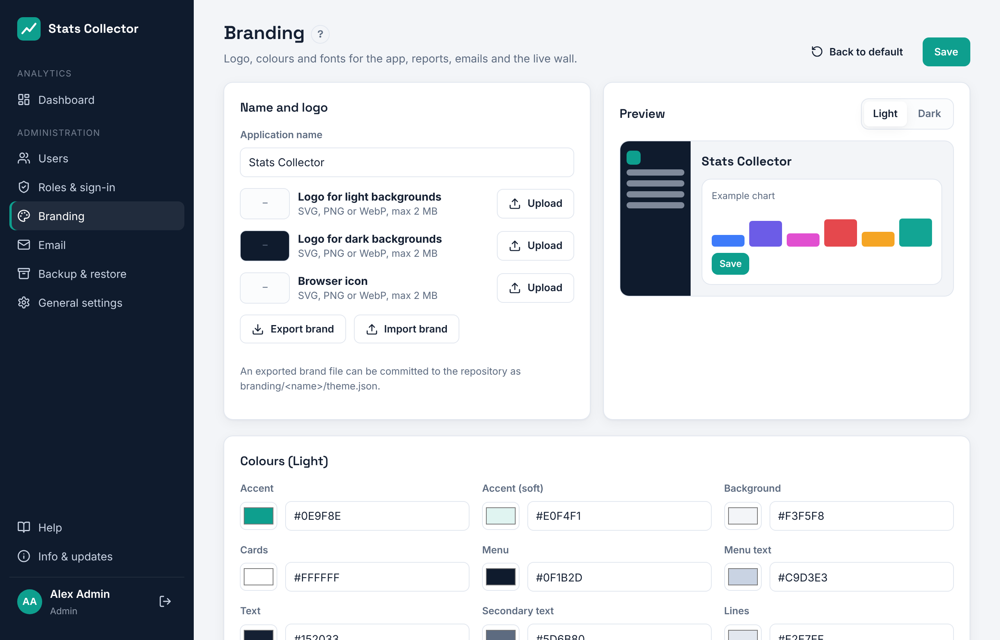

# Branding

**Administration → Branding** sets the look of the application, reports, emails and the live wall.

- **Name and logo**: application name, a logo for light backgrounds, a logo for dark backgrounds (used in the dark menu) and the browser icon. SVG, PNG, WebP or ICO up to 2 MB. SVG files that contain scripts are refused.
- **Colours**: accent, background, cards, menu, text, lines and the status colours, separately for light and dark mode. The preview updates while you change them. Text on the accent colour switches between black and white automatically for readability.
- **Colours per channel**: the colour of each platform in charts (website, Facebook, Instagram, YouTube, Owncast, Icecast).
- **Typography and shape**: heading and body font, corner radius of cards and buttons.

Click **Save** to apply the brand for everyone. **Back to default** restores the built-in brand from `branding/default/theme.json`.

## Export, import and the repository

**Export brand** downloads a `theme.json`. Commit it to the project repository as `branding/<name>/theme.json` together with the logo files, so every brand is versioned. **Import brand** loads such a file; click Save afterwards.

## Light and dark mode

Each user chooses System, Light or Dark under **My profile → Appearance**. *System* follows the computer's setting.
