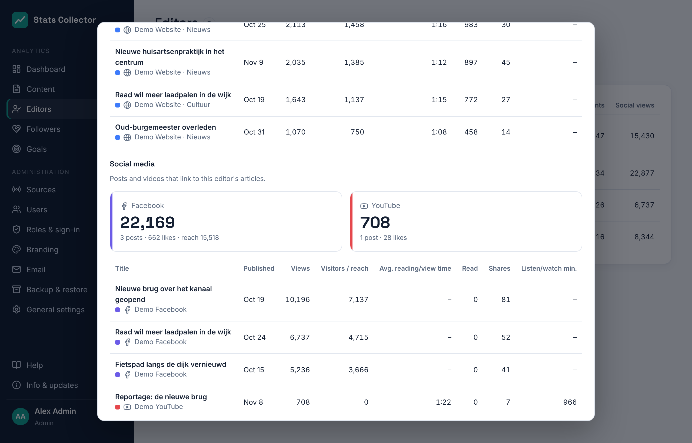
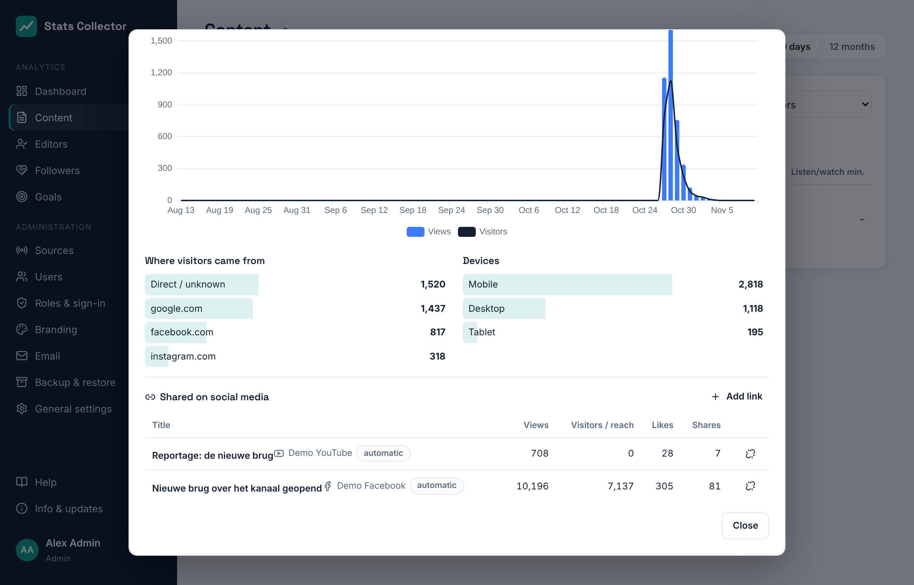

# Content and editors

## Content

**Analytics → Content** lists the articles, broadcasts and streams with the most views or listening and watching minutes in the chosen period (24 hours, 7, 30 or 90 days, or 12 months). Everyone can open it.

- **Search titles**, **Source**, **Category** and **Editor** narrow the list. The editor filter is there only for roles that may see editors (see below).
- **Sort** orders by views, visitors, reading time, read, shares, comments, listening/watching minutes, or shows the newest items first.
- Columns: **Views**, **Visitors**, **Avg. reading time** (reading time divided by views), **Read**, **Shares** and **Listen/watch min.** for broadcasts and mount points. See [WordPress](wordpress.md#what-is-counted) for what each number means.

- Facebook and Instagram posts and YouTube videos are in the same list. For a post, **Visitors / reach** shows its reach. See [Meta](meta.md) and [YouTube](youtube.md) for how their numbers are collected.

Click an item for its details: the numbers for the period, a chart per day (per hour for 24 hours), and for an article where readers came from and the devices they used. A Facebook post also shows its reactions per type (like, love, wow…); an Instagram post its saves.

## Editors

**Analytics → Editors** shows the numbers per editor: how many of their articles were published in the period, and the views, visitors, reading time, reads, shares and comments of all their articles in that period. An article with two authors counts for both.

The **Social views** column adds up the views of the Facebook and Instagram posts and YouTube videos that link to the editor's articles (see [Posts linked to articles](#posts-linked-to-articles)). Click an editor for a chart, their best-read articles and their social numbers per platform, with the linked posts.

## Posts linked to articles

A Facebook post, Instagram post or YouTube video is linked to an article automatically when it points to the article's address:

- **Facebook**: the link attached to the post, or a link in its text.
- **Instagram**: a link in the caption (Instagram links usually sit in the bio, so link these by hand when needed).
- **YouTube**: a link in the video description.

Addresses are compared without `https://`, `www.` or a trailing `/`, and without tracking parameters such as `utm_source` or `fbclid`; Facebook's redirect links are followed to the real address. The short link `?p=123` of a WordPress post works too. Links are checked every 15 minutes, after new posts have been collected.

Open an article to see the posts and videos that link to it under **Shared on social media**, with their views, reach, likes and shares, and the total as **Social views**. A post shows its **Linked article**. Click a title to open that item.

Admins, editors-in-chief and editors can change links:

- **Add link** searches articles (from a post) or posts and videos (from an article) by title or address; click a result to link it. The link is marked *by hand*.
- The unlink button removes a link. A removed automatic link stays removed, also when the post is collected again; adding it by hand brings it back.

An editor's social numbers include every post linked to one of their articles. A post linked to an article with two authors counts for both.

## Who sees what

Editor names and per-editor numbers are removed by the server before anything reaches the browser, so they cannot be found in the page either.

| Role | Content | Editors |
| --- | --- | --- |
| Admin, Editor-in-chief | All items, with editor names and the editor filter | Everyone |
| Editor | All items, without editor names | Only their own numbers |
| Staff | All items, without editor names | Not available |

An editor sees their own numbers when their Stats Collector account has the same email address as their WordPress user. Under Editors, *Not linked to a user* means no account with that email address exists yet.
