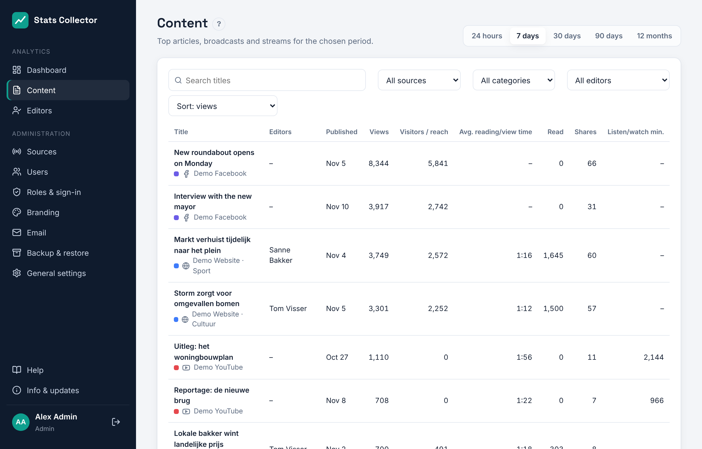
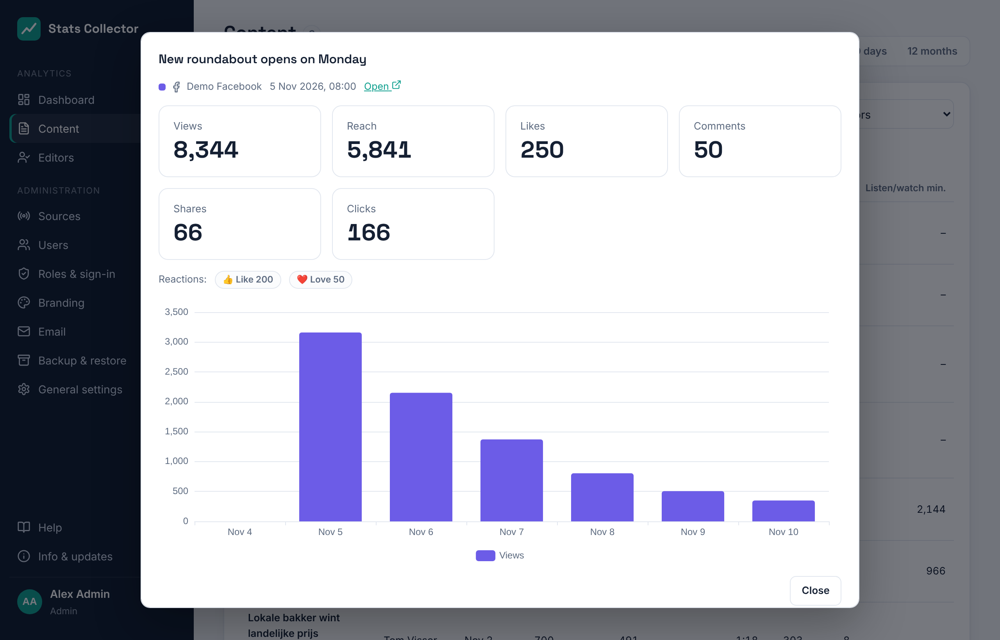
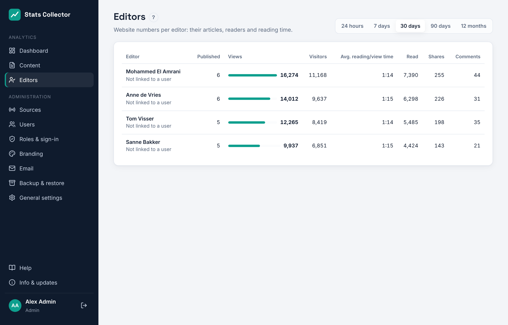

# Content and editors

## Content

**Analytics → Content** lists the articles, broadcasts and streams with the most views or listening and watching minutes in the chosen period (24 hours, 7, 30 or 90 days, or 12 months). Everyone can open it.

- **Search titles**, **Source**, **Category** and **Editor** narrow the list. The editor filter is there only for roles that may see editors (see below).
- **Sort** orders by views, visitors, reading time, read, shares, comments, listening/watching minutes, or shows the newest items first.
- Columns: **Views**, **Visitors**, **Avg. reading time** (reading time divided by views), **Read**, **Shares** and **Listen/watch min.** for broadcasts and mount points. See [WordPress](wordpress.md#what-is-counted) for what each number means.

- Facebook and Instagram posts and YouTube videos are in the same list. For a post, **Visitors / reach** shows its reach. See [Meta](meta.md) and [YouTube](youtube.md) for how their numbers are collected.

Click an item for its details: the numbers for the period, a chart per day (per hour for 24 hours), and for an article where readers came from and the devices they used. A Facebook post also shows its reactions per type (like, love, wow…); an Instagram post its saves.

## Editors

**Analytics → Editors** shows the website numbers per editor: how many of their articles were published in the period, and the views, visitors, reading time, reads, shares and comments of all their articles in that period. An article with two authors counts for both.

Click an editor for a chart and their best-read articles.

## Who sees what

Editor names and per-editor numbers are removed by the server before anything reaches the browser, so they cannot be found in the page either.

| Role | Content | Editors |
| --- | --- | --- |
| Admin, Editor-in-chief | All items, with editor names and the editor filter | Everyone |
| Editor | All items, without editor names | Only their own numbers |
| Staff | All items, without editor names | Not available |

An editor sees their own numbers when their Stats Collector account has the same email address as their WordPress user. Under Editors, *Not linked to a user* means no account with that email address exists yet.
