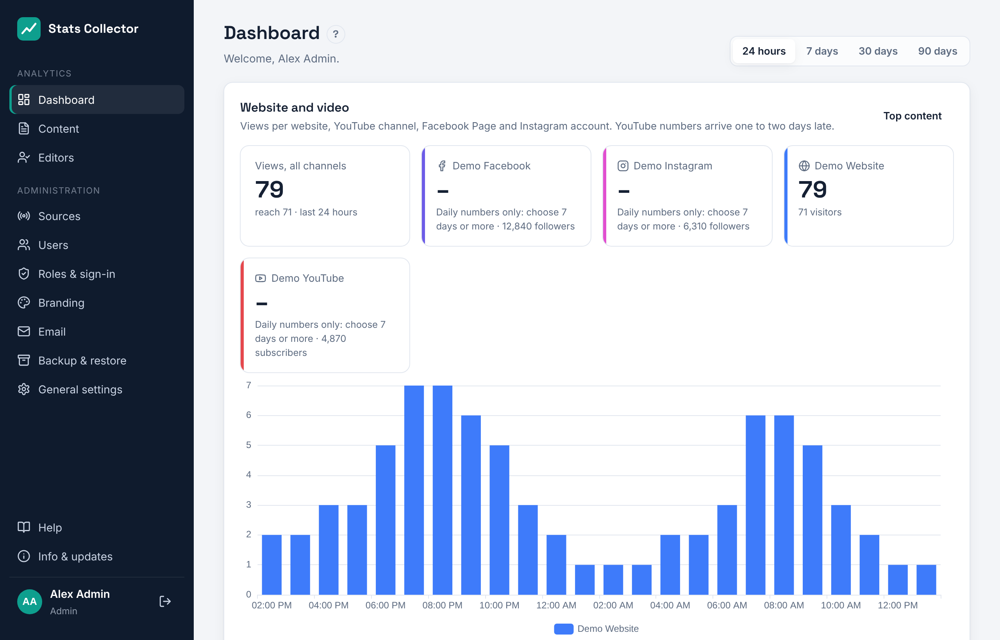

# Dashboard

The dashboard is the first screen after signing in. Everyone can open it, whatever their role.

## Website and video

When a WordPress site, YouTube channel, Facebook Page or Instagram account is connected, the dashboard starts with the card **Website and video**: the views of all channels together with their total reach, a tile per website (page views and visitors), per YouTube channel (views, minutes watched, subscribers and how many were gained in the period) and per Facebook Page or Instagram account (views, reach, followers and how many were gained), and a chart with the views per hour (24 hours) or per day, stacked per channel. YouTube numbers arrive one to two days late, so the last days of the chart fill in later. YouTube, Facebook and Instagram only report whole days: in the **24 hours** view their tiles say *daily numbers only* and they are left out of the chart. **Top content** opens the [Content](content.md) page.

## Live now

- **Live now**: everyone listening and watching at this moment, over all sources. The red dot pulses while at least one source is on air.
- **Peak today**: the highest audience of each source today, added up.
- **Listening and viewing minutes** and **Highest peak**: totals for the period you picked at the top right (24 hours, 7, 30 or 90 days).

Below that is a tile per source with the audience right now and today's peak. For an Icecast server with several mount points each mount is listed; for Owncast you see the title of the running broadcast. A red line in a tile means the last poll failed; the reason is shown, and **Administration → Sources** has the details.

The tiles refresh every 15 seconds.

## Live audience chart

- **Average**, **Peak**, **Minutes**: what the chart shows. *Average* is the number of people listening or watching at the same time, *Minutes* the total time listened and watched.
- **Stacked** adds the sources up into one total, **Overlay** draws them over each other, **Separate** gives each source its own small chart.
- Click a name in the legend below the chart to hide or show that source.

For 24 hours every point is 5 minutes, for 7 days one hour, for 30 and 90 days one day. Days follow the time zone under **General settings**.

## Per source and top broadcasts

**Per source** lists minutes, average and peak per source in the period. **Top broadcasts and streams** shows the Owncast broadcasts and Icecast mounts with the most minutes.

## How the numbers are counted

Every source is polled every 30 seconds (adjustable per source). Each poll stores the number of listeners or viewers at that moment. Every 5 minutes these samples are summed into hourly, daily and monthly totals:

- *minutes* = listeners × time between two polls;
- *average* = minutes divided by the length of the hour or day (time off air counts as zero);
- *peak* = the highest number seen in a single poll.

If the collector itself was down, that gap is not filled in. Raw samples are kept for one year; hourly and daily totals are kept forever.
