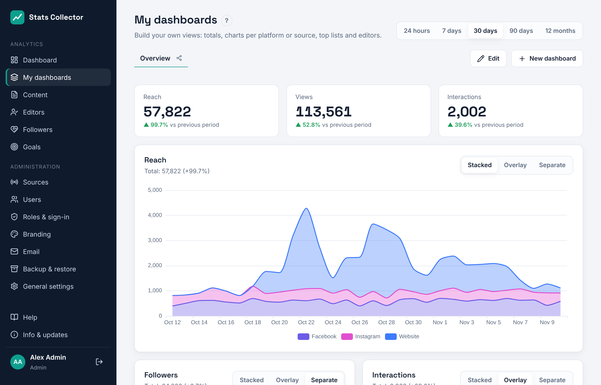
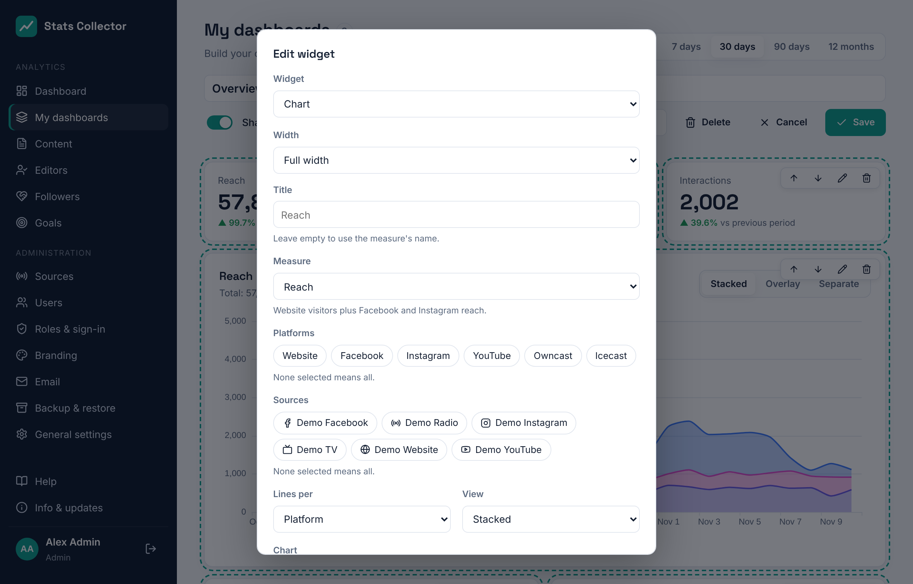

# My dashboards

**Analytics → My dashboards** lets you build your own views of the numbers: totals, charts per platform or per source, top content, the editors ranking and goals, side by side. Everyone can make dashboards for themselves; admins and editors-in-chief can also share a dashboard with everyone.

## Using a dashboard

- The tabs at the top are your dashboards and the shared ones (marked with the share icon). The app remembers which one you opened last.
- The period at the top right (24 hours, 7, 30 or 90 days, 12 months) applies to every widget.
- A **total** shows the number for the period and how much it went up or down against the period before (for 30 days: the 30 days before that).
- A **chart** can be switched between **Stacked** (the lines add up to one total), **Overlay** (lines over each other) and **Separate** (a small chart per platform or source). Anyone can switch; only someone who may edit the dashboard saves it as the default.
- Click a name in the legend below a chart to hide or show it.
- In **Top content**, click a title for its details.

## Measures

Every platform's numbers are added up in five shared measures, so channels can be stacked into one total:

| Measure | Counts |
| --- | --- |
| Reach | Website visitors plus Facebook and Instagram reach |
| Views | Page views, YouTube views and Facebook and Instagram post views |
| Interactions | Likes, reactions, comments, shares and saves (website: shares and comments) |
| Watch and listen minutes | YouTube watch minutes plus Owncast and Icecast minutes |
| Followers | YouTube subscribers plus Facebook and Instagram followers, per day |

Reach is counted per day, so someone who comes back on two days counts twice. YouTube, Facebook and Instagram only report whole days: with **24 hours** they are left out of a chart (the widget says so), and Followers always shows days.

## Building a dashboard

Click **New dashboard**, or **Edit** on a dashboard you may change. With no dashboards yet, **Create an example dashboard** gives you a ready-made start (reach, views and interactions, reach per platform, followers, interactions, top content and editors) that you can change.

While editing:

- Type the dashboard's name at the top. **Shared with everyone** (admins and editors-in-chief) makes it visible to all users; only admins, editors-in-chief and its maker can change it.
- **Add widget** opens the widget form. Each widget has arrows to move it up or down, a pencil to change it and a bin to remove it.
- **Save** stores the dashboard, **Cancel** drops the changes, **Delete** removes the whole dashboard.

The widget form:

- **Widget**: Total (KPI), Chart, Top content, Editors ranking or Goals.
- **Width**: a third, half or the full width. On a phone every widget takes the full width.
- **Title**: leave it empty to use the measure's name.
- **Measure**, **Platforms** and **Sources** (total and chart): what to count, and from where. Nothing selected means all.
- **Lines per** (chart): one line per platform, per source, or one total. **View** and **Chart** (area, line or bars) set how it is drawn.
- **Sort by**, **Items** and **Number of rows** (top content): for example the 10 most-read articles or the social posts with the most reach.

The **Editors ranking** shows editor numbers only to roles that may see them (see [Content and editors](content.md#who-sees-what)).
