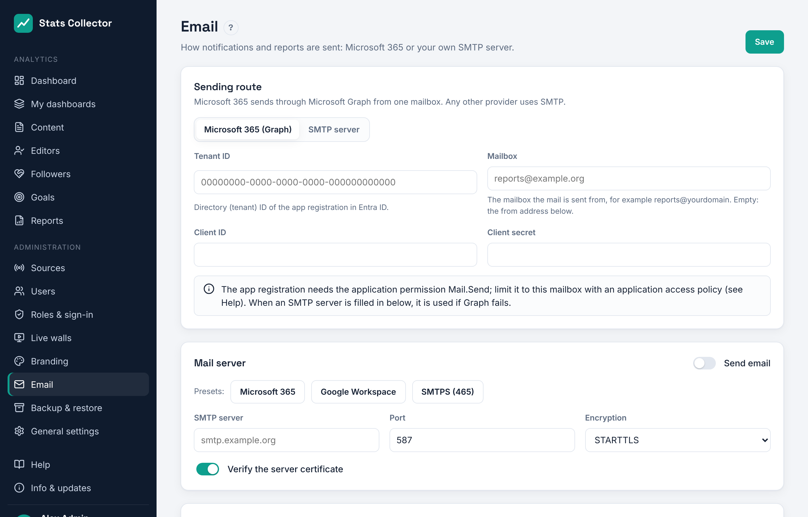

# Email

Stats Collector sends notifications and reports through Microsoft 365 (the Graph API) or through your own SMTP server. Open **Administration → Email**.

Under **Sending route** you choose how mail leaves: **Microsoft 365 (Graph)** or **SMTP server**. With Graph, an SMTP server you also set up is used as a fallback when Microsoft refuses a message.


## Settings

| Field | Explanation |
| --- | --- |
| Send email | Master switch |
| SMTP server, port | e.g. `smtp.office365.com` and `587` |
| Encryption | **STARTTLS** (port 587, recommended), **SSL/TLS** (SMTPS, port 465) or none (only on a trusted local network). TLS 1.2 is the minimum. |
| Verify the server certificate | Leave on. Only switch off for an internal server with a self-signed certificate. |
| Authentication | Username and password, OAuth 2.0 (XOAUTH2) or none |
| From address, name, reply-to | What recipients see |

The buttons **Microsoft 365**, **Google Workspace** and **SMTPS (465)** fill in the server, port and encryption.

Passwords and secrets are stored encrypted. The screen only shows that a value is stored; leave the field empty to keep it.

## Test

Enter an address under **Test** and click **Send test email**. The settings are saved first. If sending fails, the exact error from the mail server is shown, for example `535 Authentication unsuccessful`.

## Microsoft 365 with OAuth 2.0

Microsoft is switching off basic authentication for SMTP. Use OAuth 2.0 instead:

1. In the [Entra admin center](https://entra.microsoft.com) go to **App registrations → New registration**, name it *Stats Collector mail*.
2. **API permissions → Add a permission → APIs my organization uses → Office 365 Exchange Online → Application permissions → SMTP.SendAsApp**. Click **Grant admin consent**.
3. **Certificates & secrets → New client secret**. Copy the value.
4. In Exchange Online PowerShell register the app and give it rights on the sending mailbox:
   ```powershell
   New-ServicePrincipal -AppId <client-id> -ObjectId <enterprise-app-object-id>
   Add-MailboxPermission -Identity stats@example.org -User <enterprise-app-object-id> -AccessRights FullAccess
   ```
5. In Stats Collector choose **OAuth 2.0 (XOAUTH2)**:
   - Username: the mailbox, e.g. `stats@example.org`
   - Token URL: `https://login.microsoftonline.com/<tenant-id>/oauth2/v2.0/token`
   - Scope: `https://outlook.office365.com/.default`
   - Client ID and client secret from steps 1 and 3
6. Send a test email.

## Microsoft 365 through the Graph API

The Graph route needs no SMTP at all and is the most reliable way to send from Microsoft 365. Stats Collector logs in as an app (client credentials) and sends from one mailbox.



1. In the [Entra admin center](https://entra.microsoft.com) go to **App registrations → New registration** and name it *Stats Collector mail*. Note the **Application (client) ID** and the **Directory (tenant) ID**.
2. **API permissions → Add a permission → Microsoft Graph → Application permissions → Mail.Send**. Click **Grant admin consent**.
3. **Certificates & secrets → New client secret**. Copy the value.
4. Without further steps the app may send as *any* mailbox. Limit it to the sending mailbox with an application access policy in Exchange Online PowerShell (use a mail-enabled security group that holds the mailbox):
   ```powershell
   New-ApplicationAccessPolicy -AppId <client-id> -PolicyScopeGroupId stats-senders@example.org -AccessRight RestrictAccess -Description "Stats Collector mail"
   Test-ApplicationAccessPolicy -AppId <client-id> -Identity reports@example.org
   ```
5. In Stats Collector choose **Microsoft 365 (Graph)** and fill in:
   - Tenant ID and client ID from step 1, client secret from step 3
   - Sending mailbox, e.g. `reports@example.org`
6. Fill in the sender name below, save and send a test email.

Attachments up to 3 MB go with the message; a larger report PDF is left out and the mail only carries the link.
