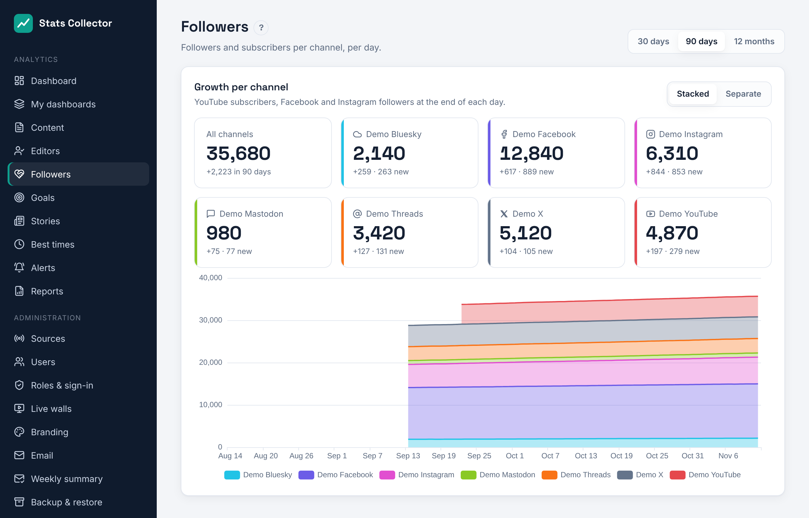
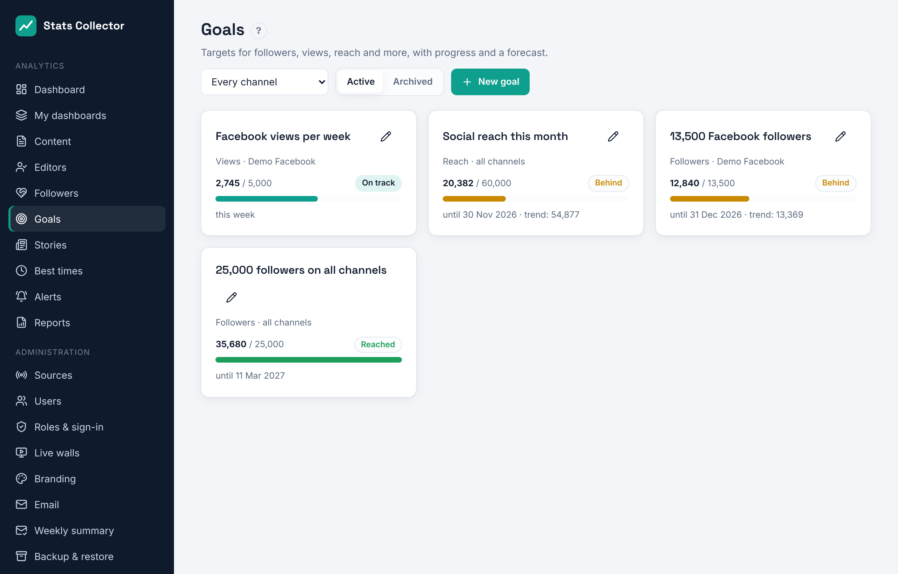
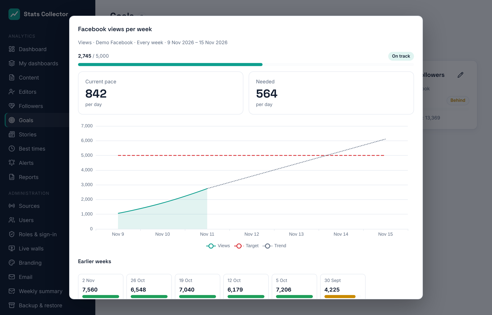

# Followers and goals

## Followers

**Analytics → Followers** shows how the number of YouTube subscribers and Facebook, Instagram, Threads, X, Bluesky and Mastodon followers grows, per channel and for all channels together. Everyone can open it.

- Pick **30 days**, **90 days** or **12 months** at the top right.
- The tiles show the count now, how much it changed in the period and how many new followers came in (people who left are not subtracted in that last number).
- **Stacked** shows the channels on top of each other, so the top line is the total; **Separate** shows each channel on its own scale.

The count per day is the count at the end of that day. YouTube and Facebook give the daily gains and losses for their whole history, so their lines go back as far as the history import. Instagram gives new followers for the last 30 days only; its line becomes exact from the day you connected it. See [YouTube](youtube.md) and [Meta](meta.md).

## Goals

**Analytics → Goals** lists the goals with their progress. Everyone can see them; the **editor-in-chief** and **administrators** can add and change them.

A goal measures one of these, over all channels or the channels you pick:

| Measure | The goal is reached when |
| --- | --- |
| Followers | the number of followers and subscribers reaches the target |
| Views | page, video and post views since the start date add up to the target |
| Reach | website visitors and social reach per day since the start date add up to the target |
| Interactions | likes, reactions, comments, shares and saves (Bluesky and Mastodon: likes or favourites, reposts or boosts, replies and quotes) since the start date add up to the target |
| Listening and watching minutes | live minutes and YouTube watch time since the start date add up to the target |

Each goal card shows the value now, the target, a progress bar and a status:

- **On track**: at the pace of the last two weeks the target is reached by the end date;
- **Behind**: at that pace it is not;
- **Reached** and **Not reached** (the end date has passed).

Click a goal for the details: the current pace and the pace needed per day, the forecast for the end date, and a chart with the value, the target as a dashed line and the trend as a dotted line.

### Adding and changing a goal

1. **New goal**: a name, what to measure, the target, a start date and (optionally) an end date. Select channels, or none for all channels.
2. Tick **Email when the goal is reached or falls behind** to get a message. Without addresses it goes to whoever made the goal. The emails go out via the mail server under **Administration → Email**; a goal that falls behind is reported at most once a week.
3. You can change the target or end date at any time. Every change is kept in the **target history** with the date, who made it and the reason. The chart shows the target that applied at each moment, so reports stay honest about what the target was then.
4. **Archive** a goal that is finished to move it out of the list; it stays under **Archived**.

### Weekly and monthly goals

Under **Repeats** a goal can be **Once** (from the start date to the end date), **Every week** (Monday to Sunday) or **Every month**. A repeating goal starts again with the same target every week or month, e.g. *5,000 Facebook views per week*. For followers it counts the growth within the week or month, e.g. *+200 Instagram followers a month*. The card shows *this week* or *this month*; the details show the **earlier weeks** or **months** with what was reached against the target. A "reached" email goes out again in every new week or month.

### Goals per channel

Pick one channel to make a goal for that channel alone. The **Channel** list at the top shows only the goals of one channel, or the goals over all channels together. A channel's own goal also appears as the ring on that channel's tile on the [live walls](live-wall.md).

**Show on the live walls** (on by default) puts the goal on the walls' top-stories screen; follower goals come first.

The dashboard shows the active goals with their progress bars under **Goals**.
