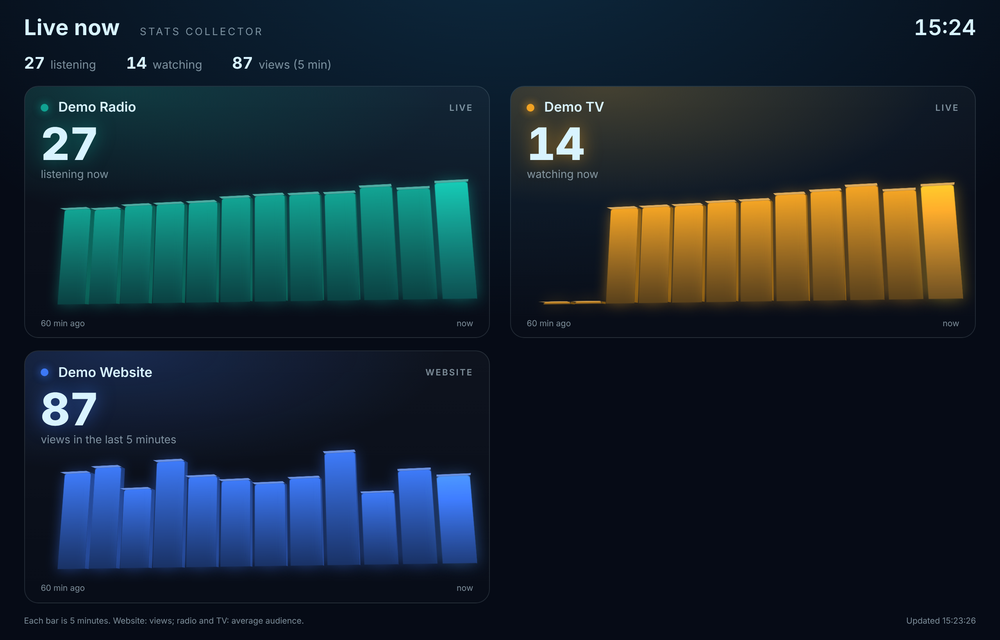
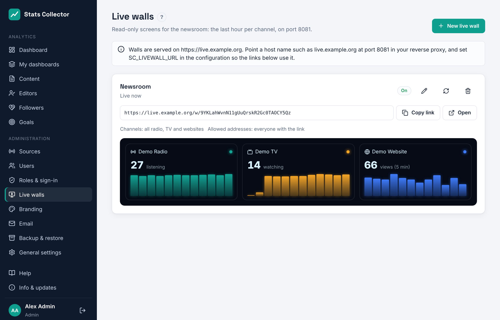

# Live wall

A live wall is a read-only screen for a TV on the newsroom floor. It shows the last hour per channel as animated 3D bars: listeners per radio stream, viewers per Owncast stream and page views per website, with the number right now in large digits. It needs no login: every wall has its own long, unguessable link.



## Making a wall

**Administration → Live walls** (admins only) lists the walls with their link and a small preview of what the screen shows.



1. Click **New live wall**.
2. **Name**: for yourself, e.g. *Newsroom*. **Title on the screen**: shown at the top of the wall; empty means the name.
3. **Channels**: the Icecast, Owncast and WordPress sources to show. None selected means all of them.
4. **Allowed addresses** (optional): IP addresses or networks, separated by commas, that may open the wall, for example the public IP address of the newsroom. Empty means everyone with the link.
5. Save, then **Copy link** and open it on the TV in a full-screen browser (kiosk mode).

The wall updates itself: the server prepares new numbers every minute and pushes them to the screen. When the connection drops, the screen reconnects by itself; if no fresh numbers arrive for five minutes the bottom line says so.

- **New link** (round arrows) makes a new link. The old link stops working at once; use it when a link has been shared too widely.
- Switching **Show this wall** off, or deleting the wall, makes the link stop working.
- The wall uses the colours of **Administration → Branding** (the live wall colours) and the channel colours.

## What is on the wall

| Channel | Number | Bars (5 minutes each) | How fresh |
| --- | --- | --- | --- |
| Icecast | Listeners at the last poll | Average listeners | Live (polled every 30 seconds) |
| Owncast | Viewers at the last poll | Average viewers | Live (polled every 30 seconds) |
| Website | Page views in the last 5 minutes | Page views | Live (the plugin reports every minute) |

The totals at the top add up all listeners, all viewers and all page views. YouTube, Facebook and Instagram report whole days only, so they are not on the wall.

## Address and reverse proxy

The wall runs as its own small service, `stats-collector-livewall`, on port 8081. It has no access to the database or to the admin functions: it only reads the numbers the worker prepares.

1. Create a DNS record for a separate host name, e.g. `live.example.org`, and a proxy rule in Zoraxy to `<ip-of-stats-server>:8081` with HTTPS, just like the main address (see [Reverse proxy](reverse-proxy.md)).
2. Add the address to `/etc/stats-collector/config.env`:

   ```
   SC_LIVEWALL_URL=https://live.example.org
   ```

   and run `systemctl restart stats-collector-web`. The links under **Live walls** then use this address. Without it they point to the main host name on port 8081.

With `--firewall` the installer allows port 8081 only from the proxy. Requests are limited to 120 per minute per IP address. Server-Sent Events need the proxy not to buffer responses; Zoraxy passes them through as they are.
