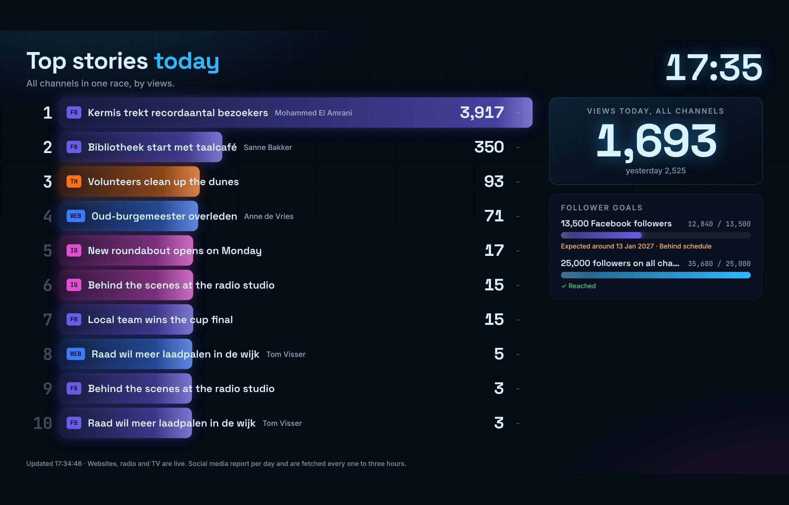

# Live wall

A live wall is a read-only screen for a TV on the newsroom floor. It shows at a glance how the channels are doing right now and how the posts score on social media. Two screens take turns (every 30 seconds by default):

- **Overview**: three big numbers (live audience, views today, interactions today) and a tile per channel with its number, a line of the last hour or the last 7 days, the change in followers and, when the channel has its own follower goal, a ring with the progress. A ticker along the bottom shows the best stories.
- **Top stories**: today's best items of all channels in one race by views, with the editor, arrows for items that move up or down, what rose fastest in the last hour, and the follower goals with the date they are expected to be reached.

Numbers count up and the race reorders itself when new numbers arrive. The wall needs no login: every wall has its own long, unguessable link.

## Making a wall

**Administration → Live walls** (admins only) lists the walls with their link and a small preview of what the screen shows.

1. Click **New live wall**.
2. **Name**: for yourself, e.g. *Newsroom*. **Title on the screen**: shown at the top of the wall; empty means the name.
3. **Channels**: the radio (Icecast), TV (Owncast), website and social media sources to show. None selected means all of them.
4. **Screens**: *Overview and top stories in turn* (default), *Overview only* or *Top stories only*. With turns, **Seconds per screen** sets how long each screen stays (10 to 300 seconds).
5. **Show editor names in the top stories**: on by default. Switch it off when the screen hangs where visitors can see it. A social post without an author of its own shows the author of the article it links to.
6. **Allowed addresses** (optional): IP addresses or networks, separated by commas, that may open the wall, for example the public IP address of the newsroom. Empty means everyone with the link.
7. Save, then **Copy link** and open it on the TV in a full-screen browser (kiosk mode).

The wall updates itself: the server prepares new numbers every minute and pushes them to the screen. When the connection drops, the screen reconnects by itself; if no fresh numbers arrive for five minutes the bottom line says so.

- **New link** (round arrows) makes a new link. The old link stops working at once; use it when a link has been shared too widely.
- Switching **Show this wall** off, or deleting the wall, makes the link stop working.
- To show one screen only on a particular TV, add `?screen=overview` or `?screen=stories` to its link, for example to put both screens next to each other on two TVs. The wall follows the language of the TV's browser; `?lang=nl` or `?lang=en` sets it (combine with `&`, e.g. `?screen=stories&lang=nl`).
- The wall uses the colours of **Administration → Branding** (the live wall colours) and the channel colours.

## What is on the wall

| Channel | Number on the tile | Line on the tile | How fresh |
| --- | --- | --- | --- |
| Radio (Icecast) | Listeners at the last poll | Last hour, average per 5 minutes | Live (polled every 30 seconds) |
| TV (Owncast) | Viewers at the last poll | Last hour, average per 5 minutes | Live (polled every 30 seconds) |
| Website | Page views in the last 5 minutes | Last hour, per 5 minutes | Live (the plugin reports every minute) |
| Facebook, Instagram, Threads, X | Views today | Last 7 days | Fetched every hour (X: as set on the source) |
| YouTube | Views on the latest day YouTube has reported, usually yesterday | Last 7 days | Fetched every 3 hours; YouTube reports a day or two late |
| Bluesky, Mastodon | Interactions today (they report no views) | Last 7 days | Fetched every hour |

Social media report per day. The chip at the top right of a social tile shows how long ago the numbers were fetched; it turns orange after four hours. Under the number the tile says which day it is (*views today*, *views yesterday* or a date).

- **Live now** adds up all listeners and viewers. A wall without radio or TV shows the website views of the last 5 minutes instead.
- **Views today** and **Interactions today** add up all channels on the wall, with yesterday's total next to them for comparison. The line shows the last 7 days.
- **Top stories** ranks the items (articles, posts and videos) of all channels on the wall by views today. Early in the morning, while fewer than three items have views today, it shows yesterday's list and says so.
- **Rising fastest** shows the items that gained most views in the last hour. It appears after the wall has been running for a few minutes.
- **Follower goals** shows the active goals on followers (see [Followers and goals](followers-and-goals.md)). A wall with chosen channels shows only goals within those channels.

## Address and reverse proxy

The wall runs as its own small service, `stats-collector-livewall`, on port 8081. It has no access to the database or to the admin functions: it only reads the numbers the worker prepares.

1. Create a DNS record for a separate host name, e.g. `live.example.org`, and a proxy rule to `<ip-of-stats-server>:8081` with HTTPS, just like the main address (see [Reverse proxy](reverse-proxy.md)). This can be the same reverse proxy as the main address or a different one.
2. Under **Administration → Live walls → Address of the walls** fill in:
    - **Public address**: the address the proxy forwards to port 8081, e.g. `https://live.example.org`. The links of all walls use it at once (the existing links keep their secret part, so screens only need the new host name). Empty means `SC_LIVEWALL_URL` from `/etc/stats-collector/config.env`, or else the main host name on port 8081.
    - **Reverse proxy addresses**: only when the walls have their own proxy on another machine. Fill in its IP address (or network), so the wall service trusts its `X-Forwarded-For` header and **Allowed addresses** sees the real visitor. The proxies in `SC_TRUSTED_PROXIES` are always trusted as well.
3. Click **Save**. The wall service picks up a new proxy address within two minutes; no restart is needed.

With `--firewall` the installer allows port 8081 only from the proxies given at installation (`--proxy-ips`). If the walls have their own proxy, run the installer again with that address added, or open port 8081 for it in nftables yourself. Requests are limited to 120 per minute per IP address. Server-Sent Events need the proxy not to buffer responses; Zoraxy passes them through as they are.
