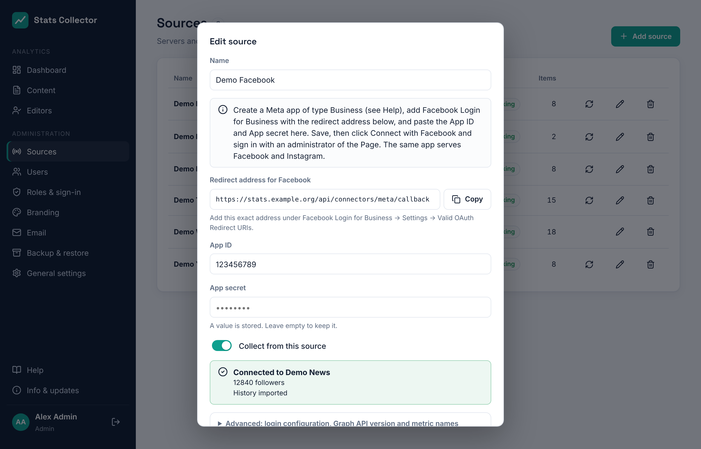

# Meta: Facebook and Instagram

Stats Collector reads the numbers of a **Facebook Page** and of an **Instagram professional account** (Business or Creator) through Meta's Graph API. One Meta app serves both. Each Page and each Instagram account is its own source, so you can add several.

What you need:

- a **Meta Business portfolio** (Business Manager) that is **verified** (done for this project);
- the **Facebook Page** you want to measure, with you as admin of it;
- for Instagram: the **Instagram professional account** linked to that Page.

## What is collected

| | Per day for the Page or account | Per post |
| --- | --- | --- |
| Facebook | Views, reach, post engagements, reactions, comments, shares, clicks, video views, new followers, unfollows, followers | Views, reach, reactions (also per type: like, love, wow…), comments, shares, clicks |
| Instagram | Views, reach, likes, comments, shares, saves, profile visits, new followers, followers | Views, reach, likes, comments, shares, saves |

Right after connecting, the history is imported: **two years** of Page numbers and all Facebook posts of those two years, and for Instagram the last **90 days** of account numbers plus the posts of the last two years. After that the numbers are updated **every hour**.

Good to know:

- Meta reports posts only as running totals. Stats Collector stores what a post gained per day; a post that is new to Stats Collector gets its whole total on the day it was published.
- Instagram gives new followers only for the last 30 days and only for accounts with at least 100 followers, and does not report unfollows. The follower count per day is worked back from the count Stats Collector sees every hour, so it becomes exact from the day you connect.
- **Reach** is the number of people who saw something. Summed over several days, a person who saw something on two days counts twice.
- Meta works in whole days: in the dashboard's **24 hours** view Facebook and Instagram show *daily numbers only*.

## 1. Create the app

1. Go to [developers.facebook.com/apps](https://developers.facebook.com/apps) → **Create app**.
2. Use case: **Other** → app type **Business**.
3. Name: *Stats Collector*, contact email, and select your verified **Business portfolio**.
4. In **App settings → Basic** fill in the privacy policy URL, terms URL, app icon (1024×1024) and category *Business and pages*. Save. Here you also find the **App ID** and **App secret** (click *Show*).

## 2. Add Facebook Login for Business

1. **Add product → Facebook Login for Business**.
2. Under **Facebook Login for Business → Settings**, paste the **redirect address** that Stats Collector shows in the source form (it ends in `/api/connectors/meta/callback`) into **Valid OAuth Redirect URIs**. Save.
3. Optional: under **Configurations** you can create a configuration of type *User access token* with the permissions below. Paste its ID in the source form under **Advanced → Configuration ID**. Without it, Stats Collector asks for the permissions directly, which also works.

## 3. Permissions and App Review

| Permission | Why |
| --- | --- |
| `pages_show_list` | List the Pages the administrator manages |
| `pages_read_engagement` | Posts, reactions, comments, shares, followers |
| `read_insights` | Page and post insights (views, reach, clicks) |
| `business_management` | Pages owned by the Business portfolio |
| `instagram_basic` | Instagram account and posts |
| `instagram_manage_insights` | Instagram views, reach, saves, profile visits |

While the app is in **development mode** it already works for people who have a role in the app (admin, developer or tester), which is enough to connect your own Page. For the app to keep working without that, request **advanced access**:

1. **App Review → Permissions and features**: click **Request advanced access** for each permission above.
2. For each, describe how it is used: *"Stats Collector is an internal analytics dashboard for our newsroom. An administrator connects our own Page and Instagram account once; we read insights for our own content and show them to staff in dashboards and monthly reports. No data is shared with third parties."*
3. Upload a short screen recording of the steps below (connect with Facebook, choose the Page, the numbers under **Content** and on the dashboard).
4. Complete **Data handling questions** and submit. Switch the app to **Live** after approval.

## 4. Add the source in Stats Collector

1. **Administration → Sources → Add source**, kind **Facebook (Page)** or **Instagram (account)**.
2. Fill in a name, the **App ID** and the **App secret**, and save.

    

3. Click **Connect with Facebook** and sign in with an administrator of the Page. On Facebook's screen select the Page (and its Instagram account) and allow every permission.
4. Back in Stats Collector:
    - with one Page (or one Instagram account) it is connected right away;
    - with several, the form asks **Which Page?** or **Which Instagram account?**. Pick one; add another source for each of the others. You can reuse the same App ID and secret.
5. The history is imported in the background. The source list shows *Importing history…* until it is done.

The Page token Stats Collector receives does not expire, but it stops working when the administrator who connected it changes their Facebook password, loses their role on the Page or removes the app. The source then shows *Access to Facebook has ended*: click **Connect with Facebook** again.

**Disconnect** stops collecting and forgets the token; the numbers collected so far are kept.

## Advanced: Graph API version and metric names

Meta brings out a new Graph API version a few times a year and sometimes renames or removes metrics. Stats Collector:

- uses a tested Graph API version, shown under **Advanced**; fill in another (for example `v24.0`) when Meta retires the one in use;
- knows the old and new names of each metric and finds out by itself which one works, once per version;
- marks metrics Meta no longer offers as *not available* under **Advanced → Metric names**.

When Meta announces a new name for a metric, fill it in next to that metric and save; Stats Collector tries it first.

## Problems

| Message | What to do |
| --- | --- |
| Facebook did not accept the code | Check the App ID, App secret and that the redirect address is in **Valid OAuth Redirect URIs** exactly. |
| This Facebook account manages no Page | Connect again and select the Page on Facebook's screen (click *Edit access* if you connected before). |
| None of the Pages … has an Instagram professional account | Link the Instagram account to the Page (Instagram app → Settings → Account type, or Meta Business Suite), then connect again. |
| Meta refused access | A permission is missing or the app is still in development mode for someone without a role in the app. |
| Meta asks to slow down | Nothing: collecting continues automatically a little later. |
