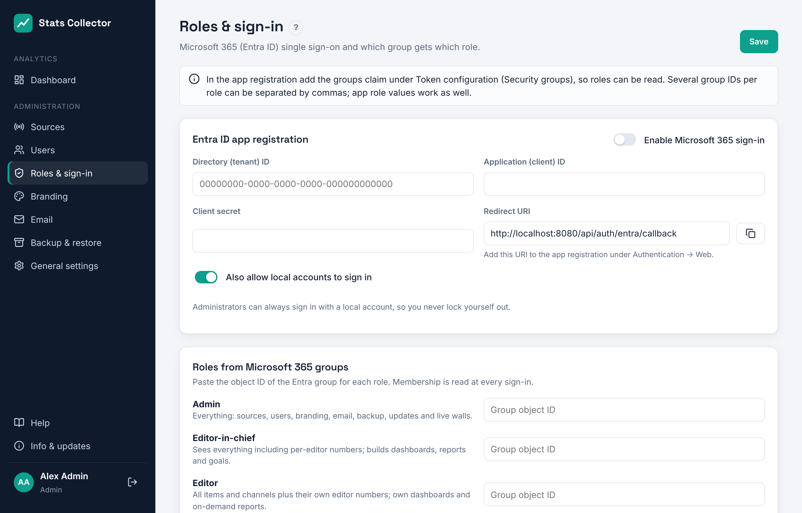

# Microsoft 365 (Entra ID)

Colleagues sign in with their Microsoft 365 account (button **Sign in with Microsoft 365** on the sign-in page) and get their role from a Microsoft 365 group. Set it up under **Administration → Roles & sign-in**.

## 1. App registration

1. Open the [Entra admin center](https://entra.microsoft.com) → **Identity → Applications → App registrations → New registration**.
2. Name: *Stats Collector*. Supported account types: **Accounts in this organizational directory only (single tenant)**.
3. Redirect URI: platform **Web**, value: copy it from **Roles & sign-in → Redirect URI** in Stats Collector (it looks like `https://stats.example.org/api/auth/entra/callback`).
4. Click **Register**. Copy the **Application (client) ID** and **Directory (tenant) ID** into Stats Collector.
5. **Certificates & secrets → New client secret**, valid for 24 months. Copy the *Value* (not the ID) into **Client secret**. Put a reminder in your calendar to renew it.
6. **Token configuration → Add groups claim → Security groups**, for the *ID* token, format *Group ID*.
7. **API permissions**: `openid`, `profile`, `email` and `User.Read` (delegated) are enough. Click **Grant admin consent**.

## 2. Groups for roles

Create four security groups in Microsoft 365 (names are an example):

| Role | Group |
| --- | --- |
| Admin | `SC-Admins` |
| Editor-in-chief | `SC-EditorsInChief` |
| Editor | `SC-Editors` |
| Staff | everyone else in the organisation (no group needed) |

Copy each group's **Object ID** into **Roles & sign-in → Roles from Microsoft 365 groups**. Several IDs per role can be separated by commas, and the value of an *app role* (App registration → App roles) works too. Membership is read at every sign-in, so adding or removing someone in Microsoft 365 changes their role the next time they sign in. When someone is in several groups, the highest role wins (Admin, then Editor-in-chief, Editor, Staff); someone in none of the groups gets the role under **Role for everyone else in the organisation**.

When a person is a member of more than about 200 groups, Microsoft leaves the groups out of the sign-in token. Stats Collector then reads them from Microsoft Graph; for that add the delegated permission `GroupMember.Read.All` with admin consent.

## 3. Switch it on and test

1. Fill in the tenant ID, client ID and client secret, map the groups and switch on **Enable Microsoft 365 sign-in**. Click **Save**.
2. Open the sign-in page in a private browser window and click **Sign in with Microsoft 365**.
3. After signing in you land on the dashboard; your role is shown at the bottom of the menu. **Users** lists the account with sign-in method *Microsoft 365*.

Does it fail? The sign-in page shows the reason, for example a wrong client secret or redirect URI. The most common mistake is a redirect URI that does not match exactly: it must be the `https://` address users open, so check `SC_PUBLIC_URL` (see [Reverse proxy](reverse-proxy.md)).

## 4. Local accounts

An existing local account with the same e-mail address is linked on the first Microsoft sign-in. It keeps its password and the role set in Stats Collector, so your first administrator stays a working break-glass account. Accounts created by Microsoft sign-in get their role from Microsoft 365 at every sign-in.

Keep **Also allow local accounts to sign in** on until Microsoft 365 sign-in works. Administrators can always sign in with a local account, so a broken Entra configuration never locks you out.
