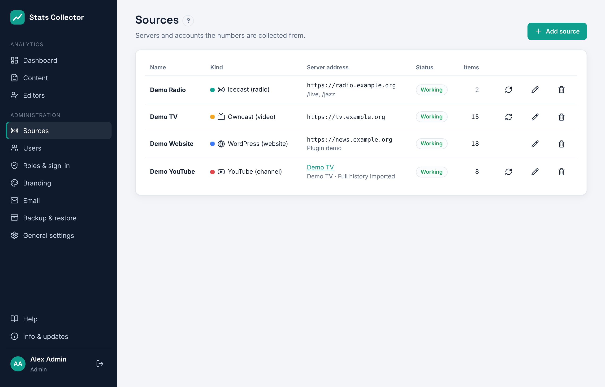

# Sources: Owncast and Icecast

Add your streaming servers under **Administration → Sources**. Each server is polled every 30 seconds for the number of viewers (Owncast) or listeners (Icecast). You can add 2 to 5 of each, or more.

## Add a source

1. Click **Add source** and pick **Icecast (radio)** or **Owncast (video)**.
2. Fill in a **Name** (shown on the dashboard) and the **Server address**.
3. Optionally fill in the admin password (see below).
4. Click **Test connection**. You see the server name and, for Icecast, the mount points and their listeners right now.
5. Click **Save**. The first numbers appear on the dashboard within a minute.

The status column shows **Working** after a successful poll, or the reason the last poll failed (wrong password, server not reachable, ...). **Poll now** (the round arrow) polls straight away. Switching off **Collect from this source** pauses it without losing its numbers. Deleting a source also deletes all its numbers.

## Icecast

- **Server address**: the address of Icecast itself, e.g. `https://radio.example.org:8000`, without `/status-json.xsl`.
- **Mount points**: e.g. `/live, /jazz`. Leave empty to collect every mount the server reports. A configured mount that is not broadcasting counts as zero.
- **Admin user and password** (optional): `<admin-user>` and `<admin-password>` from `icecast.xml`. With it Stats Collector also reads the average listening time and which players are used (VLC, browser, smart speaker...). IP addresses of listeners are never stored.

Stats Collector reads `status-json.xsl`, available in Icecast 2.4 and later.

Some hosting providers remove `status-json.xsl` and change `status.xsl` so it no longer shows the mount points. Stats Collector then reads the same numbers from `admin/stats`, the page Icecast keeps for its own admin interface. That page needs the **admin user and password**: ask your hosting provider for them if you do not have them. Without them the source shows *This server has no public status page*.

## Owncast

- **Server address**: the address of your Owncast server, e.g. `https://live.example.org`.
- **Admin password** (optional): the Owncast admin password. Without it the public status is used, which gives the same viewer numbers.

Every broadcast becomes a separate item with its title and start and end time, so you can compare broadcasts under **Top broadcasts and streams** on the dashboard.

### Webhook (recommended)

After saving, the edit window shows a **Webhook for Owncast** URL. In Owncast go to **Integrations → Webhooks → Create webhook**, paste the URL and select **Stream started** and **Stream stopped**. Broadcasts then start and end on the minute instead of at the next poll. The URL contains a secret; if it leaks, click **Renew** next to it and update the webhook in Owncast.

## Network

The Stats Collector server must be able to reach these addresses. When a source sits on the internal network, use its internal address. A self-signed certificate works if you switch off **Verify the server certificate**.
