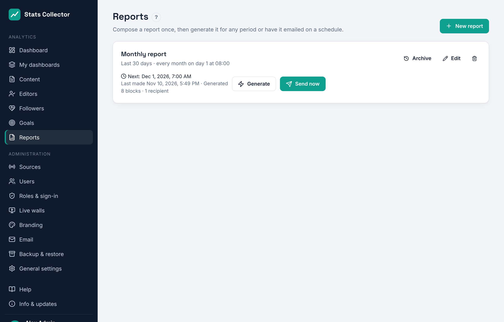
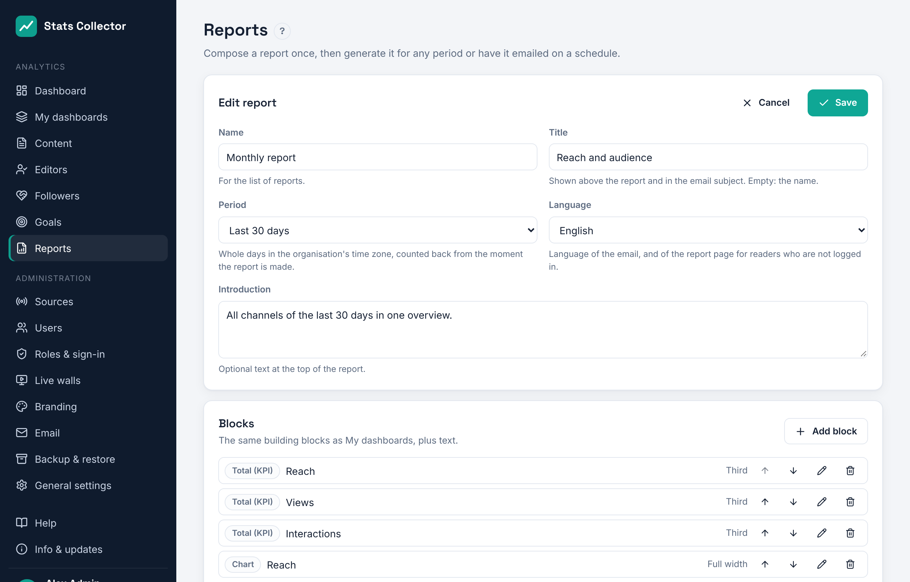
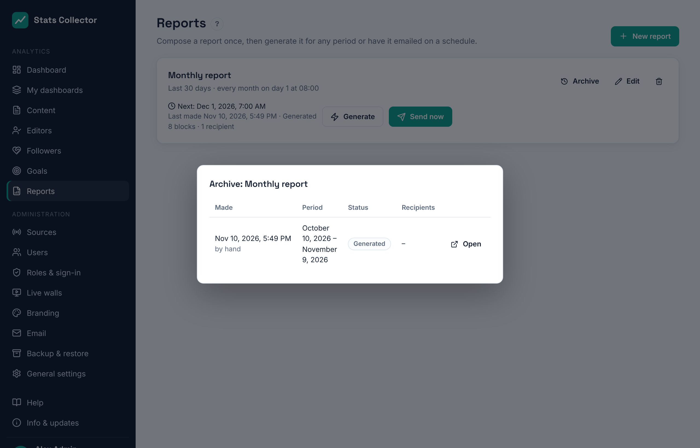
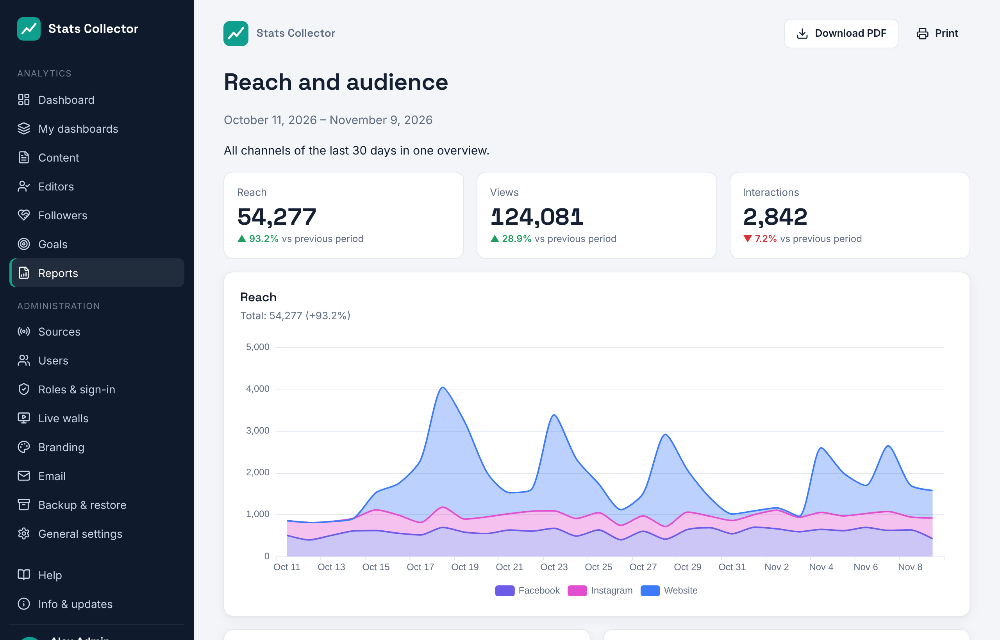

# Reports

**Analytics → Reports** turns the numbers into a report you can open, print, download as a PDF or have emailed on a schedule, for example a monthly report to the board.

## Who can do what

| Role | Reports |
| --- | --- |
| Administrator, editor-in-chief | Make, edit and delete every report; send now; schedule; recipients; the editors ranking |
| Editor | Make their own reports and open or download them; no editors ranking, no sending or schedule |
| Staff | No reports |

## Making a report

Click **New report**. A new report starts with reach, views, interactions, two charts and the top content, so you only adjust it.

| Field | Explanation |
| --- | --- |
| Name | For the list of reports |
| Title | Shown above the report and in the email subject. Empty: the name |
| Period | **Last month**, **Last week (Mon–Sun)**, **Yesterday**, or the **last 7, 30 or 90 days**. Whole days in the organisation's time zone, counted back from the moment the report is made. A monthly report sent on the 1st therefore covers the whole previous month. |
| Language | Language of the email, and of the report page for readers who are not logged in |
| Introduction | Optional text at the top |

**Blocks** are the same building blocks as [My dashboards](dashboards.md): totals (with the change against the period before), charts per platform or source, top content, the editors ranking and goals, plus **text** for your own notes. Use the arrows to change the order and the size (third, half, full width) to place them side by side.

## Generate, send and the archive

- **Generate** makes the report now and opens it in a new tab. Nothing is sent.
- **Send now** makes the report and emails it to its recipients straight away, schedule or not.
- **Archive** lists every report made, with its period, status and recipients. **Open** shows it again, **PDF** downloads it.

A report is frozen when it is made: the archive and the link always show the numbers of that moment, even if data is corrected later.

## The report page and the PDF

The email contains a summary of the totals, a button to the interactive report and the report as a PDF attachment. The interactive report opens without logging in until the link expires (**Link valid for**, default 30 days); after that it shows that the link has expired. Inside the app the archive keeps working.

The PDF is the same page, printed by Chromium on the server (A4). The installer installs Chromium; an update installs it if it is missing.

## Schedule and recipients

Under **Delivery** (administrators and editors-in-chief):

| Field | Explanation |
| --- | --- |
| Schedule | Only on demand, every day, every week (choose the day) or every month (day 1 to 28) |
| Time | In the organisation's time zone (**Administration → General settings**) |
| Users | Users of Stats Collector; the email goes to their address |
| Other email addresses | Anyone else, separated by commas. Each recipient gets their own email, so addresses are not shared |
| Attach a PDF | On by default |
| Schedule active | Pause a schedule without losing it |

The list shows when a report is sent next and how the last one went. A failed send shows the reason, for example a mail server error; **Send now** tries again.

!!! note "Editors ranking"
    A report with the editors ranking can only be sent to editors-in-chief and administrators. Other users and external addresses are refused, so per-editor numbers never leave that group.

Reports are sent with the route set under [Email](email.md): Microsoft 365 (Graph) or SMTP.
