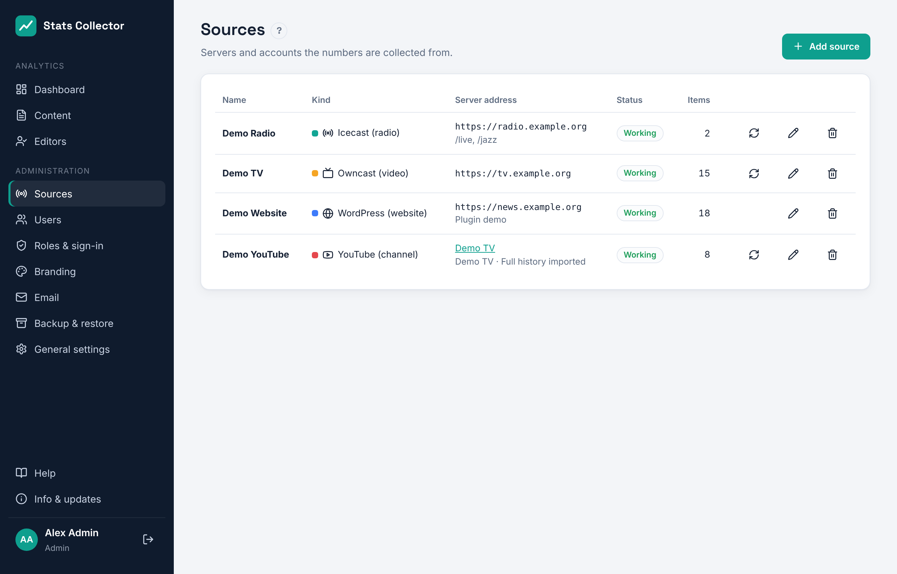

# Setting up sources: overview

A **source** is one website, social media account or streaming server that Stats Collector collects numbers from. Every source is added under **Administration → Sources → Add source**. This page tells you, per platform, **where you have to go**, what you need before you start, and which values end up in which field of Stats Collector. Each platform has its own page with the full step-by-step guide.

## Before you start

Check these once, before you connect anything:

1. **Stats Collector has its public `https://` address.** Facebook, Instagram, Threads, YouTube and X send you back to Stats Collector after you sign in. They only accept an `https://` address that is reachable from the internet. Set it up first: see [Reverse proxy and HTTPS](reverse-proxy.md). The address in `SC_PUBLIC_URL` (in `/etc/stats-collector/config.env`) must be exactly the address people type in their browser.
2. **You are an administrator in Stats Collector.** Only administrators see **Administration → Sources**.
3. **You have the right account on the platform.** You need to be admin of the Facebook Page, manager or owner of the YouTube channel, owner of the X account, and so on. A colleague's personal account is not enough when they are not a manager of the page or channel.
4. **Use an organisation account for developer apps** where you can (for example a shared mailbox for Google Cloud and the Meta app), so the apps do not disappear when someone leaves.

## Which platform, where to go

| Source | Where you go | What you need | Costs | Review by the platform | Time to set up |
| --- | --- | --- | --- | --- | --- |
| [WordPress](wordpress.md) | Your own WordPress admin (**Plugins → Add New Plugin → Upload Plugin**) | Administrator in WordPress | Free | No | 10 minutes per site |
| [YouTube](youtube.md) | [console.cloud.google.com](https://console.cloud.google.com) | Google account that manages the channel | Free | Only to stop the 7-day re-connect (optional) | 30 minutes |
| [Facebook](meta.md) | [developers.facebook.com/apps](https://developers.facebook.com/apps) and [business.facebook.com](https://business.facebook.com) | Admin of the Page, verified Business portfolio | Free | Yes, *advanced access* (days to weeks); works for app roles right away | 1 hour + review |
| [Instagram](meta.md) | Same Meta app as Facebook | Instagram professional account linked to the Page | Free | Same review as Facebook | 15 minutes after Facebook |
| [Threads](threads.md) | Same Meta app, use case *Access the Threads API* | The Threads account (tester invite) | Free | Yes, *advanced access*; works for testers right away | 30 minutes |
| [X](x.md) | [console.x.com](https://console.x.com) | Owner of the X account, payment card | Pay per post read (~$30/month) | No | 30 minutes |
| [Bluesky](bluesky-mastodon.md) | Nowhere: only the handle | The handle | Free | No | 2 minutes |
| [Mastodon](bluesky-mastodon.md) | Nowhere, or **Preferences → Development** on your Mastodon server | The account; sometimes an access token | Free | No | 2–5 minutes |
| [Icecast](owncast-icecast.md) | Your Icecast server or hosting provider | Server address; admin user and password for extra numbers | Free | No | 5 minutes |
| [Owncast](owncast-icecast.md) | Your Owncast admin (`https://<owncast>/admin`) | Server address; admin password (optional) | Free | No | 5 minutes |

Sign-in with Microsoft 365 is not a source but is set up the same way; see [Microsoft 365](microsoft-365.md).

## What goes in which field

| Source | Fields in Stats Collector | Where you find the value |
| --- | --- | --- |
| WordPress | Name, website address | You choose; the address of the site |
| | → *you get* plugin address, site key, secret | Paste these in WordPress under **Settings → Stats Collector** |
| YouTube | Client ID, Client secret | Google Cloud → **APIs & Services → Credentials** → your OAuth client |
| Facebook / Instagram | App ID, App secret, Configuration ID (optional) | Meta app → **App settings → Basic**; configuration under **Facebook Login for Business → Configurations** |
| Threads | Threads App ID, Threads App secret | Meta app → **Use cases → Access the Threads API → Customize → Settings** (not the Facebook App ID) |
| X | OAuth 2.0 Client ID, OAuth 2.0 Client Secret, monthly budget, read every … hours, price per post | X console → your app → **Keys and tokens → OAuth 2.0 Client ID and Client Secret** |
| Bluesky | Bluesky handle | The profile on bsky.app, e.g. `@ournews.bsky.social` |
| Mastodon | Mastodon account, Access token (optional) | The profile, e.g. `@ournews@mastodon.social`; token from **Preferences → Development** |
| Icecast | Server address, mount points, admin user, admin password | `icecast.xml` (`<authentication>`), or ask your hosting provider |
| Owncast | Server address, admin password | Owncast admin → **Configuration → Server setup → Admin password** |

## Redirect addresses

For the platforms where you sign in (Google, Meta, Threads, X), the platform must know where to send you back. Stats Collector shows this **redirect address** in the source form, with a copy button. Copy it from there; they always look like this:

| Platform | Redirect address | Where you paste it |
| --- | --- | --- |
| YouTube | `https://<stats address>/api/connectors/youtube/callback` | Google Cloud → OAuth client → **Authorised redirect URIs** |
| Facebook / Instagram | `https://<stats address>/api/connectors/meta/callback` | Meta app → **Facebook Login for Business → Settings → Valid OAuth Redirect URIs** |
| Threads | `https://<stats address>/api/connectors/threads/callback` | Meta app → **Access the Threads API → Settings → Redirect callback URLs** |
| X | `https://<stats address>/api/connectors/x/callback` | X console → app → **User authentication settings → Callback URI / Redirect URL** |

The address must match **exactly**: `https`, the same host name, no trailing slash. If you later change the address of Stats Collector, update it on every platform.

## The general flow

Every source follows the same steps:

1. **Prepare the platform** (developer app, permissions, plugin): see the platform page.
2. **Administration → Sources → Add source**, choose the kind, give it a clear **name** (it is shown on the dashboard and live wall, for example *Facebook IJmond360* or *Radio live*).
3. Fill in the values from the table above and click **Save**.
4. For sign-in platforms click **Connect with …** and sign in on the platform's own page. Allow every permission it asks for.
5. Use **Test connection** where it is offered. The **Status** column then shows **Working**, or the reason it fails.
6. History is imported in the background; the dashboard fills within minutes (YouTube: hours for an old channel).

You can add as many sources of one kind as you like: one per Page, account, site or stream. A Meta, Google or X app can be reused for several sources: fill in the same ID and secret.

## Secrets and safety

- App secrets, client secrets, passwords and tokens are stored **encrypted** and are never shown again. To change one, type a new value; leave the field empty to keep the current one.
- Stats Collector only asks for **read** permissions. It never posts, comments or changes anything on a platform.
- When someone who connected a source leaves the organisation, connect the source again with another administrator before their account is removed; otherwise collection stops with *Access … has ended*.

## Coming later: LinkedIn and TikTok

These are not available yet, because both platforms first review the app, which takes weeks. You can already start:

- **LinkedIn**: on [linkedin.com/developers/apps](https://www.linkedin.com/developers/apps) create an app linked to the organisation's **LinkedIn Page** (a Page admin must verify it), then under **Products** request **Community Management API**. LinkedIn asks for a short screen recording and company details.
- **TikTok**: on [developers.tiktok.com](https://developers.tiktok.com) create an app, add the **Login Kit** and **Display API** products with the scopes `user.info.basic`, `user.info.stats` and `video.list`, and submit it for review.

Keep the IDs and secrets; you will need them when these sources arrive.

## Something goes wrong?

Each platform page ends with a table of messages and what to do. The most common causes:

| Symptom | Cause |
| --- | --- |
| The platform says the redirect URI is not allowed | The redirect address on the platform is not exactly the one Stats Collector shows. |
| *Access … has ended* | The person who connected changed their password, lost their role, or the token expired. Click **Connect with …** again. |
| It works for you but stops after a while | The app is still in development or testing mode. Finish the platform's review (Meta, Threads) or publish the app (Google). |
| No numbers from WordPress | WordPress cron does not run; see [WordPress](wordpress.md). |

See also [Troubleshooting](troubleshooting.md).
