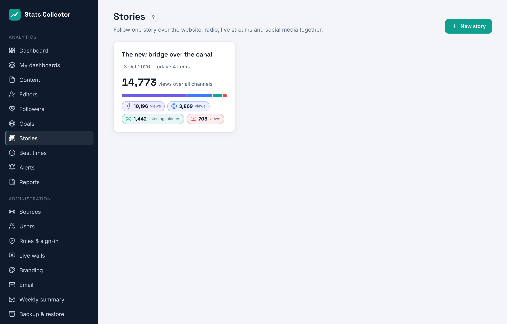
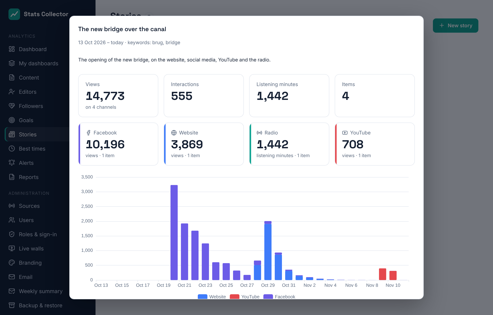

# Stories

**Analytics → Stories** follows one subject over all channels together: the website, social media, YouTube, live streams and the radio. Everyone can look at the stories; editors, the editor-in-chief and administrators can make them.

Each card shows the views over all channels, a bar with the share per channel and a chip per channel.

## What is in a story

- **Items** you pick: articles, posts, videos and broadcasts (search by title or address).
- Everything **linked** to them: posts and videos that link to a picked article, and the article a picked post links to. These are the same links as under [Content](content.md).
- **Keywords**: items published within the story's dates with one of the words in their title come along (at least three letters per word).
- **Radio and stream fragments**: a stream, a start and end time and a label, e.g. the interview on air. They are measured from the listener counts of that time: average and peak listeners and listening minutes.

An item you do not want can be taken out with **×** in the story; it stays out, also when it matches a keyword.

## The story's numbers

Click a story to see:

- the totals: views, interactions, listening minutes and the number of items;
- a tile per channel;
- a chart per day with a bar per channel;
- the items with why they are in the story (*chosen*, *linked* or *keyword*), and the radio fragments.

The numbers cover the story's dates; without an end date up to today.
