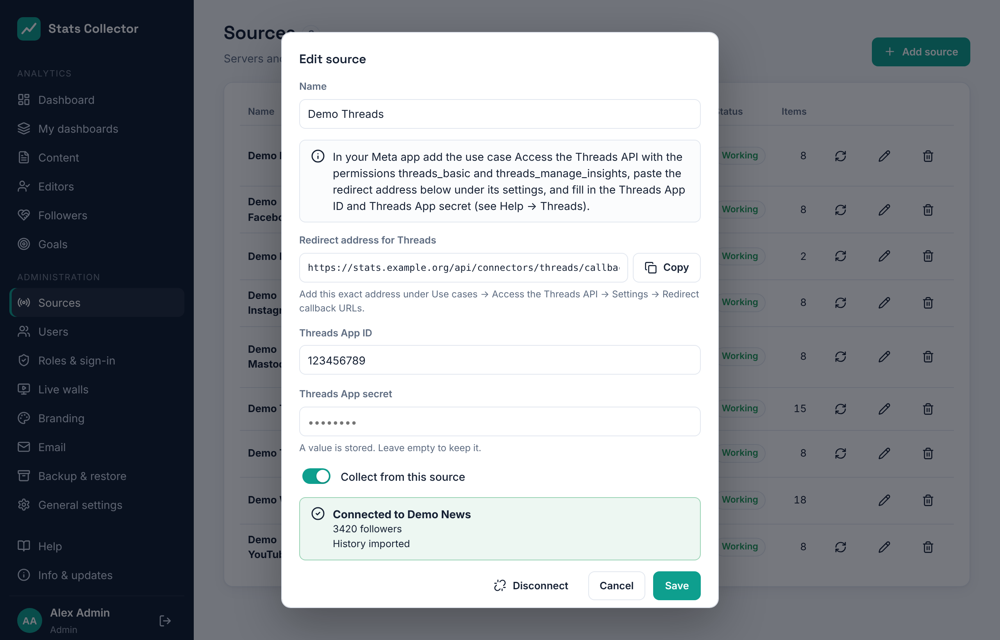

# Threads

Stats Collector reads the numbers of a **Threads** account through the Threads API. It uses the same Meta app as Facebook and Instagram (see [Meta: Facebook and Instagram](meta.md)), with one extra use case. Each Threads account is its own source.

## What is collected

| | Per day for the account | Per post |
| --- | --- | --- |
| Threads | Views, likes, replies, reposts, quotes, shares, new followers (net), followers | Views, likes, replies, reposts, quotes, shares |

Good to know:

- **Threads has no reach.** Threads counts towards the *views*, *interactions* and *followers* measures.
- Account views per day come straight from Threads, back to two years (Threads keeps nothing from before 13 April 2024). Likes, replies, reposts, quotes and shares per day are what the posts gained that day; a post that is new to Stats Collector gets its whole total on the day it was published.
- **New followers (net)** is the change in the follower count from one day to the next. The follower count per day starts on the day you connect.
- Posts of the last 7 days are read again every hour, posts of the last 30 days once a day. Reposts of other people's posts are left out.
- Threads works in whole days: in the dashboard's **24 hours** view it shows *daily numbers only*.
- Links in a post link it to the website article it points to (see [Content](content.md)).

## 1. Add the Threads use case to the Meta app

1. Open your app on [developers.facebook.com/apps](https://developers.facebook.com/apps) → **Use cases → Add use case → Access the Threads API**.
2. Under **Customize → Permissions** add **threads_basic** and **threads_manage_insights**.
3. Under **Customize → Settings** paste the **redirect address** that Stats Collector shows in the source form (it ends in `/api/connectors/threads/callback`) into **Redirect callback URLs**, and also into the uninstall and delete callback fields. Save.
4. On the same page you find the **Threads App ID** and **Threads App secret**. They are different from the Facebook App ID and secret.
5. Under **App roles → Roles → Threads testers** add the Threads account you want to measure. Then, in the Threads app or on threads.net, go to **Settings → Account → Website permissions → Invites** and accept the invitation.

While the app is in development mode this works for accounts that are testers. For it to keep working without that, request advanced access for both permissions under **App Review**, with the same description as for Facebook.

## 2. Add the source in Stats Collector

1. **Administration → Sources → Add source**, kind **Threads (account)**.
2. Fill in a name, the **Threads App ID** and the **Threads App secret**, and save.

    

3. Click **Connect with Threads** and sign in with the Threads account. Allow both permissions.
4. Back in Stats Collector the account is connected and the history is imported in the background.

The token lasts 60 days; Stats Collector renews it every week, so it keeps working as long as the source syncs. If the source shows *Access to Threads has ended* (for example after a password change), click **Connect with Threads** again. **Disconnect** forgets the token; the numbers collected so far are kept.
