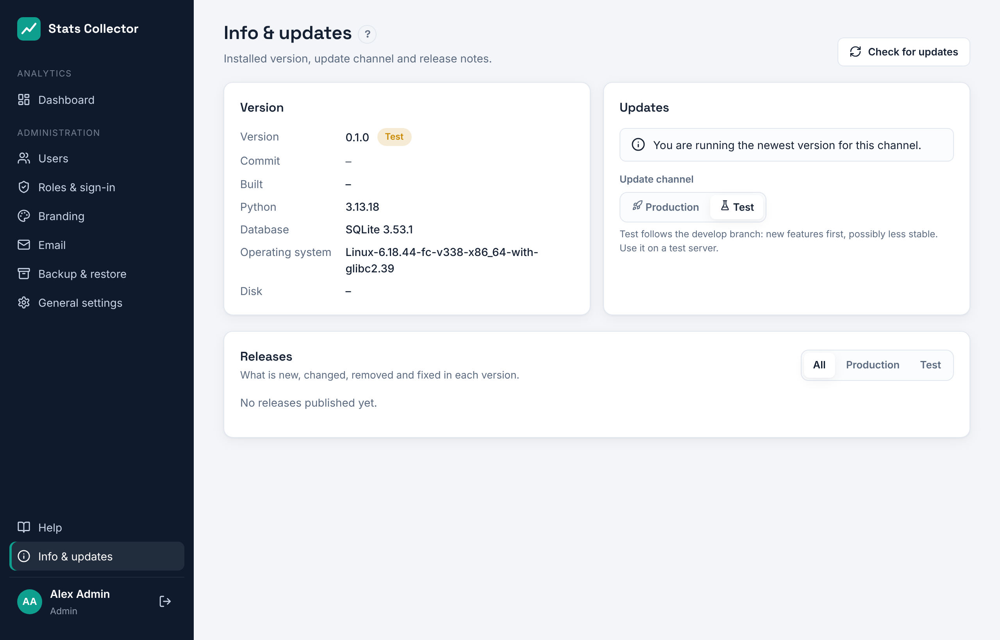

# Info, updates and the production/test channel

Click **Info & updates** at the bottom of the left menu. A dot next to it means an update is available.

## Version

The **Version** card shows the installed version, the channel, the git commit, the build date and, for administrators, the database, operating system and free disk space.

## Channels

| Channel | Follows | For |
| --- | --- | --- |
| Production | Releases from the `main` branch | Daily use |
| Test | Test builds from the `develop` branch (and production releases) | A test server, or trying new features early |

Switch with the **Production / Test** buttons. Switching only changes which releases are offered; nothing is installed until you click **Update now** or **Install**.

## Checking and installing updates

**Check for updates** asks GitHub for the newest releases (the result is cached for ten minutes otherwise). When a newer version exists for your channel, **Update now** appears.

An update:

1. downloads the release and checks its SHA-256 checksum;
2. makes a database dump;
3. installs the new version next to the current one, with its own Python environment;
4. runs the database migrations;
5. switches over and restarts the web service;
6. checks that the new version responds. If it does not, the previous version and the database dump are restored automatically.

The page shows the log while this runs and reloads when it is finished. The last three versions stay on disk.

## Releases and release notes

The **Releases** list shows every version with its channel and date. The tabs **New**, **Changed**, **Removed** and **Fixed** show what changed, in your language. **Install** puts any listed version on the server, for example to go back from a test build to the newest production release. When the target version is older, the database schema is migrated down first.

The same notes are in [CHANGELOG.md](https://github.com/rhisijmuiden/stats-collector/blob/develop/CHANGELOG.md) and on the GitHub releases page.
