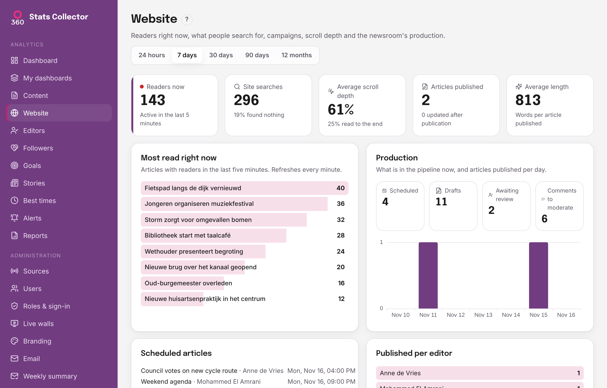
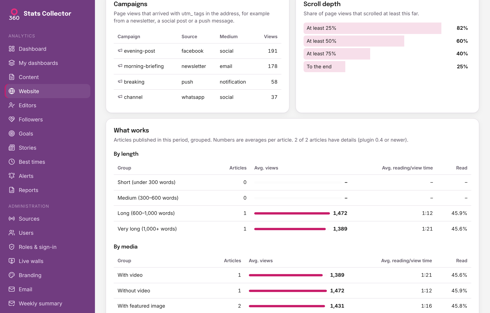
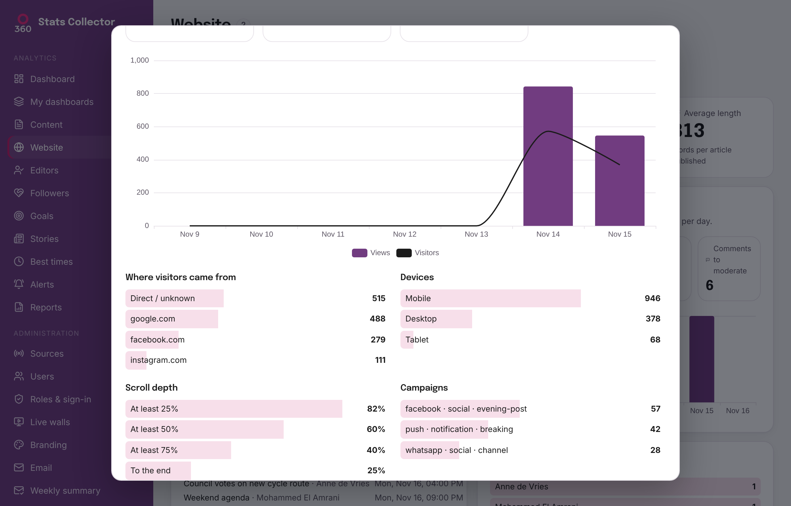

# Website

**Website** in the left menu shows what the WordPress plugin tells beyond page views: who is reading right now, what visitors search for, which campaigns bring readers, how far people scroll, what the newsroom has in the pipeline and what kind of article does well.

Everything on this page needs version **0.4 or newer** of the Stats Collector WordPress plugin. With an older plugin the page shows a notice; download the new plugin under **Administration → Sources → your website → Download WordPress plugin** and upload it in WordPress (**Plugins → Add New Plugin → Upload Plugin**, then **Replace current with uploaded**). The settings are kept.

Choose the period at the top right. With more than one website you can pick one site or all of them.

## The numbers at the top

| Number | Meaning |
| --- | --- |
| Readers now | Visitors with an article or the home page open and active in the last five minutes. The page refreshes it every minute. |
| Site searches | Searches in the search box of the website, with the share that found nothing. |
| Average scroll depth | How far down the page readers got on average, and the share that reached the end. |
| Articles published | Articles published in the period, and how many of them were updated more than 15 minutes after publication. |
| Average length | Words per article published in the period. |

## Most read right now

The articles with readers in the last five minutes. Click a title to open the article with all its numbers.

## Production

What is in the pipeline now: **scheduled** articles, **drafts**, articles **awaiting review** and **comments to moderate**, with a chart of articles published per day. Below it the next scheduled articles and, for Admin and Editor-in-chief, the number of articles published per editor.

## Site search

**Most searched** are the terms visitors typed in the search box of the website. **Found nothing** are the searches that gave no results: this shows what readers look for and do not find. Terms are counted in lower case; the same visitor searching the same term again within 30 minutes counts once.

Search terms can contain names or other personal details that visitors type. Turn off **Site search** in the plugin settings if you do not want them counted.

## Campaigns

Page views that arrived with **utm tags** in the address, for example `https://www.example.org/article?utm_source=newsletter&utm_medium=email&utm_campaign=morning-briefing`. Put these tags on the links in your newsletter, social posts and push messages to see what each one brings. Only `utm_source`, `utm_medium` and `utm_campaign` are used.

## Scroll depth

The share of page views that scrolled at least 25%, 50%, 75% of the page and to the end. Only page views that stayed long enough to report back (about 15 seconds, or until the reader left) count.

## What works

The articles published in the period, in groups, with per group the number of articles, the average views per article, the average reading time and the share read:

- **By length**: short (under 300 words), medium, long and very long (1,000 words or more).
- **By media**: with or without a video (an embedded YouTube, Vimeo or Dailymotion video, or a video block), with or without a featured image.
- **Updated after publication**: articles changed more than 15 minutes after they went online, against the rest.
- **By SEO score**: the score from **Yoast SEO** or **Rank Math**, when the site uses one of them, and the number of articles without a focus keyword.

The numbers count what each article reached in the chosen period, so very recent articles have had less time. Compare groups over 30 or 90 days for a fair picture.

## One article

When you open an article (here or under **Content**) you also see its length, video and featured image, how often it was updated, when it last changed, its SEO keyword and score, the readers right now, its scroll depth and the campaigns that brought readers.

## Who sees what

Everyone can open this page. Editor names (scheduled articles, published per editor) are only shown to Admin and Editor-in-chief, as on the other pages.
