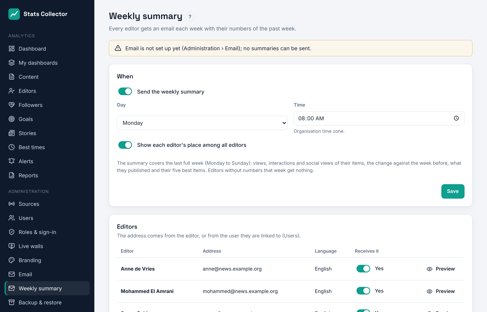
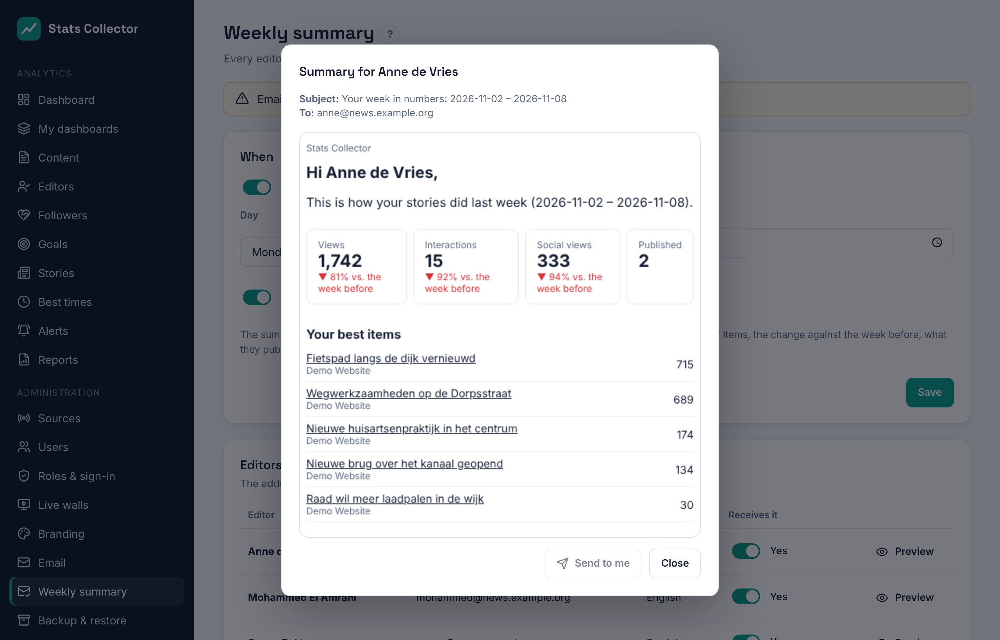

# Weekly summary per editor

**Administration → Weekly summary** sends every editor an email each week with their own numbers of the past week. The **editor-in-chief** and **administrators** set it up.

## Switching it on

1. Make sure email works (**Administration → Email**).
2. Switch on **Send the weekly summary** and pick the day and time (organisation time zone), e.g. Monday 08:00.
3. Choose whether each editor sees their **place among all editors** by views.
4. Save.

## Who gets it

The list **Editors** shows every editor (a person credited on articles) with the address the summary goes to: the editor's own address, or that of the user they are linked to. Switch **Receives it** off for anyone who should not get it. Editors without an address, or without any numbers that week, get nothing.

## What is in it

The summary covers the last full week, Monday to Sunday:

- views, interactions and social views (posts that link to their articles) of their items, with the change against the week before;
- how many items they published;
- their five best items with a link;
- optionally their place among all editors;
- a button to their numbers in Stats Collector.

The email is in the language of the linked user, otherwise in the default language (**Administration → General settings**). **Preview** shows an editor's summary of last week; **Send to me** sends it to your own address.
