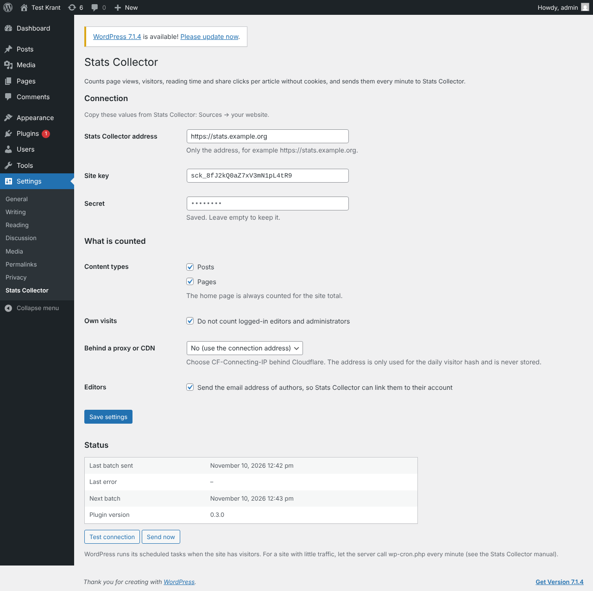

# WordPress

Stats Collector has its own WordPress plugin. It counts per article, without cookies, how often it is viewed, by how many visitors, how long people read, whether they read it, where they came from (Google, Facebook…), which device they use and how often the share buttons are clicked. Every minute it sends these numbers to Stats Collector, together with the title, author, category and tags of each article, so you can see numbers per editor.

No cookie banner is needed: the plugin does not set cookies and does not store IP addresses. A visitor is recognised for one day only, by a code made from the IP address, the browser and a random value that changes every night. The next day the same person counts as a new visitor, and the code can never be turned back into an IP address.

## Requirements

- WordPress 6.5 or newer, PHP 8.1 or newer.
- The WordPress server can reach your Stats Collector over HTTPS (outgoing).
- Stats Collector is reachable at its public address (see [Reverse proxy](reverse-proxy.md)).

## Step 1: add the site in Stats Collector

1. Go to **Administration → Sources → Add source** and choose **WordPress (website)**.
2. Fill in a name (for example the name of the website) and the address of the website. Click **Save**.
3. The dialog now shows three values: the **Stats Collector address for the plugin**, the **site key** and the **secret**. Copy the secret now: it is shown only once.
4. Click **Download WordPress plugin** to get `stats-collector-wordpress.zip`.

Lost the secret? Open the site under Sources and click **New key and secret**. The plugin stops sending until you paste the new values in WordPress.

## Step 2: install the plugin in WordPress

1. In WordPress go to **Plugins → Add New Plugin → Upload Plugin**, choose `stats-collector-wordpress.zip` and click **Install Now**, then **Activate**.
2. Go to **Settings → Stats Collector**.
3. Fill in **Stats Collector address** (only the address, for example `https://stats.example.org`), the **site key** and the **secret**. Click **Save settings**.
4. Click **Test connection**. You should see *Connection works*.

Repeat this for every website. Each website is a separate source with its own key.

## Plugin settings

| Setting | What it does |
| --- | --- |
| Content types | Which kinds of content are counted per item (posts and pages by default). The home page always counts towards the site total. |
| Own visits | When on (default), logged-in editors and administrators are not counted. |
| Behind a proxy or CDN | Choose `CF-Connecting-IP` when the website is behind Cloudflare, `X-Forwarded-For` or `X-Real-IP` behind another proxy. Otherwise every visitor looks the same and unique visitors are undercounted. |
| Editors | Sends the email address of authors so Stats Collector can link them to their account (see below). |

The **Status** block shows when the last batch was sent and the last error. **Send now** sends straight away.

## What is counted

| Number | Meaning |
| --- | --- |
| Views | Every time an article is opened. A reload by the same visitor within 30 minutes counts once. Search engines and other bots are left out. |
| Visitors | Different visitors. Per day these are real unique visitors; over a longer period the days are added up (the same person on two days counts twice, because the plugin forgets visitors every night). |
| Reading time | The time the article was visible on screen while the reader was active (scrolling, moving the mouse, touching), at most 30 minutes per view. **Avg. reading time** is the reading time divided by the views. |
| Read | A view in which someone read for at least 30 seconds, or scrolled through three quarters of the page in at least 10 seconds. |
| Shares | Clicks on share links for Facebook, X, WhatsApp, LinkedIn, Telegram, Bluesky, Reddit, Pinterest and email. Your own share button counts too when it has the attribute `data-sc-share`. |
| Comments | Approved comments per hour. |
| Referrers and devices | Per day the site that sent the visitor (`direct` when unknown) and the type of device: mobile, desktop or tablet. |

Returning visitors are not counted, because that is not possible without cookies.

The plugin keeps the raw page views for 35 days in its own table (`wp_sc_views`) so it can resend after an outage. The numbers themselves are stored in Stats Collector for good.

## Editors

Each WordPress author becomes an editor in Stats Collector. When the email address of the WordPress user is the same as the email address of a Stats Collector user (local or Microsoft 365), they are linked: that user then sees their own numbers under **Editors**. Co-authors are supported when the *Co-Authors Plus* plugin is installed.

See [Content and editors](content.md) for what each role can see.

## Sending every minute

WordPress runs its scheduled tasks when someone visits the site. On a busy website that is every minute anyway. On a quiet site, let the server call WordPress every minute and turn off the built-in trigger:

1. Add to `wp-config.php`: `define('DISABLE_WP_CRON', true);`
2. Add a cron job on the web server: `* * * * * curl -fsS https://www.example.org/wp-cron.php?doing_wp_cron >/dev/null`

If the connection is down for a while, the plugin catches up by itself, 24 hours per minute, for up to 35 days.

## Problems

| Message | Solution |
| --- | --- |
| *the site key or secret is wrong* | Copy both again from Stats Collector, or make a new key and secret. |
| *the clock of this server is more than five minutes off* | Turn on time synchronisation (NTP) on the web server. |
| *this site is paused in Stats Collector* | Turn **Collect from this source** back on under Sources. |
| A connection error (cURL) | The web server cannot reach Stats Collector: check the address, the firewall and the HTTPS certificate. |
| No numbers although the test works | Check that WordPress cron runs (**Next batch** in the status should be within a minute) and that you are not testing while logged in as an editor. |
