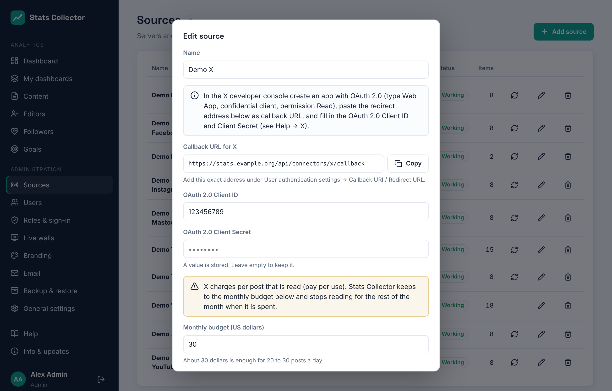

# X

Stats Collector reads the numbers of an **X** account (formerly Twitter) through the X API v2. Each X account is its own source.

!!! warning "X charges per post"
    The X API is **pay per use**: you buy credit in the X developer console and pay for every post that is read (about $0.005 per post in 2026). Stats Collector therefore has a **monthly budget** per source and stops reading for the rest of the month when it is spent. With the defaults (every 6 hours, budget $30) an account that posts 20 to 30 times a day stays within budget.

## What is collected

| | Per day for the account | Per post |
| --- | --- | --- |
| X | Impressions, likes, reposts, replies, quotes, bookmarks, link clicks, profile clicks, new followers (net), followers | Same as per day |

Good to know:

- **X has no reach.** Impressions count towards *views*; likes, reposts, replies, quotes and bookmarks towards *interactions*.
- Link clicks and profile clicks are only given for posts of the **last 30 days**.
- Per day is what the posts gained that day; a post that is new to Stats Collector gets its whole total on the day it was published.
- **New followers (net)** is the change in the follower count from one day to the next. The follower count per day starts on the day you connect.
- Posts of the last 24 hours are read every **6 hours** (adjustable), posts of the last 7 days once a day while less than 80% of the budget is used. Right after connecting, up to 200 older posts are read once (about $1). Reposts and replies are left out.
- X works in whole days here: in the dashboard's **24 hours** view it shows *daily numbers only*.
- Links in a post link it to the website article it points to (see [Content](content.md)).

## 1. Create the app in the X developer console

1. Sign in on [console.x.com](https://console.x.com) with the X account of the organisation and buy some **credit** (pay per use).
2. Create a **project** and an **app** in it.
3. In the app open **User authentication settings → Set up**:
    - **App permissions**: *Read*;
    - **Type of App**: *Web App, Automated App or Bot* (a confidential client);
    - **Callback URI / Redirect URL**: the address Stats Collector shows in the source form (it ends in `/api/connectors/x/callback`);
    - **Website URL**: the address of Stats Collector.
4. Save. Under **Keys and tokens** copy the **OAuth 2.0 Client ID** and **Client Secret** (not the API Key and Secret of OAuth 1.0a).

## 2. Add the source in Stats Collector

1. **Administration → Sources → Add source**, kind **X (account)**.
2. Fill in a name, the **OAuth 2.0 Client ID** and **Client Secret**.
3. Set the **monthly budget**, how often to read (**Read every … hours**) and, when X changes its prices, the **price per post read**. Save.

    

4. Click **Connect with X** and sign in with the X account. Allow access.
5. Back in Stats Collector the account is connected and the first posts are read in the background.

The form shows how much of the budget is used this month (an estimate; the real costs are in the X developer console). When the budget is spent the source shows *The monthly budget for X is spent* and reading starts again on the first of the next month, or as soon as you raise the budget.

Access stays valid as long as the source syncs: X hands out a new refresh token at every sync. If the source shows *Access to X has ended*, click **Connect with X** again. **Disconnect** forgets the tokens; the numbers collected so far are kept.
