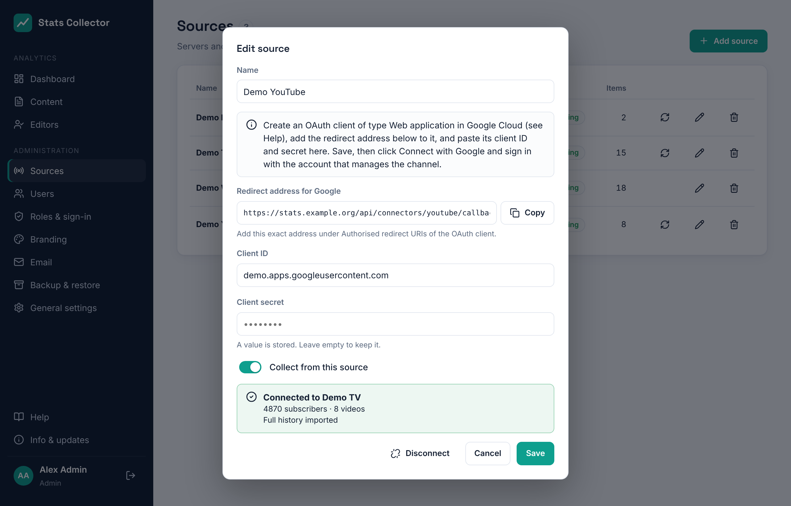

# YouTube

Stats Collector reads your YouTube channel with the **YouTube Data API v3** (videos, subscriber count) and the **YouTube Analytics API** (views, watch time, likes, comments, shares, subscribers gained and lost). After connecting, it imports the **whole history of the channel**, back to the day it was created, and then keeps it up to date every three hours.

## What you get

| Number | Per | Note |
| --- | --- | --- |
| Views, watch time, average view duration | Channel and video, per day | Average view duration = watch time ÷ views |
| Likes, comments, shares | Channel and video, per day | |
| Subscribers gained and lost | Channel, per day | |
| Subscribers | Channel, per day | See below |

- YouTube Analytics has numbers **per day**, not per hour, and they arrive **one to two days late**. Today and yesterday therefore fill in later; Stats Collector reads the last five days again at every run.
- Per video, the 200 most viewed videos of each day are stored. For a regional channel that is every video that was watched that day.
- **Subscribers per day**: YouTube only gives today's count. Stats Collector works the earlier days back from it with the daily gains and losses, so the history is a close estimate (YouTube corrects spam subscribers now and then, which the daily numbers do not show).
- Videos that were deleted or made private keep their numbers; they show their video ID instead of the title.

The numbers appear on the **Dashboard** (card *Website and video*) and on the **Content** page, where every video is an item. See [Content and editors](content.md).

## 1. Google Cloud project

1. Open [console.cloud.google.com](https://console.cloud.google.com) with the Google account that owns or manages the YouTube channel → **New project**, for example *Stats Collector*.
2. **APIs & Services → Library**: enable **YouTube Data API v3** and **YouTube Analytics API**.

## 2. OAuth consent screen

1. **APIs & Services → OAuth consent screen** (in newer consoles: **Google Auth Platform → Branding / Audience**). User type **External**, unless the channel belongs to your own Google Workspace; then **Internal** needs no verification.
2. App name *Stats Collector*, support email, home page (`https://stats.example.org`), privacy policy URL and authorised domain (`example.org`).
3. Scopes (**Data access**): `https://www.googleapis.com/auth/youtube.readonly` and `https://www.googleapis.com/auth/yt-analytics.readonly`.
4. While the app is in **Testing**, add the Google account that manages the channel as a **test user**. In testing mode Google ends the access after **7 days**; Stats Collector then shows *Access to YouTube has ended* and you connect again. Publish the app (**Audience → Publish app**) and complete Google's verification to avoid that.

## 3. OAuth client

1. In Stats Collector go to **Administration → Sources → Add source**, choose **YouTube (channel)** and copy the **Redirect address for Google** shown in the dialog. It is `https://<your Stats Collector address>/api/connectors/youtube/callback`.
2. In Google Cloud: **APIs & Services → Credentials → Create credentials → OAuth client ID**, type **Web application**. Under **Authorised redirect URIs** paste the redirect address. Click **Create** and copy the **client ID** and **client secret**.

## 4. Connect the channel

1. Back in Stats Collector paste the client ID and client secret, give the source a name and click **Save**.
2. Click **Connect with Google**. Sign in with the account that manages the channel. For a channel on a brand account, choose that brand account when Google asks which channel or account to use. Allow both permissions.
3. You return to Sources with *YouTube channel connected*. The dialog shows the channel, its subscribers and videos, and how far the history import has come.

The history is imported in steps of about 120 days per quarter of an hour, so a channel that is ten years old is complete in about eight hours. The channel totals per day are there right away.

## Disconnecting

**Disconnect** in the dialog withdraws the access at Google and stops collecting. The numbers collected so far stay. To connect another channel with the same Google app, add a new YouTube source with the same client ID and secret.

## Problems

| Message | Solution |
| --- | --- |
| *Google did not accept the code* | The client secret is wrong, or the redirect address in Google Cloud is not exactly the one shown in Stats Collector (check `https`, the host name and that there is no trailing slash). |
| *Not all permissions were granted* | Connect again and tick both boxes on the Google screen. |
| *This Google account has no YouTube channel* | Sign in with the account (or brand account) of the channel. |
| *Access to YouTube has ended* | Connect again. In testing mode this happens every 7 days; publish the app to stop it. |
| *YouTube refused access* | Enable both APIs in the Google Cloud project. |
| *The daily YouTube quota is used up* | Collecting continues the next day. The Data API allows 10,000 units a day; Stats Collector normally uses a few hundred. |
| *The sign-in with Google took too long* | Start again with **Connect with Google** and finish within 10 minutes. |
