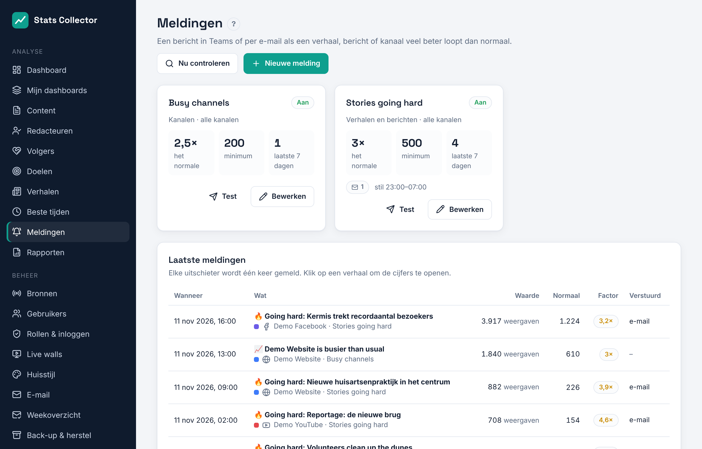
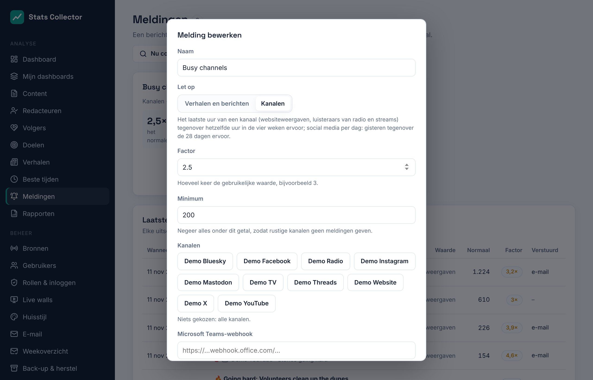

# Meldingen

**Analyse → Meldingen** stuurt een bericht naar Microsoft Teams en/of per e-mail als een verhaal, bericht of kanaal opeens veel beter loopt dan normaal. Redacteuren kunnen de meldingen zien; de **hoofdredacteur** en **beheerders** stellen ze in.

## Twee soorten meldingen

| Let op | Er gaat een melding uit als |
| --- | --- |
| **Verhalen en berichten** | een artikel, bericht of video van de laatste drie dagen meer haalt dan *factor* keer wat de items van dat kanaal meestal halen. "Meestal" is de mediaan van de items van het kanaal van de laatste 30 dagen (minstens vijf). Weergaven tellen; bij Bluesky en Mastodon, die geen weergaven geven, tellen interacties. |
| **Kanalen** | het laatste volle uur van een kanaal *factor* keer zo hoog is als hetzelfde uur in de vier weken ervoor: websiteweergaven, of het gemiddelde aantal luisteraars en kijkers van een radio- of livestream. Social media melden per dag, dus daar wordt gisteren vergeleken met de 28 dagen ervoor. |

Het **minimum** voorkomt dat rustige kanalen meldingen geven: alles daaronder telt niet mee, hoe veel keer het normale het ook is.

Elke uitschieter wordt **één keer** gemeld. De worker kijkt elk kwartier. **Nu controleren** kijkt meteen.

## Een melding instellen

1. **Nieuwe melding**: een naam, waar op gelet wordt, de factor (bijv. 3 = drie keer het normale) en het minimum.
2. Kies kanalen, of geen voor alle kanalen.
3. Waar het heen gaat:
   - **Microsoft Teams-webhook**: zie hieronder. Het adres wordt versleuteld bewaard; laat het veld leeg om het te houden.
   - **E-mail naar**: een of meer adressen. E-mail gaat via **Beheer → E-mail**.
4. De **taal** van de berichten en eventueel **stille uren** (bijv. 23:00 – 07:00): dan wordt niets verstuurd.
5. Sla op en druk op **Test** voor een testbericht.

De lijst **Laatste meldingen** toont elke uitschieter met de waarde, wat normaal is, de factor en waar hij heen ging. Klik op een verhaal om de cijfers te openen.

## Het Teams-adres

Teams ontvangt de meldingen via een **werkstroom** (Power Automate):

1. Open in Teams het kanaal en kies **⋯ → Werkstromen**.
2. Kies de sjabloon **Posten in een kanaal wanneer een webhookaanvraag wordt ontvangen**, geef een naam en kies het team en kanaal.
3. Kopieer het adres dat Teams aan het eind toont en plak het bij **Microsoft Teams-webhook**.

Een ouder adres van een **inkomende webhook** (`…webhook.office.com/…`) werkt ook. Het bericht is een Adaptive Card met de titel, de cijfers en een knop **Openen** naar het verhaal.
