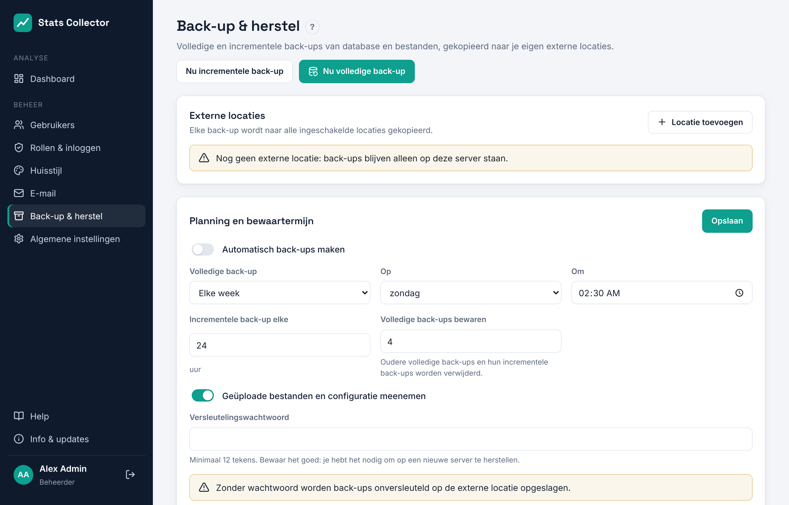

# Back-up en herstel

**Beheer → Back-up & herstel** maakt volledige en incrementele back-ups van de database en de bestanden (geüploade logo's en het configuratiebestand) en kopieert ze naar een of meer externe locaties.

## Hoe het werkt

- De database wordt geback-upt met **pgBackRest**. Een *volledige* back-up bevat alles; een *incrementele* alleen wat er sinds de vorige back-up veranderd is. PostgreSQL archiveert zijn transactielog doorlopend, dus back-ups zijn consistent terwijl de app gewoon doordraait.
- Bestanden worden met `tar` in incrementele modus ingepakt.
- Na elke back-up wordt de hele lokale back-upmap (`/var/lib/stats-collector/backup`) met **rclone** gesynchroniseerd naar elke ingeschakelde externe locatie.
- Met een versleutelingswachtwoord worden de kopieën op de externe locatie versleuteld (rclone *crypt*: XSalsa20-Poly1305). Zonder dat wachtwoord kan niemand ze lezen, jij ook niet, dus bewaar het in je wachtwoordmanager.

## Externe locaties

Klik op **Locatie toevoegen** en kies een protocol:

| Protocol | Wanneer | Opmerkingen |
| --- | --- | --- |
| SCP / SFTP (SSH) | NAS, Linux-server, hosting met SSH | Wachtwoord of privésleutel (OpenSSH- of PEM-formaat). Bij de eerste **Test** wordt de hostsleutel van de server opgeslagen en daarna steeds gecontroleerd. |
| FTPS | NAS of hosting met FTP over TLS | *Expliciet* (poort 21, AUTH TLS) komt het meest voor; *impliciet* gebruikt poort 990. |
| FTP | Alleen op een vertrouwd netwerk | Het wachtwoord gaat onversleuteld over het netwerk. |

**Map** is het pad op de externe server; die wordt automatisch aangemaakt. Klik op **Testen** om de verbinding te controleren: het logboek toont elke stap en de back-ups die er al staan.

## Planning en bewaartermijn

- **Automatisch back-ups maken**: aan of uit.
- **Volledige back-up** elke dag, week (kies de dag) of maand, op het gekozen tijdstip (tijdzone uit Algemene instellingen).
- **Incrementele back-up elke** N uur daartussen.
- **Volledige back-ups bewaren**: hoeveel volledige back-ups (met hun incrementele) bewaard blijven. Oudere worden lokaal en op de externe locaties verwijderd.

**Nu volledige back-up** en **Nu incrementele back-up** starten er direct een. Het logboek verschijnt op de pagina.

## Herstellen

1. Kies onder **Herstellen** een locatie en klik op **Back-ups tonen**. De lijst komt van de externe locatie zelf, dus dit werkt ook op een gloednieuwe server.
2. Klik op **Herstellen** naast het moment waar je naar terug wilt. Kies je een incrementele back-up, dan wordt de volledige back-up plus alle incrementele tot dat moment teruggezet.
3. Typ `RESTORE` en bevestig. De applicatie stopt, database en bestanden worden vervangen en de applicatie start weer. Log daarna opnieuw in.

### Noodherstel op een nieuwe server

1. Installeer Stats Collector met het installatiescript op de nieuwe server.
2. Maak via de installatielink een tijdelijke beheerder aan.
3. Stel onder **Back-up & herstel** **hetzelfde versleutelingswachtwoord** in en voeg de externe locatie toe.
4. Toon de back-ups en zet de nieuwste terug. De teruggezette configuratie bevat de oorspronkelijke geheime sleutel, dus opgeslagen wachtwoorden blijven werken.

## Voor elke update

Updates vanuit de interface maken eerst een extra databasedump in `/var/lib/stats-collector/backup/pre-update/` en gebruiken die om automatisch terug te draaien als de update mislukt.
