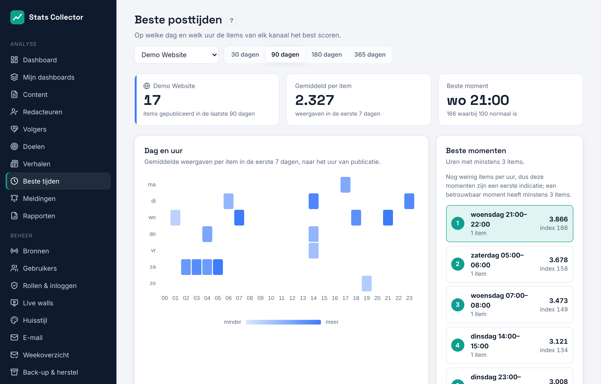

# Beste posttijden

**Analyse → Beste tijden** toont per kanaal op welke weekdag en welk uur de artikelen, berichten en video's het best scoren. Iedereen kan het openen.

1. Kies een kanaal (website of social media) en een periode: 30, 90, 180 of 365 dagen.
2. De **heatmap** heeft een rij per weekdag en een kolom per uur. Hoe donkerder een vakje, hoe meer een item dat in dat uur verscheen gemiddeld haalde.
3. **Beste momenten** toont de vijf beste uren van de week met minstens drie items, met het gemiddelde en een index: 100 is normaal voor het kanaal, 180 is 80% beter.
4. **Per weekdag** en **Per uur** tellen de uren op per dag en per uur van de dag. Staven boven de stippellijn (100) doen het beter dan normaal.

Zo wordt geteld:

- Elk item telt één keer, in het uur waarin het verscheen (tijdzone van de organisatie, **Beheer → Algemene instellingen**).
- De score van een item is wat het in de **eerste zeven dagen** haalde: weergaven, of interacties bij Bluesky en Mastodon. Oudere items winnen dus niet doordat ze langer de tijd hadden.
- Items jonger dan twee dagen tellen niet mee, omdat hun cijfers nog niet compleet zijn.

Radio en livestreams hebben geen berichten en staan niet in de lijst; hun drukste uren staan op het [Dashboard](dashboard.md).
