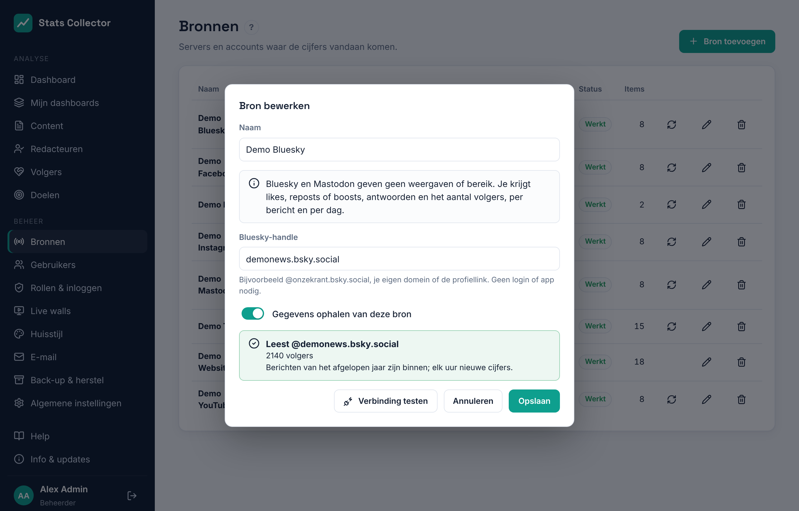

# Bluesky en Mastodon

Stats Collector leest openbare **Bluesky**- en **Mastodon**-accounts via hun open API's. Er is geen ontwikkelaarsapp, geen app-review en het kost niets: je vult alleen het account in. Elk account is een eigen bron, dus je kunt er meerdere toevoegen.

## Wat wordt verzameld

| | Per dag voor het account | Per bericht |
| --- | --- | --- |
| Bluesky | Likes, reposts, antwoorden, citaten, nieuwe volgers (netto), volgers | Likes, reposts, antwoorden, citaten |
| Mastodon | Favorieten, boosts, antwoorden, nieuwe volgers (netto), volgers | Favorieten, boosts, antwoorden |

Goed om te weten:

- **Geen van beide platforms geeft weergaven of bereik.** Bluesky en Mastodon tellen daarom mee voor de doelen en dashboardmaten *interacties* en *volgers*, niet voor weergaven of bereik.
- Berichten hebben alleen lopende totalen. Stats Collector bewaart wat een bericht per dag erbij kreeg; een bericht dat nieuw is voor Stats Collector krijgt zijn hele totaal op de dag dat het verscheen.
- **Nieuwe volgers (netto)** is de verandering van het aantal volgers van de ene dag op de andere: nieuwe volgers min mensen die vertrokken. Het aantal volgers per dag begint op de dag dat je het account toevoegt en wordt vanaf dan een volledige geschiedenis.
- Direct na het toevoegen worden de berichten van het **afgelopen jaar** gelezen, een paar pagina's per keer. Daarna worden de cijfers **elk uur** bijgewerkt en worden de berichten van de laatste 30 dagen steeds opnieuw gelezen.
- Reposts van berichten van anderen en antwoorden aan andere accounts tellen niet mee; je eigen threads wel.
- Beide platforms werken in hele dagen: in de weergave **24 uur** van het dashboard tonen ze *alleen dagcijfers*.
- Links in een bericht (en de linkkaart) worden gebruikt om het bericht te koppelen aan het websiteartikel waarnaar het verwijst, net als bij Facebook-berichten (zie [Content](content.md)).

## Een Bluesky-account toevoegen

1. Ga naar **Beheer → Bronnen → Bron toevoegen** en kies **Bluesky (account)**.
2. Geef een naam, bijv. *Bluesky*.
3. Vul de **Bluesky-handle** in: `@onzekrant.bsky.social`, je eigen domein als het account dat gebruikt (`@onzekrant.nl`), of de profiellink `https://bsky.app/profile/…`.
4. Klik op **Verbinding testen**: je ziet de handle en het aantal volgers.
5. Klik op **Opslaan**. De eerste cijfers komen binnen een paar minuten binnen.

## Een Mastodon-account toevoegen

1. Ga naar **Beheer → Bronnen → Bron toevoegen** en kies **Mastodon (account)**.
2. Vul het **Mastodon-account** in als `@onzekrant@mastodon.social` of als profiellink `https://mastodon.social/@onzekrant`. De **Server** wordt voor je ingevuld.
3. Klik op **Verbinding testen**.
4. Zegt de test dat de server alleen met een toegangstoken antwoordt, maak er dan een aan op het Mastodon-account zelf: **Voorkeuren → Ontwikkelen → Nieuwe applicatie**, naam *Stats Collector*, vink alleen de scope **read** aan (write en follow uit), sla op, open de applicatie en kopieer **Je toegangscode** naar **Toegangstoken**. Het token wordt versleuteld bewaard.
5. Klik op **Opslaan**.

## Problemen

| Melding | Wat te doen |
| --- | --- |
| Het account is niet gevonden | Controleer de handle (Bluesky) of het account en de server (Mastodon). Een Bluesky-handle bevat altijd een punt. |
| Deze Mastodon-server antwoordt alleen met een toegangstoken | Maak een toegangstoken aan zoals in stap 4 hierboven. |
| Het platform vraagt om het rustiger aan te doen | Niets: de volgende synchronisatie (elk uur) probeert het opnieuw. |
