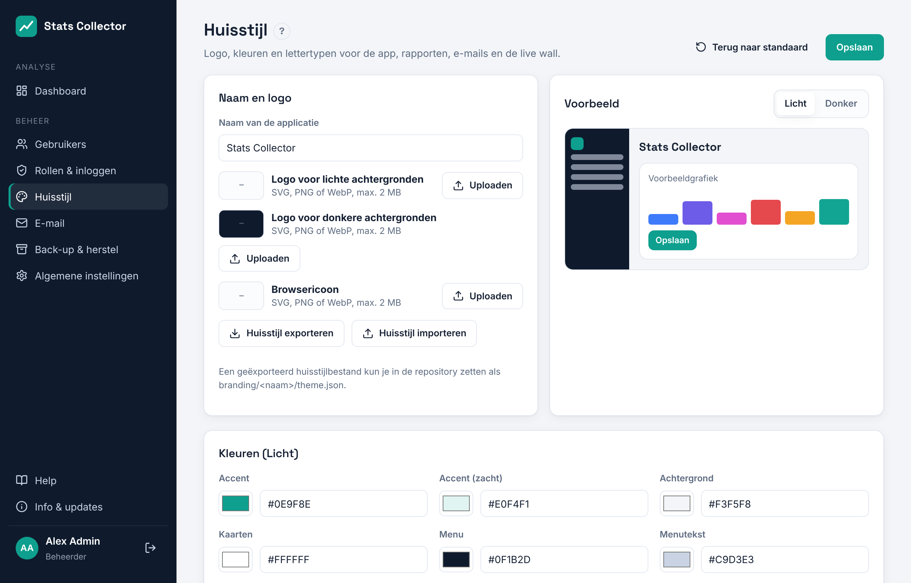

# Huisstijl

**Beheer → Huisstijl** bepaalt het uiterlijk van de applicatie, rapporten, e-mails en de live wall.

- **Naam en logo**: naam van de applicatie, een logo voor lichte achtergronden, een logo voor donkere achtergronden (gebruikt in het donkere menu) en het browsericoon. SVG, PNG, WebP of ICO tot 2 MB. SVG-bestanden met scripts worden geweigerd.
- **Kleuren**: accent, achtergrond, kaarten, menu, tekst, lijnen en de statuskleuren, apart voor licht en donker thema. Het voorbeeld verandert mee. Tekst op de accentkleur wisselt automatisch tussen zwart en wit voor de leesbaarheid.
- **Kleuren per kanaal**: de kleur van elk platform in grafieken (website, Facebook, Instagram, YouTube, Owncast, Icecast).
- **Typografie en vorm**: lettertype voor koppen en tekst, hoekafronding van kaarten en knoppen.

Klik op **Opslaan** om de huisstijl voor iedereen toe te passen. **Terug naar standaard** zet de ingebouwde huisstijl uit `branding/default/theme.json` terug.

## Exporteren, importeren en de repository

**Huisstijl exporteren** downloadt een `theme.json`. Zet die in de repository van het project als `branding/<naam>/theme.json`, samen met de logobestanden, zodat elke huisstijl in versiebeheer staat. **Huisstijl importeren** laadt zo'n bestand; klik daarna op Opslaan.

## Licht en donker thema

Elke gebruiker kiest Systeem, Licht of Donker onder **Mijn profiel → Weergave**. *Systeem* volgt de instelling van de computer.
