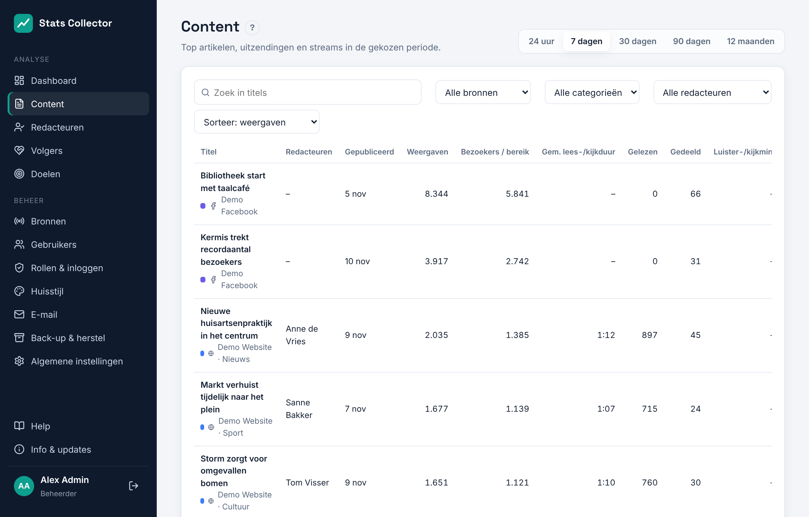
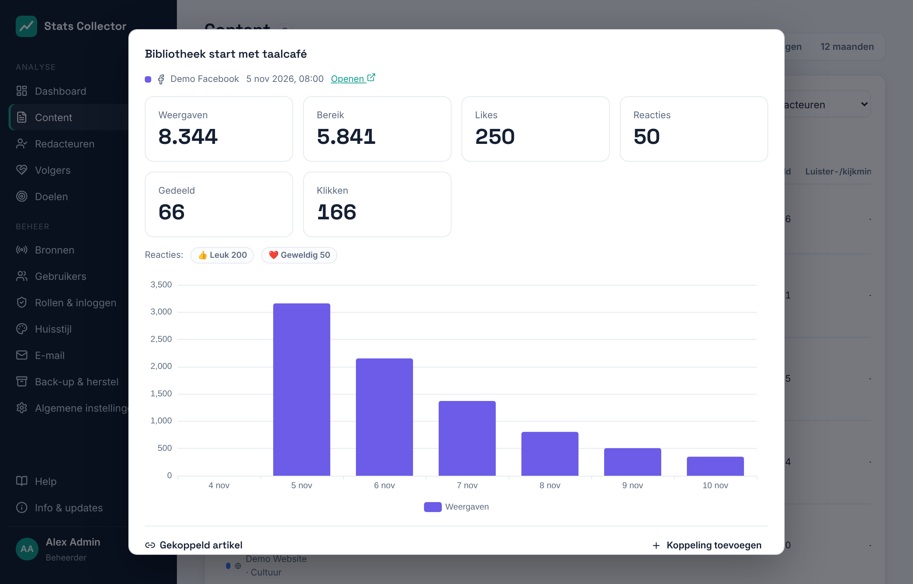
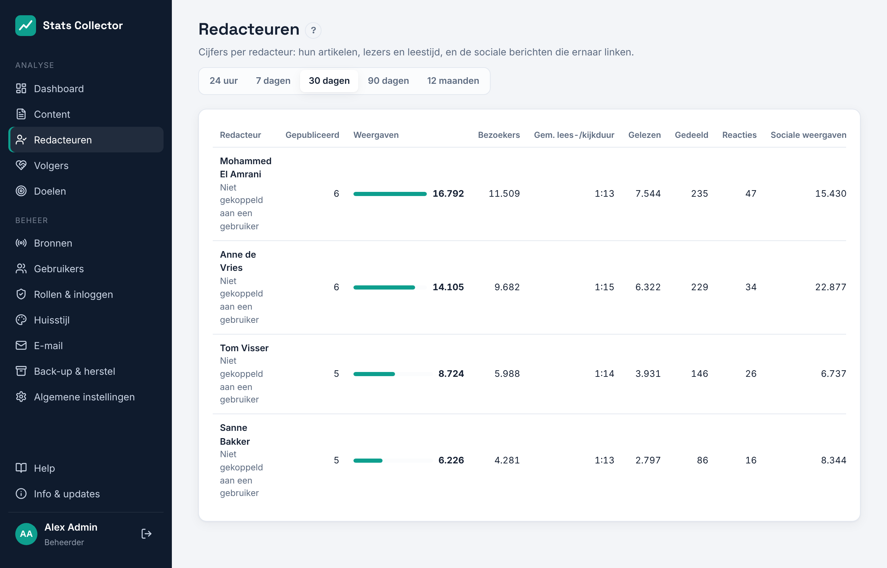
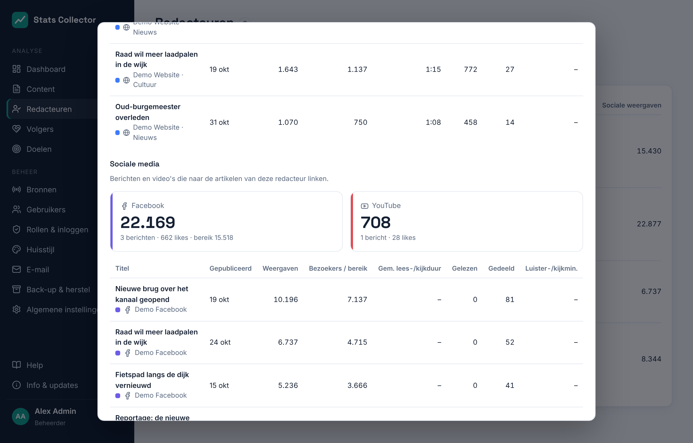
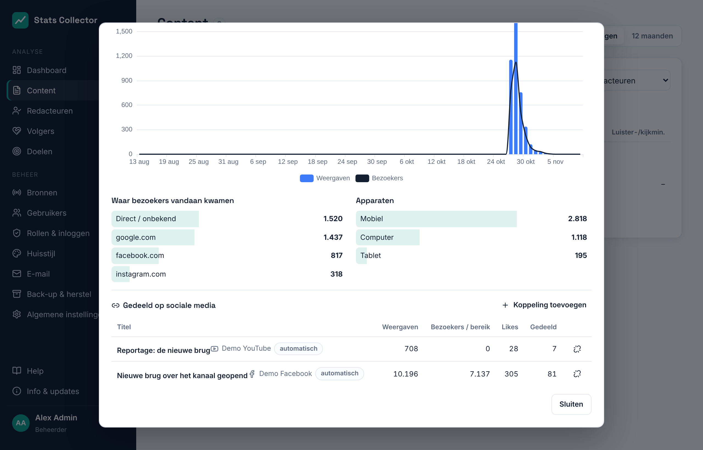

# Content en redacteuren

## Content

**Analyse → Content** toont de artikelen, uitzendingen en streams met de meeste weergaven of luister- en kijkminuten in de gekozen periode (24 uur, 7, 30 of 90 dagen, of 12 maanden). Iedereen kan deze pagina openen.

- **Zoek in titels**, **Bron**, **Categorie** en **Redacteur** maken de lijst kleiner. Het filter op redacteur is er alleen voor rollen die redacteuren mogen zien (zie hieronder).
- **Sorteer** zet de lijst op volgorde van weergaven, bezoekers, leestijd, gelezen, gedeeld, reacties of luister-/kijkminuten, of toont de nieuwste items eerst.
- Kolommen: **Weergaven**, **Bezoekers**, **Gem. leestijd** (leestijd gedeeld door weergaven), **Gelezen**, **Gedeeld** en **Luister-/kijkmin.** voor uitzendingen en mountpoints. Zie [WordPress](wordpress.md#wat-wordt-geteld) voor de betekenis van elk cijfer.

- Facebook- en Instagram-berichten en YouTube-video's staan in dezelfde lijst. Bij een bericht toont **Bezoekers / bereik** het bereik. Zie [Meta](meta.md) en [YouTube](youtube.md) voor hoe die cijfers verzameld worden.

Klik op een item voor de details: de cijfers over de periode, een grafiek per dag (per uur bij 24 uur), en bij een artikel waar lezers vandaan kwamen en welke apparaten ze gebruikten. Een Facebook-bericht toont ook de reacties per soort (leuk, geweldig, wauw…); een Instagram-bericht hoe vaak het is opgeslagen.

## Redacteuren

**Analyse → Redacteuren** toont de cijfers per redacteur: hoeveel van hun artikelen in de periode zijn gepubliceerd, en de weergaven, bezoekers, leestijd, gelezen artikelen, keren gedeeld en reacties van al hun artikelen in die periode. Een artikel met twee auteurs telt voor allebei.

De kolom **Sociale weergaven** telt de weergaven op van de Facebook- en Instagram-berichten en YouTube-video's die naar de artikelen van de redacteur linken (zie [Berichten gekoppeld aan artikelen](#berichten-gekoppeld-aan-artikelen)). Klik op een redacteur voor een grafiek, de best gelezen artikelen en de sociale cijfers per platform, met de gekoppelde berichten.

## Berichten gekoppeld aan artikelen

Een Facebook-bericht, Instagram-bericht of YouTube-video wordt automatisch aan een artikel gekoppeld als het naar het adres van dat artikel verwijst:

- **Facebook**: de link die bij het bericht is gevoegd, of een link in de tekst.
- **Instagram**: een link in het bijschrift (op Instagram staan links meestal in de bio, koppel die berichten dan met de hand).
- **YouTube**: een link in de videobeschrijving.

Adressen worden vergeleken zonder `https://`, `www.` of een `/` aan het eind, en zonder trackingparameters zoals `utm_source` of `fbclid`; de doorstuurlinks van Facebook worden gevolgd naar het echte adres. De korte link `?p=123` van een WordPress-bericht werkt ook. De koppelingen worden elke 15 minuten bijgewerkt, nadat nieuwe berichten zijn opgehaald.

Open een artikel om onder **Gedeeld op sociale media** de berichten en video's te zien die ernaar linken, met hun weergaven, bereik, likes en keren gedeeld, en het totaal als **Sociale weergaven**. Een bericht toont zijn **Gekoppeld artikel**. Klik op een titel om dat item te openen.

Beheerders, hoofdredacteuren en redacteuren kunnen koppelingen aanpassen:

- **Koppeling toevoegen** zoekt artikelen (vanuit een bericht) of berichten en video's (vanuit een artikel) op titel of adres; klik op een resultaat om het te koppelen. De koppeling heet dan *handmatig*.
- De ontkoppelknop haalt een koppeling weg. Een weggehaalde automatische koppeling blijft weg, ook als het bericht opnieuw wordt opgehaald; met de hand toevoegen brengt hem terug.

De sociale cijfers van een redacteur tellen elk bericht dat aan een van zijn of haar artikelen is gekoppeld. Een bericht bij een artikel met twee auteurs telt voor allebei.

## Wie ziet wat

Namen van redacteuren en cijfers per redacteur worden door de server weggehaald voordat er iets naar de browser gaat, dus ze zijn ook niet in de pagina terug te vinden.

| Rol | Content | Redacteuren |
| --- | --- | --- |
| Beheerder, Hoofdredacteur | Alle items, met namen van redacteuren en het filter op redacteur | Iedereen |
| Redacteur | Alle items, zonder namen van redacteuren | Alleen de eigen cijfers |
| Medewerker | Alle items, zonder namen van redacteuren | Niet beschikbaar |

Een redacteur ziet de eigen cijfers als het Stats Collector-account hetzelfde e-mailadres heeft als de WordPress-gebruiker. *Niet gekoppeld aan een gebruiker* onder Redacteuren betekent dat er nog geen account met dat e-mailadres is.
