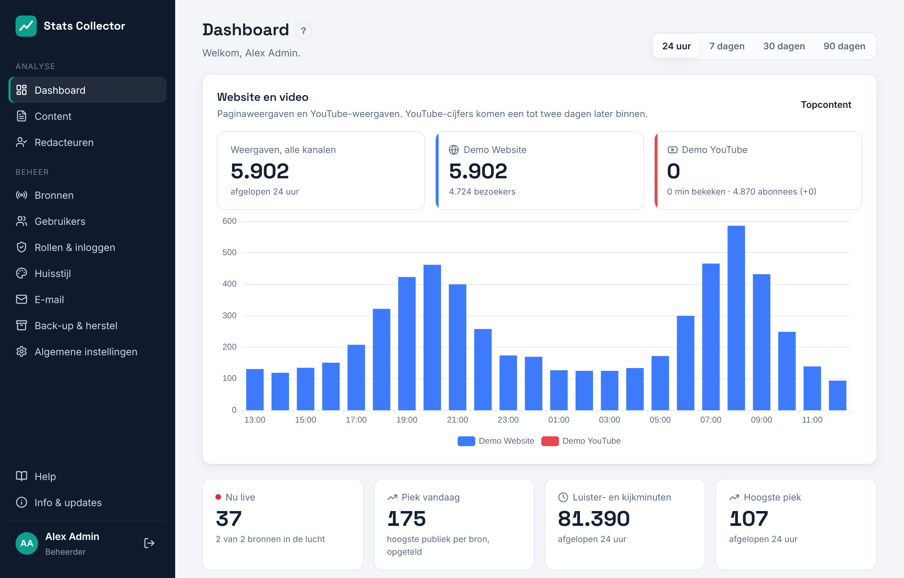

# Dashboard

Het dashboard is het eerste scherm na het inloggen. Iedereen kan het openen, welke rol je ook hebt.

## Website en video

Is er een WordPress-site of YouTube-kanaal gekoppeld, dan begint het dashboard met de kaart **Website en video**: de weergaven van alle kanalen samen, een tegel per website (paginaweergaven en bezoekers) en per YouTube-kanaal (weergaven, bekeken minuten, abonnees en hoeveel erbij kwamen in de periode), en een grafiek met de weergaven per uur (24 uur) of per dag, gestapeld per kanaal. YouTube-cijfers komen een tot twee dagen later binnen, dus de laatste dagen van de grafiek vullen zich later aan. **Topcontent** opent de pagina [Content](content.md).

## Nu live

- **Nu live**: iedereen die op dit moment luistert en kijkt, over alle bronnen samen. De rode stip knippert zolang minstens één bron in de lucht is.
- **Piek vandaag**: het hoogste publiek van elke bron vandaag, opgeteld.
- **Luister- en kijkminuten** en **Hoogste piek**: totalen over de periode die je rechtsboven kiest (24 uur, 7, 30 of 90 dagen).

Daaronder staat per bron een tegel met het publiek op dit moment en de piek van vandaag. Bij een Icecast-server met meerdere mountpoints staat elke mount apart; bij Owncast zie je de titel van de lopende uitzending. Een rode regel in een tegel betekent dat de laatste ophaalronde mislukte; de reden staat erbij, en onder **Beheer → Bronnen** vind je de details.

De tegels verversen elke 15 seconden.

## Grafiek live publiek

- **Gemiddeld**, **Piek**, **Minuten**: wat de grafiek laat zien. *Gemiddeld* is het aantal mensen dat tegelijk luistert of kijkt, *Minuten* de totale luister- en kijktijd.
- **Gestapeld** telt de bronnen op tot één totaal, **Over elkaar** tekent ze over elkaar heen, **Apart** geeft elke bron een eigen kleine grafiek.
- Klik op een naam in de legenda onder de grafiek om die bron te verbergen of weer te tonen.

Bij 24 uur is elk punt 5 minuten, bij 7 dagen een uur, bij 30 en 90 dagen een dag. Dagen volgen de tijdzone onder **Algemene instellingen**.

## Per bron en best bekeken uitzendingen

**Per bron** geeft minuten, gemiddelde en piek per bron in de periode. **Best bekeken uitzendingen en streams** toont de Owncast-uitzendingen en Icecast-mounts met de meeste minuten.

## Hoe de cijfers worden geteld

Elke bron wordt elke 30 seconden opgehaald (per bron in te stellen). Bij elke ophaalronde wordt het aantal luisteraars of kijkers op dat moment opgeslagen. Elke 5 minuten worden die metingen opgeteld tot totalen per uur, dag en maand:

- *minuten* = luisteraars × tijd tussen twee ophaalrondes;
- *gemiddeld* = minuten gedeeld door de lengte van het uur of de dag (tijd uit de lucht telt als nul);
- *piek* = het hoogste aantal in één ophaalronde.

Lag de verzamelaar zelf stil, dan wordt dat gat niet opgevuld. Ruwe metingen worden een jaar bewaard; totalen per uur en per dag blijven altijd bewaard.
