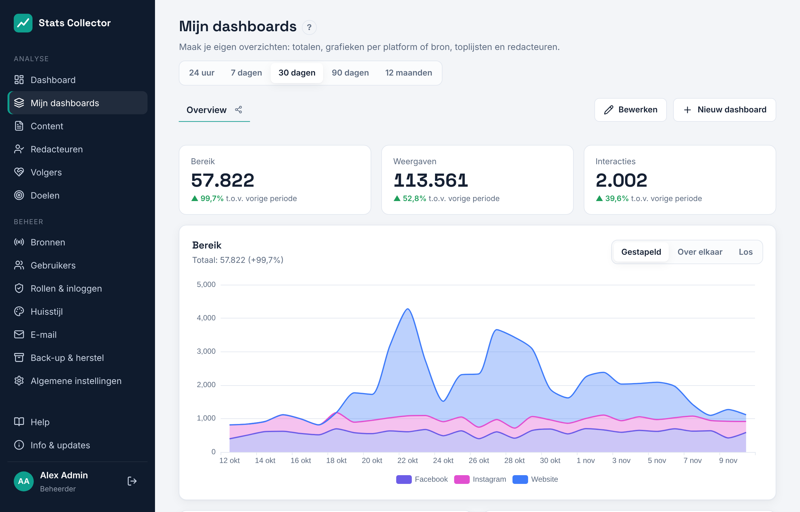
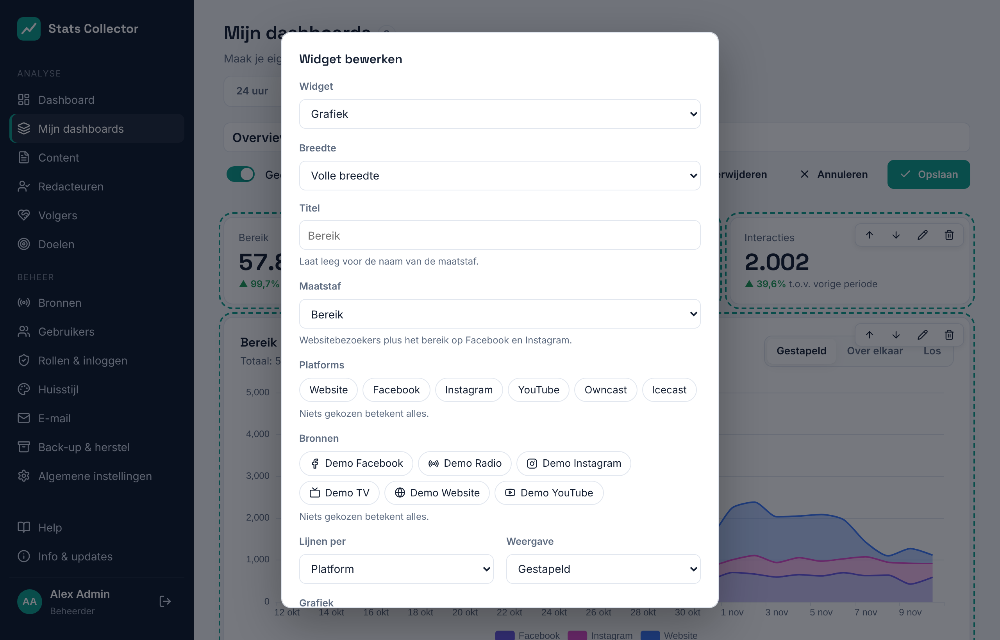

# Mijn dashboards

**Analyse → Mijn dashboards** laat je je eigen overzichten van de cijfers maken: totalen, grafieken per platform of per bron, topcontent, de ranglijst van redacteuren en doelen, naast elkaar. Iedereen kan dashboards voor zichzelf maken; beheerders en hoofdredacteuren kunnen een dashboard ook met iedereen delen.

## Een dashboard gebruiken

- De tabbladen bovenaan zijn jouw dashboards en de gedeelde (met het deel-icoon). De app onthoudt welke je het laatst open had.
- De periode rechtsboven (24 uur, 7, 30 of 90 dagen, 12 maanden) geldt voor alle widgets.
- Een **totaal** toont het cijfer over de periode en hoeveel het steeg of daalde ten opzichte van de periode ervoor (bij 30 dagen: de 30 dagen daarvoor).
- Een **grafiek** kan wisselen tussen **Gestapeld** (de lijnen tellen op tot één totaal), **Over elkaar** (lijnen over elkaar heen) en **Los** (een kleine grafiek per platform of bron). Iedereen kan wisselen; alleen wie het dashboard mag bewerken slaat het op als standaard.
- Klik op een naam in de legenda onder een grafiek om die te verbergen of te tonen.
- Klik in **Topcontent** op een titel voor de details.

## Maatstaven

De cijfers van elk platform worden opgeteld in vijf gedeelde maatstaven, zodat kanalen tot één totaal gestapeld kunnen worden:

| Maatstaf | Telt |
| --- | --- |
| Bereik | Websitebezoekers plus het bereik op Facebook en Instagram |
| Weergaven | Paginaweergaven, weergaven op YouTube en weergaven van Facebook- en Instagram-berichten |
| Interacties | Likes, reacties, opmerkingen, keren gedeeld en opgeslagen (website: gedeeld en reacties) |
| Kijk- en luisterminuten | Kijkminuten op YouTube plus minuten via Owncast en Icecast |
| Volgers | Abonnees op YouTube plus volgers op Facebook en Instagram, per dag |

Bereik wordt per dag geteld, dus iemand die op twee dagen terugkomt telt twee keer. YouTube, Facebook en Instagram geven alleen hele dagen door: bij **24 uur** staan ze niet in een grafiek (de widget meldt dat), en Volgers toont altijd dagen.

## Een dashboard bouwen

Klik op **Nieuw dashboard**, of op **Bewerken** bij een dashboard dat je mag aanpassen. Heb je nog geen dashboards, dan geeft **Voorbeelddashboard maken** een kant-en-klaar begin (bereik, weergaven en interacties, bereik per platform, volgers, interacties, topcontent en redacteuren) dat je kunt aanpassen.

Tijdens het bewerken:

- Typ bovenaan de naam van het dashboard. **Gedeeld met iedereen** (beheerders en hoofdredacteuren) maakt het zichtbaar voor alle gebruikers; alleen beheerders, hoofdredacteuren en de maker kunnen het aanpassen.
- **Widget toevoegen** opent het widgetformulier. Elke widget heeft pijlen om hem omhoog of omlaag te zetten, een potlood om hem aan te passen en een prullenbak om hem weg te halen.
- **Opslaan** bewaart het dashboard, **Annuleren** gooit de wijzigingen weg, **Verwijderen** haalt het hele dashboard weg.

Het widgetformulier:

- **Widget**: Totaal (KPI), Grafiek, Topcontent, Ranglijst redacteuren of Doelen.
- **Breedte**: een derde, half of de volle breedte. Op een telefoon neemt elke widget de volle breedte.
- **Titel**: laat leeg voor de naam van de maatstaf.
- **Maatstaf**, **Platforms** en **Bronnen** (totaal en grafiek): wat er geteld wordt, en waarvandaan. Niets gekozen betekent alles.
- **Lijnen per** (grafiek): één lijn per platform, per bron, of één totaal. **Weergave** en **Grafiek** (vlak, lijn of staven) bepalen hoe hij getekend wordt.
- **Sorteer op**, **Items** en **Aantal regels** (topcontent): bijvoorbeeld de 10 best gelezen artikelen of de sociale berichten met het meeste bereik.

De **Ranglijst redacteuren** toont cijfers per redacteur alleen aan rollen die ze mogen zien (zie [Content en redacteuren](content.md#wie-ziet-wat)).
