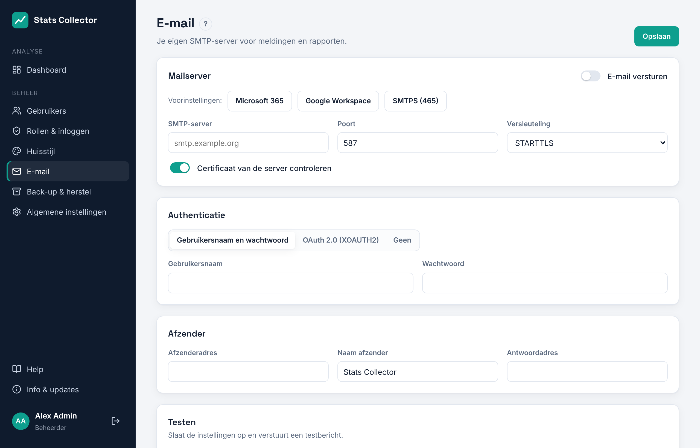

# E-mail (SMTP)

Stats Collector verstuurt meldingen en (vanaf fase 4) rapporten via je eigen SMTP-server. Open **Beheer → E-mail**.



## Instellingen

| Veld | Uitleg |
| --- | --- |
| E-mail versturen | Hoofdschakelaar |
| SMTP-server, poort | bijv. `smtp.office365.com` en `587` |
| Versleuteling | **STARTTLS** (poort 587, aanbevolen), **SSL/TLS** (SMTPS, poort 465) of geen (alleen op een vertrouwd lokaal netwerk). TLS 1.2 is het minimum. |
| Certificaat van de server controleren | Laat aan. Zet alleen uit voor een interne server met een zelfondertekend certificaat. |
| Authenticatie | Gebruikersnaam en wachtwoord, OAuth 2.0 (XOAUTH2) of geen |
| Afzenderadres, naam, antwoordadres | Wat ontvangers zien |

De knoppen **Microsoft 365**, **Google Workspace** en **SMTPS (465)** vullen server, poort en versleuteling in.

Wachtwoorden en geheimen worden versleuteld opgeslagen. Het scherm laat alleen zien dat er een waarde is opgeslagen; laat het veld leeg om die te behouden.

## Testen

Vul onder **Testen** een adres in en klik op **Testmail versturen**. De instellingen worden eerst opgeslagen. Als versturen mislukt, zie je de exacte foutmelding van de mailserver, bijvoorbeeld `535 Authentication unsuccessful`.

## Microsoft 365 met OAuth 2.0

Microsoft zet basisauthenticatie voor SMTP uit. Gebruik daarom OAuth 2.0:

1. Ga in het [Entra-beheercentrum](https://entra.microsoft.com) naar **App-registraties → Nieuwe registratie** en noem hem *Stats Collector mail*.
2. **API-machtigingen → Een machtiging toevoegen → API's die mijn organisatie gebruikt → Office 365 Exchange Online → Toepassingsmachtigingen → SMTP.SendAsApp**. Klik op **Beheerderstoestemming verlenen**.
3. **Certificaten en geheimen → Nieuw clientgeheim**. Kopieer de waarde.
4. Registreer de app in Exchange Online PowerShell en geef hem rechten op de verzendende mailbox:
   ```powershell
   New-ServicePrincipal -AppId <client-id> -ObjectId <object-id-enterprise-app>
   Add-MailboxPermission -Identity stats@example.org -User <object-id-enterprise-app> -AccessRights FullAccess
   ```
5. Kies in Stats Collector **OAuth 2.0 (XOAUTH2)**:
   - Gebruikersnaam: de mailbox, bijv. `stats@example.org`
   - Token-URL: `https://login.microsoftonline.com/<tenant-id>/oauth2/v2.0/token`
   - Scope: `https://outlook.office365.com/.default`
   - Client-ID en clientgeheim uit stap 1 en 3
6. Verstuur een testmail.

Versturen via de Microsoft Graph API (in plaats van SMTP) komt samen met de rapporten in fase 4.
