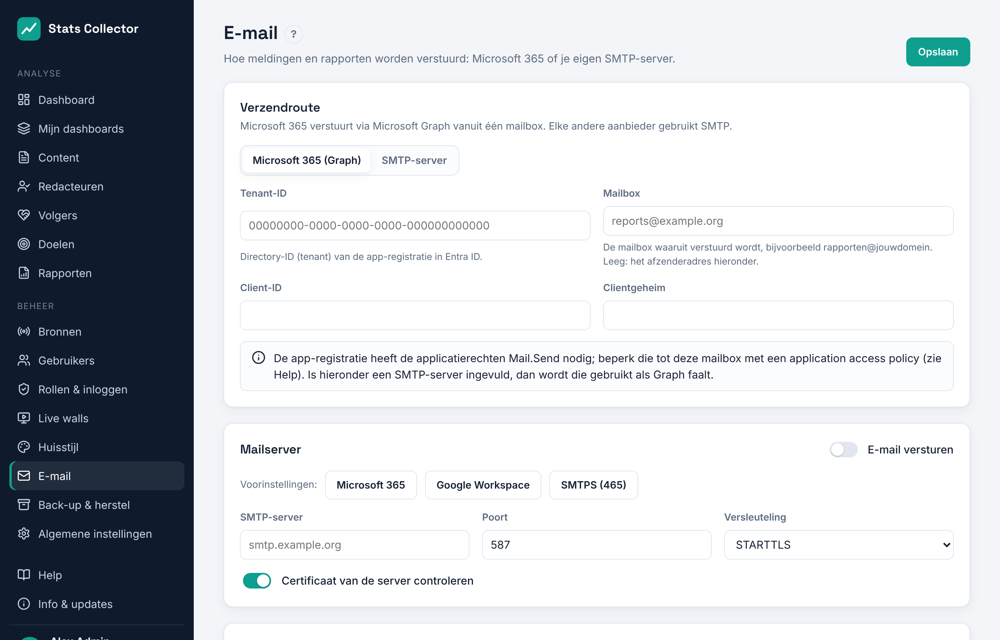

# E-mail

Stats Collector verstuurt meldingen en rapporten via Microsoft 365 (de Graph API) of via je eigen SMTP-server. Open **Beheer → E-mail**.

Bij **Verzendroute** kies je hoe mail de deur uitgaat: **Microsoft 365 (Graph)** of **SMTP-server**. Met Graph wordt een SMTP-server die je ook instelt als terugval gebruikt wanneer Microsoft een bericht weigert.


## Instellingen

| Veld | Uitleg |
| --- | --- |
| E-mail versturen | Hoofdschakelaar |
| SMTP-server, poort | bijv. `smtp.office365.com` en `587` |
| Versleuteling | **STARTTLS** (poort 587, aanbevolen), **SSL/TLS** (SMTPS, poort 465) of geen (alleen op een vertrouwd lokaal netwerk). TLS 1.2 is het minimum. |
| Certificaat van de server controleren | Laat aan. Zet alleen uit voor een interne server met een zelfondertekend certificaat. |
| Authenticatie | Gebruikersnaam en wachtwoord, OAuth 2.0 (XOAUTH2) of geen |
| Afzenderadres, naam, antwoordadres | Wat ontvangers zien |

De knoppen **Microsoft 365**, **Google Workspace** en **SMTPS (465)** vullen server, poort en versleuteling in.

Wachtwoorden en geheimen worden versleuteld opgeslagen. Het scherm laat alleen zien dat er een waarde is opgeslagen; laat het veld leeg om die te behouden.

## Testen

Vul onder **Testen** een adres in en klik op **Testmail versturen**. De instellingen worden eerst opgeslagen. Als versturen mislukt, zie je de exacte foutmelding van de mailserver, bijvoorbeeld `535 Authentication unsuccessful`.

## Microsoft 365 met OAuth 2.0

Microsoft zet basisauthenticatie voor SMTP uit. Gebruik daarom OAuth 2.0:

1. Ga in het [Entra-beheercentrum](https://entra.microsoft.com) naar **App-registraties → Nieuwe registratie** en noem hem *Stats Collector mail*.
2. **API-machtigingen → Een machtiging toevoegen → API's die mijn organisatie gebruikt → Office 365 Exchange Online → Toepassingsmachtigingen → SMTP.SendAsApp**. Klik op **Beheerderstoestemming verlenen**.
3. **Certificaten en geheimen → Nieuw clientgeheim**. Kopieer de waarde.
4. Registreer de app in Exchange Online PowerShell en geef hem rechten op de verzendende mailbox:
   ```powershell
   New-ServicePrincipal -AppId <client-id> -ObjectId <object-id-enterprise-app>
   Add-MailboxPermission -Identity stats@example.org -User <object-id-enterprise-app> -AccessRights FullAccess
   ```
5. Kies in Stats Collector **OAuth 2.0 (XOAUTH2)**:
   - Gebruikersnaam: de mailbox, bijv. `stats@example.org`
   - Token-URL: `https://login.microsoftonline.com/<tenant-id>/oauth2/v2.0/token`
   - Scope: `https://outlook.office365.com/.default`
   - Client-ID en clientgeheim uit stap 1 en 3
6. Verstuur een testmail.

## Microsoft 365 via de Graph API

De Graph-route heeft geen SMTP nodig en is de betrouwbaarste manier om vanuit Microsoft 365 te versturen. Stats Collector logt in als app (client credentials) en verstuurt vanuit één mailbox.



1. Ga in het [Entra-beheercentrum](https://entra.microsoft.com) naar **App-registraties → Nieuwe registratie** en noem hem *Stats Collector mail*. Noteer de **Toepassings-ID (client)** en de **Map-ID (tenant)**.
2. **API-machtigingen → Een machtiging toevoegen → Microsoft Graph → Toepassingsmachtigingen → Mail.Send**. Klik op **Beheerderstoestemming verlenen**.
3. **Certificaten en geheimen → Nieuw clientgeheim**. Kopieer de waarde.
4. Zonder verdere stappen mag de app als *elke* mailbox versturen. Beperk hem tot de verzendende mailbox met een toegangsbeleid in Exchange Online PowerShell (gebruik een beveiligingsgroep met e-mail waarin de mailbox zit):
   ```powershell
   New-ApplicationAccessPolicy -AppId <client-id> -PolicyScopeGroupId stats-senders@example.org -AccessRight RestrictAccess -Description "Stats Collector mail"
   Test-ApplicationAccessPolicy -AppId <client-id> -Identity reports@example.org
   ```
5. Kies in Stats Collector **Microsoft 365 (Graph)** en vul in:
   - Tenant-ID en client-ID uit stap 1, clientgeheim uit stap 3
   - Verzendende mailbox, bijv. `reports@example.org`
6. Vul hieronder de afzendernaam in, sla op en verstuur een testmail.

Bijlagen tot 3 MB gaan mee met het bericht; een grotere rapport-PDF wordt weggelaten en de mail bevat dan alleen de link.
