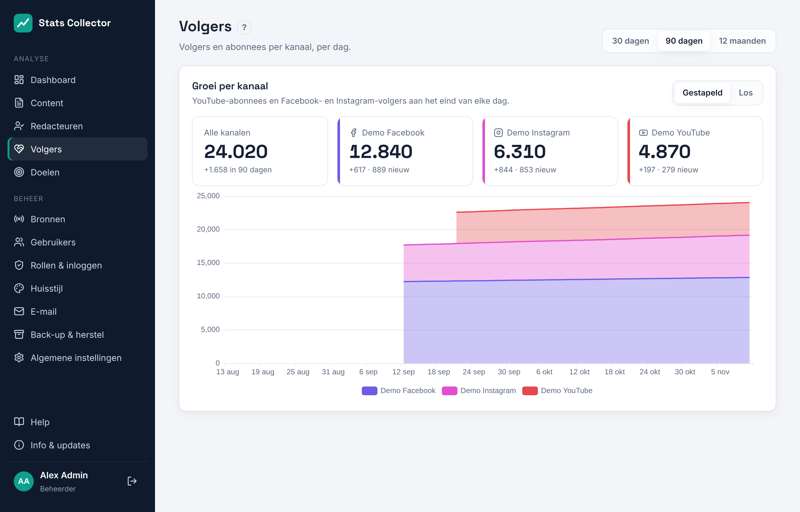
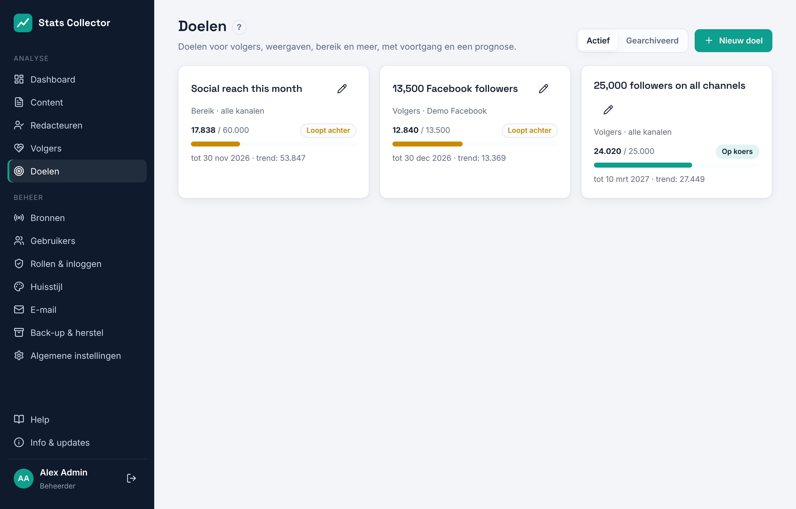
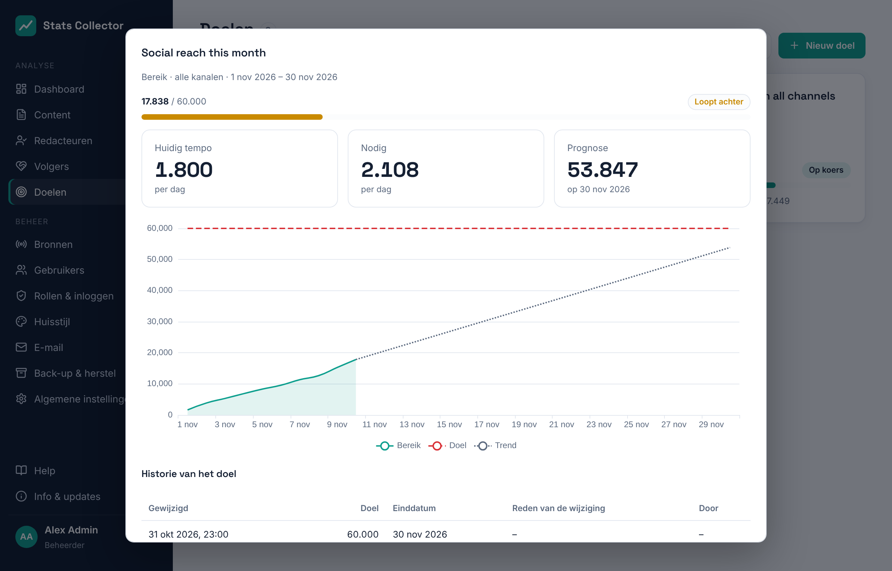

# Volgers en doelen

## Volgers

**Analyse → Volgers** toont hoe het aantal YouTube-abonnees en Facebook- en Instagram-volgers groeit, per kanaal en voor alle kanalen samen. Iedereen kan deze pagina openen.

- Kies rechtsboven **30 dagen**, **90 dagen** of **12 maanden**.
- De tegels tonen het aantal nu, hoeveel het veranderde in de periode en hoeveel nieuwe volgers er kwamen (wie vertrok wordt in dat laatste getal niet afgetrokken).
- **Gestapeld** zet de kanalen op elkaar, zodat de bovenste lijn het totaal is; **Los** toont elk kanaal op een eigen schaal.

Het aantal per dag is het aantal aan het eind van die dag. YouTube en Facebook geven de dagelijkse aanwas en het verlies over hun hele historie, dus hun lijnen gaan terug tot zover de historie is opgehaald. Instagram geeft nieuwe volgers alleen voor de laatste 30 dagen; die lijn is exact vanaf de dag dat je koppelde. Zie [YouTube](youtube.md) en [Meta](meta.md).

## Doelen

**Analyse → Doelen** toont de doelen met hun voortgang. Iedereen kan ze zien; de **hoofdredacteur** en **beheerders** kunnen ze toevoegen en wijzigen.

Een doel meet een van deze, over alle kanalen of de kanalen die je kiest:

| Meten | Het doel is gehaald als |
| --- | --- |
| Volgers | het aantal volgers en abonnees het doel haalt |
| Weergaven | pagina-, video- en berichtweergaven vanaf de startdatum samen het doel halen |
| Bereik | websitebezoekers en sociaal bereik per dag vanaf de startdatum samen het doel halen |
| Interacties | likes, reacties, opmerkingen, keren gedeeld en opgeslagen vanaf de startdatum samen het doel halen |
| Luister- en kijkminuten | live minuten en YouTube-kijktijd vanaf de startdatum samen het doel halen |

Elke doelkaart toont de waarde nu, het doel, een voortgangsbalk en een status:

- **Op koers**: in het tempo van de laatste twee weken wordt het doel op de einddatum gehaald;
- **Loopt achter**: in dat tempo niet;
- **Gehaald** en **Niet gehaald** (de einddatum is voorbij).

Klik op een doel voor de details: het huidige tempo en het tempo dat per dag nodig is, de prognose voor de einddatum, en een grafiek met de waarde, het doel als streepjeslijn en de trend als stippellijn.

### Een doel toevoegen en wijzigen

1. **Nieuw doel**: een naam, wat je meet, het doel, een startdatum en (optioneel) een einddatum. Kies kanalen, of geen voor alle kanalen.
2. Zet **Mail als het doel gehaald is of achterloopt** aan voor een bericht. Zonder adressen gaat het naar wie het doel maakte. De mails gaan via de mailserver bij **Beheer → E-mail**; een doel dat achterloopt wordt hooguit één keer per week gemeld.
3. Je kunt het doel of de einddatum altijd wijzigen. Elke wijziging blijft bewaard in de **historie van het doel**, met de datum, wie het deed en de reden. De grafiek toont het doel dat op elk moment gold, zodat rapportages eerlijk laten zien wat het doel toen was.
4. **Archiveer** een afgerond doel om het uit de lijst te halen; het staat dan onder **Gearchiveerd**.

Het dashboard toont de actieve doelen met hun voortgangsbalk onder **Doelen**.
