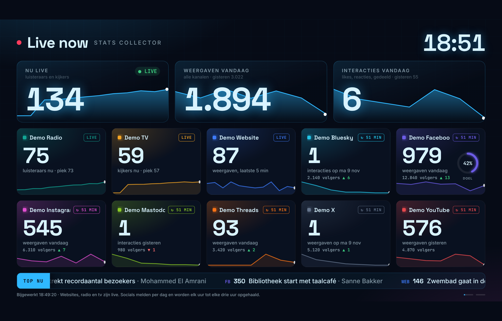
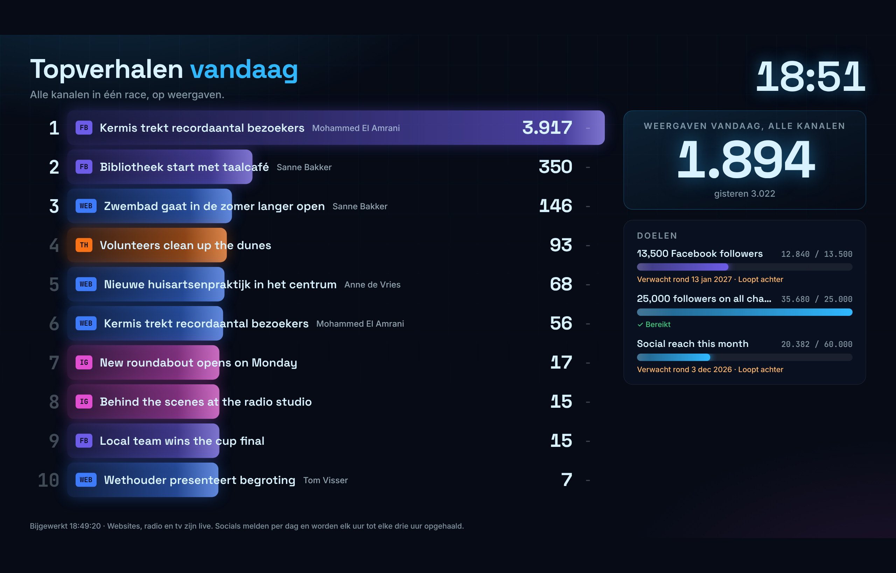
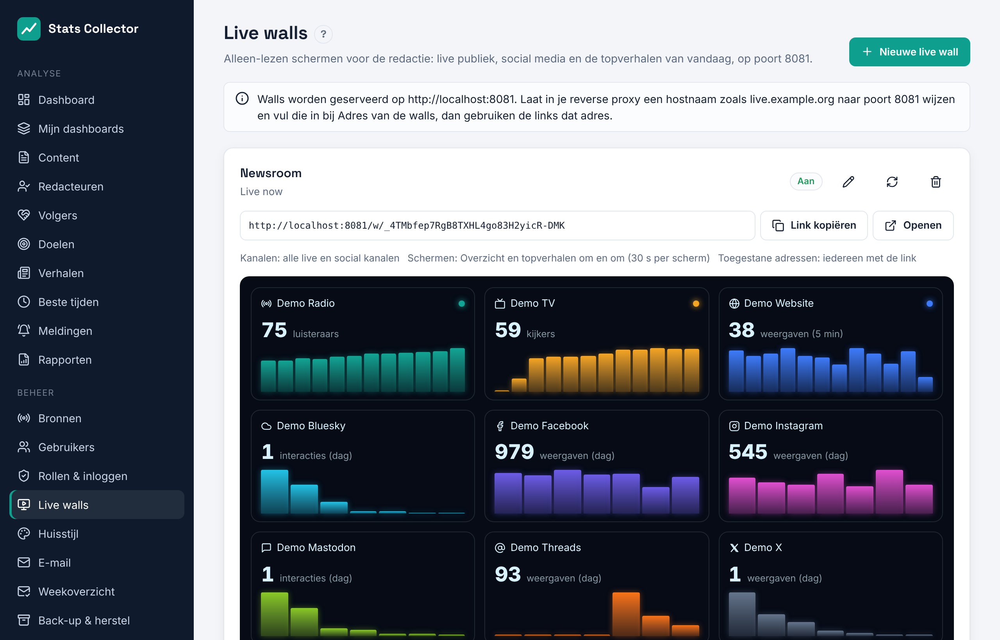

# Live wall

Een live wall is een alleen-lezen scherm voor een tv op de redactievloer. Je ziet in één oogopslag hoe de kanalen het nu doen en hoe de berichten scoren op social media. Twee schermen wisselen elkaar af (standaard elke 30 seconden):

- **Overzicht**: drie grote cijfers (live publiek, weergaven vandaag, interacties vandaag) en een tegel per kanaal met het getal, een lijn van het laatste uur of de laatste 7 dagen, de verandering in volgers en, als het kanaal een eigen volgersdoel heeft, een ring met de voortgang. Onderin loopt een ticker met de beste verhalen.
- **Topverhalen**: de beste berichten van vandaag van alle kanalen in één race op weergaven, met de redacteur, pijltjes voor berichten die stijgen of zakken, de snelste stijgers van het laatste uur en de doelen (volgers eerst, ook week- en maanddoelen) met de datum waarop ze naar verwachting gehaald worden.

Cijfers tellen op en de race schuift vanzelf als er nieuwe cijfers binnenkomen. Er is geen login nodig: elke wall heeft een eigen lange, onraadbare link.

## Een wall maken

**Beheer → Live walls** (alleen beheerders) toont de walls met hun link en een klein voorbeeld van wat het scherm laat zien.

1. Klik op **Nieuwe live wall**.
2. **Naam**: voor jezelf, bijv. *Redactie*. **Titel op het scherm**: staat bovenaan de wall; leeg betekent de naam.
3. **Kanalen**: de bronnen voor radio (Icecast), tv (Owncast), websites en social media die je wilt tonen. Niets gekozen betekent alles.
4. **Schermen**: *Overzicht en topverhalen om en om* (standaard), *Alleen overzicht* of *Alleen topverhalen*. Bij om en om stel je met **Seconden per scherm** in hoe lang elk scherm blijft staan (10 tot 300 seconden).
5. **Namen van redacteuren tonen bij de topverhalen**: staat standaard aan. Zet het uit als het scherm hangt waar bezoekers het zien. Een social bericht zonder eigen auteur krijgt de auteur van het artikel waarnaar het verwijst.
6. **Toegestane adressen** (optioneel): IP-adressen of netwerken, gescheiden door komma's, die de wall mogen openen, bijvoorbeeld het openbare IP-adres van de redactie. Leeg betekent iedereen met de link.
7. Sla op, klik op **Link kopiëren** en open de link op de tv in een browser op volledig scherm (kioskmodus).

De wall werkt zichzelf bij: de server zet elke minuut nieuwe cijfers klaar en stuurt ze naar het scherm. Valt de verbinding weg, dan maakt het scherm zelf opnieuw verbinding; komen er vijf minuten geen verse cijfers, dan meldt de onderste regel dat.

- **Nieuwe link** (ronde pijlen) maakt een nieuwe link. De oude link werkt meteen niet meer; gebruik dit als een link te breed is gedeeld.
- Zet je **Deze wall tonen** uit, of verwijder je de wall, dan werkt de link niet meer.
- Wil je op een bepaalde tv maar één scherm, zet dan `?screen=overview` of `?screen=stories` achter de link, bijvoorbeeld om beide schermen naast elkaar op twee tv's te zetten. De wall volgt de taal van de browser op de tv; met `?lang=nl` of `?lang=en` stel je die vast (combineer met `&`, bijv. `?screen=stories&lang=nl`).
- De wall gebruikt de kleuren van **Beheer → Huisstijl** (de live-wallkleuren) en de kanaalkleuren.

## Wat staat er op de wall

| Kanaal | Getal op de tegel | Lijn op de tegel | Hoe vers |
| --- | --- | --- | --- |
| Radio (Icecast) | Luisteraars bij de laatste meting | Laatste uur, gemiddeld per 5 minuten | Live (elke 30 seconden gemeten) |
| Tv (Owncast) | Kijkers bij de laatste meting | Laatste uur, gemiddeld per 5 minuten | Live (elke 30 seconden gemeten) |
| Website | Paginaweergaven in de laatste 5 minuten | Laatste uur, per 5 minuten | Live (de plugin meldt elke minuut) |
| Facebook, Instagram, Threads, X | Weergaven vandaag | Laatste 7 dagen | Elk uur opgehaald (X: zoals ingesteld bij de bron) |
| YouTube | Weergaven op de laatste dag die YouTube heeft doorgegeven, meestal gisteren | Laatste 7 dagen | Elke 3 uur opgehaald; YouTube meldt een à twee dagen later |
| Bluesky, Mastodon | Interacties vandaag (ze geven geen weergaven door) | Laatste 7 dagen | Elk uur opgehaald |

Social media melden per dag. Het label rechtsboven op een social tegel laat zien hoe lang geleden de cijfers zijn opgehaald; na vier uur wordt het oranje. Onder het getal staat over welke dag het gaat (*weergaven vandaag*, *weergaven gisteren* of een datum).

- **Nu live** telt alle luisteraars en kijkers op. Een wall zonder radio of tv toont in plaats daarvan de websiteweergaven van de laatste 5 minuten.
- **Weergaven vandaag** en **Interacties vandaag** tellen alle kanalen op de wall op, met het totaal van gisteren ernaast om te vergelijken. De lijn toont de laatste 7 dagen.
- **Topverhalen** zet de items (artikelen, berichten en video's) van alle kanalen op de wall op volgorde van weergaven vandaag. Vroeg in de ochtend, zolang minder dan drie items vandaag weergaven hebben, toont de wall de lijst van gisteren en zegt dat erbij.
- **Snelste stijgers** toont de items die het laatste uur de meeste weergaven erbij kregen. Dit verschijnt nadat de wall een paar minuten draait.
- **Doelen** toont de actieve doelen met **Tonen op de live walls**, volgersdoelen eerst; week- en maanddoelen tonen *deze week* of *deze maand* (zie [Volgers en doelen](followers-and-goals.md)). Een wall met gekozen kanalen toont alleen doelen binnen die kanalen.

## Adres en reverse proxy

De wall draait als eigen kleine dienst, `stats-collector-livewall`, op poort 8081. Die kan niet bij de database of de beheerfuncties: hij leest alleen de cijfers die de worker klaarzet.

1. Maak een DNS-record voor een aparte hostnaam, bijv. `live.example.org`, en een proxyregel naar `<ip-van-stats-server>:8081` met HTTPS, net als het hoofdadres (zie [Reverse proxy](reverse-proxy.md)). Dat kan dezelfde reverse proxy zijn als voor het hoofdadres of een andere.
2. Vul onder **Beheer → Live walls → Adres van de walls** in:
    - **Openbaar adres**: het adres dat de proxy doorstuurt naar poort 8081, bijv. `https://live.example.org`. De links van alle walls gebruiken het meteen (bestaande links houden hun geheime deel, dus schermen hebben alleen de nieuwe hostnaam nodig). Leeg betekent `SC_LIVEWALL_URL` uit `/etc/stats-collector/config.env`, of anders de hoofdhostnaam op poort 8081.
    - **Adressen van de reverse proxy**: alleen als de walls een eigen proxy op een andere machine hebben. Vul het IP-adres (of netwerk) ervan in, zodat de wall-dienst de header `X-Forwarded-For` vertrouwt en **Toegestane adressen** de echte bezoeker ziet. De proxy's in `SC_TRUSTED_PROXIES` worden altijd ook vertrouwd.
3. Klik op **Opslaan**. De wall-dienst neemt een nieuw proxyadres binnen twee minuten over; opnieuw starten is niet nodig.

Met `--firewall` laat het installatiescript poort 8081 alleen toe vanaf de proxy's die bij de installatie zijn opgegeven (`--proxy-ips`). Hebben de walls een eigen proxy, voer het installatiescript dan opnieuw uit met dat adres erbij, of open poort 8081 er zelf voor in nftables. Verzoeken zijn beperkt tot 120 per minuut per IP-adres. Server-Sent Events vragen dat de proxy antwoorden niet buffert; Zoraxy geeft ze ongewijzigd door.
