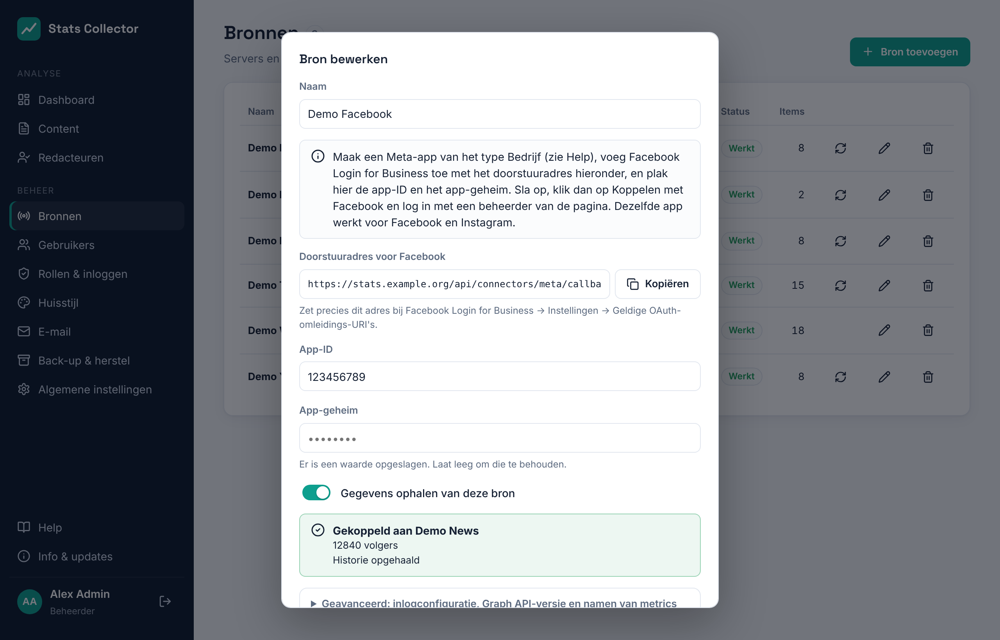

# Meta: Facebook en Instagram

Stats Collector leest de cijfers van een **Facebook-pagina** en van een **professioneel Instagram-account** (Zakelijk of Creator) via de Graph API van Meta. Eén Meta-app werkt voor allebei. Elke pagina en elk Instagram-account is een eigen bron, dus je kunt er meerdere toevoegen.

Wat je nodig hebt:

- een **Meta Business-portfolio** (Business Manager) dat **geverifieerd** is (voor dit project al gedaan);
- de **Facebook-pagina** die je wilt meten, met jou als beheerder;
- voor Instagram: het **professionele Instagram-account** dat aan die pagina gekoppeld is.

## Wat er verzameld wordt

| | Per dag voor de pagina of het account | Per bericht |
| --- | --- | --- |
| Facebook | Weergaven, bereik, interacties, reacties (emoji), opmerkingen, keren gedeeld, klikken, videoweergaven, nieuwe volgers, ontvolgd, volgers | Weergaven, bereik, reacties (ook per soort: leuk, geweldig, wauw…), opmerkingen, keren gedeeld, klikken |
| Instagram | Weergaven, bereik, likes, opmerkingen, keren gedeeld, opgeslagen, profielbezoeken, nieuwe volgers, volgers | Weergaven, bereik, likes, opmerkingen, keren gedeeld, opgeslagen |

Direct na het koppelen wordt de historie opgehaald: **twee jaar** paginacijfers en alle Facebook-berichten van die twee jaar, en voor Instagram de laatste **90 dagen** accountcijfers plus de berichten van de laatste twee jaar. Daarna worden de cijfers **elk uur** bijgewerkt.

Goed om te weten:

- Meta geeft van berichten alleen een lopend totaal. Stats Collector bewaart wat een bericht per dag erbij kreeg; een bericht dat nieuw is voor Stats Collector krijgt zijn hele totaal op de dag van publicatie.
- Instagram geeft nieuwe volgers alleen voor de laatste 30 dagen en alleen bij accounts met minstens 100 volgers, en meldt geen ontvolgers. Het aantal volgers per dag wordt teruggerekend vanaf het aantal dat Stats Collector elk uur ziet, en is dus exact vanaf de dag dat je koppelt.
- **Bereik** is het aantal mensen dat iets zag. Opgeteld over meerdere dagen telt iemand die op twee dagen iets zag twee keer.
- Meta werkt in hele dagen: in de weergave **24 uur** van het dashboard tonen Facebook en Instagram *alleen cijfers per dag*.

## 1. App aanmaken

1. Ga naar [developers.facebook.com/apps](https://developers.facebook.com/apps) → **App maken**.
2. Toepassing: **Overig** → apptype **Zakelijk**.
3. Naam: *Stats Collector*, contactadres, en kies je geverifieerde **Business-portfolio**.
4. Vul bij **App-instellingen → Basis** de URL van het privacybeleid, de URL van de voorwaarden, het app-icoon (1024×1024) en de categorie *Bedrijven en pagina's* in. Sla op. Hier vind je ook de **app-ID** en het **app-geheim** (klik op *Weergeven*).

## 2. Facebook Login for Business toevoegen

1. **Product toevoegen → Facebook Login for Business**.
2. Plak bij **Facebook Login for Business → Instellingen** het **doorstuuradres** dat Stats Collector in het bronformulier toont (het eindigt op `/api/connectors/meta/callback`) in **Geldige OAuth-omleidings-URI's**. Sla op.
3. Optioneel: bij **Configuraties** kun je een configuratie van het type *Gebruikerstoegangstoken* maken met de rechten hieronder. Plak de ID in het bronformulier bij **Geavanceerd → Configuratie-ID**. Zonder configuratie vraagt Stats Collector de rechten rechtstreeks; dat werkt ook.

## 3. Rechten en App Review

| Recht | Waarom |
| --- | --- |
| `pages_show_list` | De pagina's tonen die de beheerder beheert |
| `pages_read_engagement` | Berichten, reacties, opmerkingen, keren gedeeld, volgers |
| `read_insights` | Statistieken van pagina en berichten (weergaven, bereik, klikken) |
| `business_management` | Pagina's die bij het Business-portfolio horen |
| `instagram_basic` | Instagram-account en berichten |
| `instagram_manage_insights` | Instagram-weergaven, bereik, opgeslagen, profielbezoeken |

Zolang de app in **ontwikkelmodus** staat werkt hij al voor mensen met een rol in de app (beheerder, ontwikkelaar of tester); dat is genoeg om je eigen pagina te koppelen. Om de app zonder die beperking te laten werken vraag je **geavanceerde toegang** aan:

1. **App Review → Rechten en functies**: klik voor elk recht hierboven op **Geavanceerde toegang aanvragen**.
2. Beschrijf per recht het gebruik: *"Stats Collector is an internal analytics dashboard for our newsroom. An administrator connects our own Page and Instagram account once; we read insights for our own content and show them to staff in dashboards and monthly reports. No data is shared with third parties."*
3. Upload een korte schermopname van de stappen hieronder (koppelen met Facebook, de pagina kiezen, de cijfers bij **Content** en op het dashboard).
4. Vul de **vragen over gegevensverwerking** in en dien in. Zet de app na goedkeuring op **Live**.

## 4. De bron toevoegen in Stats Collector

1. **Beheer → Bronnen → Bron toevoegen**, soort **Facebook (pagina)** of **Instagram (account)**.
2. Vul een naam, de **app-ID** en het **app-geheim** in en sla op.

    

3. Klik op **Koppelen met Facebook** en log in met een beheerder van de pagina. Selecteer op het scherm van Facebook de pagina (en het Instagram-account) en sta alle rechten toe.
4. Terug in Stats Collector:
    - met één pagina (of één Instagram-account) is hij meteen gekoppeld;
    - met meerdere vraagt het formulier **Welke pagina?** of **Welk Instagram-account?**. Kies er één; maak voor de andere een extra bron aan. Je kunt dezelfde app-ID en hetzelfde geheim opnieuw gebruiken.
5. De historie wordt op de achtergrond opgehaald. De bronnenlijst toont *Historie wordt opgehaald…* tot het klaar is.

Het paginatoken dat Stats Collector krijgt verloopt niet, maar werkt niet meer als de beheerder die koppelde zijn Facebook-wachtwoord wijzigt, zijn rol op de pagina kwijtraakt of de app verwijdert. De bron toont dan *De toegang tot Facebook is beëindigd*: klik opnieuw op **Koppelen met Facebook**.

**Ontkoppelen** stopt het verzamelen en vergeet het token; de cijfers tot nu toe blijven bewaard.

## Geavanceerd: Graph API-versie en namen van metrics

Meta brengt een paar keer per jaar een nieuwe Graph API-versie uit en hernoemt of schrapt soms metrics. Stats Collector:

- gebruikt een geteste Graph API-versie, zichtbaar bij **Geavanceerd**; vul een andere in (bijvoorbeeld `v24.0`) als Meta de gebruikte versie uitfaseert;
- kent de oude en nieuwe namen van elke metric en zoekt zelf uit welke werkt, één keer per versie;
- markeert metrics die Meta niet meer aanbiedt als *niet beschikbaar* bij **Geavanceerd → Namen van metrics**.

Kondigt Meta een nieuwe naam aan voor een metric, vul die dan naast die metric in en sla op; Stats Collector probeert hem als eerste.

## Problemen

| Melding | Wat te doen |
| --- | --- |
| Facebook accepteerde de code niet | Controleer de app-ID, het app-geheim en of het doorstuuradres precies zo in **Geldige OAuth-omleidings-URI's** staat. |
| Dit Facebook-account beheert geen pagina | Koppel opnieuw en selecteer de pagina op het scherm van Facebook (klik op *Toegang bewerken* als je eerder koppelde). |
| Geen van de pagina's … heeft een gekoppeld Instagram-bedrijfsaccount | Koppel het Instagram-account aan de pagina (Instagram-app → Instellingen → Accounttype, of Meta Business Suite) en koppel opnieuw. |
| Meta weigerde de toegang | Er ontbreekt een recht, of de app staat nog in ontwikkelmodus voor iemand zonder rol in de app. |
| Meta vraagt het rustiger aan te doen | Niets: het verzamelen gaat vanzelf iets later verder. |
