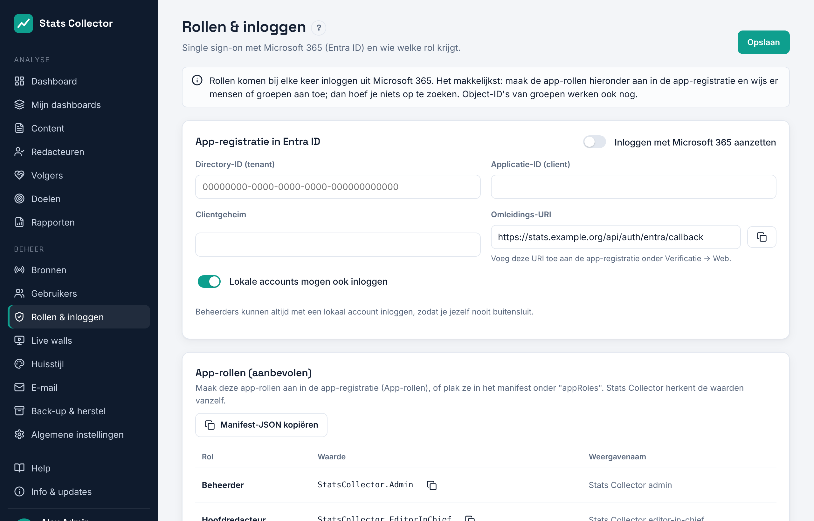

# Microsoft 365 (Entra ID)

Collega's loggen in met hun Microsoft 365-account (knop **Inloggen met Microsoft 365** op de inlogpagina) en krijgen hun rol uit Microsoft 365: uit een app-rol (het makkelijkst) of uit een groep. Je stelt dit in onder **Beheer → Rollen & inloggen**.

## 1. App-registratie

1. Open het [Entra-beheercentrum](https://entra.microsoft.com) → **Identiteit → Toepassingen → App-registraties → Nieuwe registratie**.
2. Naam: *Stats Collector*. Ondersteunde accounttypen: **Alleen accounts in deze organisatiemap (één tenant)**.
3. Omleidings-URI: platform **Web**, waarde: kopieer die uit **Rollen & inloggen → Omleidings-URI** in Stats Collector (zoiets als `https://stats.example.org/api/auth/entra/callback`).
4. Klik op **Registreren**. Kopieer de **Applicatie-ID (client)** en **Directory-ID (tenant)** naar Stats Collector.
5. **Certificaten en geheimen → Nieuw clientgeheim**, 24 maanden geldig. Kopieer de *Waarde* (niet de ID) naar **Clientgeheim**. Zet een herinnering in je agenda om het op tijd te vernieuwen.
6. Alleen als je groepen gebruikt in plaats van app-rollen (zie 2b): **Tokenconfiguratie → Groepsclaim toevoegen → Beveiligingsgroepen**, voor het *ID*-token, formaat *Groeps-ID*.
7. **API-machtigingen**: `openid`, `profile`, `email` en `User.Read` (gedelegeerd) zijn genoeg. Klik op **Beheerderstoestemming verlenen**.

## 2. Rollen

### 2a. App-rollen (aanbevolen)

Met app-rollen hoef je nooit een object-ID op te zoeken. Stats Collector kent deze waarden zelf:

| Rol | Waarde | Weergavenaam |
| --- | --- | --- |
| Beheerder | `StatsCollector.Admin` | Stats Collector admin |
| Hoofdredacteur | `StatsCollector.EditorInChief` | Stats Collector editor-in-chief |
| Redacteur | `StatsCollector.Editor` | Stats Collector editor |
| Medewerker | `StatsCollector.Staff` | Stats Collector staff |

1. Open in de app-registratie **App-rollen → App-rol maken** en maak de vier rollen: toegestane lidtypen **Gebruikers/groepen**, weergavenaam en waarde uit de tabel, een beschrijving naar keuze, **Inschakelen** aan. De tabel staat ook op **Rollen & inloggen**, met een kopieerknop naast elke waarde.
   *Sneller:* klik op **Rollen & inloggen** op **Manifest-JSON kopiëren**, open **Manifest** in de app-registratie en plak de gekopieerde regels tussen de blokhaken van `"appRoles": [ ]`. Klik op **Opslaan**.
2. Open **Bedrijfstoepassingen → Stats Collector → Gebruikers en groepen → Gebruiker/groep toevoegen**, kies mensen of een groep en de rol. Een groep toewijzen kan vanaf Entra ID P1; op andere abonnementen wijs je mensen toe.
3. Optioneel: zet onder **Bedrijfstoepassingen → Stats Collector → Eigenschappen** **Toewijzing vereist** op *Ja*, zodat alleen mensen met een rol kunnen inloggen.

Entra zet de rol in het inlogtoken, dus er is geen extra machtiging of tokeninstelling nodig. De rol wordt bij elke keer inloggen gelezen: verander je iemands toewijzing, dan verandert de rol bij de volgende keer inloggen. Wie meerdere rollen heeft krijgt de hoogste (Beheerder, dan Hoofdredacteur, Redacteur, Medewerker); wie geen rol heeft krijgt de rol bij **Rol voor alle anderen in de organisatie**.

### 2b. Groepen (alternatief)

Werk je liever met bestaande beveiligingsgroepen? Plak de **Object-ID** van elke groep (Entra → Groepen → de groep → Overzicht) bij **Rollen & inloggen → Rollen uit Microsoft 365-groepen**; meerdere ID's per rol scheid je met komma's. Hiervoor is de groepsclaim uit stap 6 van deel 1 nodig. Groepen en app-rollen kun je combineren; de hoogste rol geldt.

Is iemand lid van meer dan ongeveer 200 groepen, dan laat Microsoft de groepen weg uit het inlogtoken. Stats Collector leest ze dan uit Microsoft Graph; voeg daarvoor de gedelegeerde machtiging `GroupMember.Read.All` toe met beheerderstoestemming. App-rollen hebben deze grens niet.

## 3. Aanzetten en testen

1. Vul de tenant-ID, client-ID en het clientgeheim in (en de groeps-ID's als je groepen gebruikt), en zet **Inloggen met Microsoft 365 aanzetten** aan. Klik op **Opslaan**.
2. Open de inlogpagina in een privévenster en klik op **Inloggen met Microsoft 365**.
3. Na het inloggen kom je op het dashboard; je rol staat onderaan het menu. Onder **Gebruikers** staat het account met inlogmethode *Microsoft 365*.

Lukt het niet? De inlogpagina toont de reden, bijvoorbeeld een verkeerd clientgeheim of een verkeerde omleidings-URI. De meest gemaakte fout is een omleidings-URI die niet precies klopt: die moet het `https://`-adres zijn dat gebruikers openen, dus controleer `SC_PUBLIC_URL` (zie [Reverse proxy](reverse-proxy.md)).

## 4. Lokale accounts

Een bestaand lokaal account met hetzelfde e-mailadres wordt bij de eerste keer inloggen met Microsoft gekoppeld. Het houdt zijn wachtwoord en de rol die in Stats Collector is ingesteld, zodat je eerste beheerder altijd een werkend noodaccount blijft. Accounts die via Microsoft worden aangemaakt, krijgen hun rol bij elke keer inloggen uit Microsoft 365.

Laat **Lokale accounts mogen ook inloggen** aan totdat inloggen met Microsoft 365 werkt. Beheerders kunnen altijd met een lokaal account inloggen, dus een kapotte Entra-configuratie sluit je nooit buiten.
