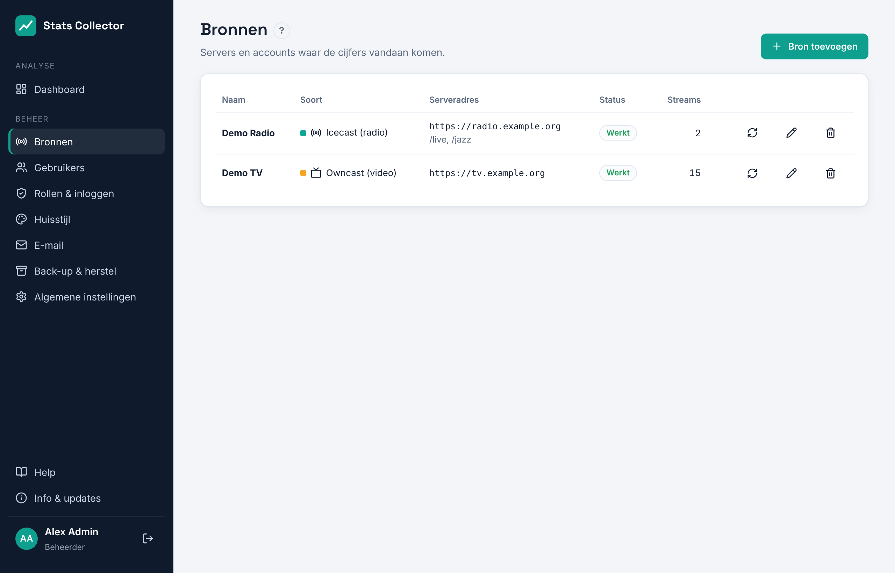

# Bronnen: Owncast en Icecast

Voeg je streamingservers toe onder **Beheer → Bronnen**. Elke server wordt elke 30 seconden opgehaald voor het aantal kijkers (Owncast) of luisteraars (Icecast). Je kunt er van elk 2 tot 5 toevoegen, of meer.

## Een bron toevoegen

1. Klik op **Bron toevoegen** en kies **Icecast (radio)** of **Owncast (video)**.
2. Vul een **Naam** in (die staat op het dashboard) en het **Serveradres**.
3. Vul eventueel het beheerwachtwoord in (zie hieronder).
4. Klik op **Verbinding testen**. Je ziet de servernaam en, bij Icecast, de mountpoints met hun luisteraars op dit moment.
5. Klik op **Opslaan**. Binnen een minuut verschijnen de eerste cijfers op het dashboard.

In de kolom Status staat **Werkt** na een geslaagde ophaalronde, of de reden waarom de laatste ronde mislukte (verkeerd wachtwoord, server niet bereikbaar, ...). **Nu ophalen** (de ronde pijl) haalt direct op. Zet je **Gegevens ophalen van deze bron** uit, dan pauzeert de bron zonder dat de cijfers verdwijnen. Een bron verwijderen wist ook al zijn cijfers.

## Icecast

- **Serveradres**: het adres van Icecast zelf, bijv. `https://radio.example.org:8000`, zonder `/status-json.xsl`.
- **Mountpoints**: bijv. `/live, /jazz`. Laat leeg om alle mounts te verzamelen die de server meldt. Een ingestelde mount die niet uitzendt telt als nul.
- **Beheergebruiker en -wachtwoord** (optioneel): `<admin-user>` en `<admin-password>` uit `icecast.xml`. Daarmee leest Stats Collector ook de gemiddelde luistertijd en welke spelers worden gebruikt (VLC, browser, slimme speaker...). IP-adressen van luisteraars worden nooit opgeslagen.

Stats Collector leest `status-json.xsl`, beschikbaar vanaf Icecast 2.4.

## Owncast

- **Serveradres**: het adres van je Owncast-server, bijv. `https://live.example.org`.
- **Beheerwachtwoord** (optioneel): het beheerwachtwoord van Owncast. Zonder wordt de openbare status gebruikt, die dezelfde kijkcijfers geeft.

Elke uitzending wordt een apart item met titel, begin- en eindtijd, zodat je uitzendingen kunt vergelijken onder **Best bekeken uitzendingen en streams** op het dashboard.

### Webhook (aanbevolen)

Na opslaan toont het bewerkvenster een URL bij **Webhook voor Owncast**. Ga in Owncast naar **Integrations → Webhooks → Create webhook**, plak de URL en kies **Stream started** en **Stream stopped**. Uitzendingen beginnen en eindigen dan op de minuut in plaats van bij de volgende ophaalronde. De URL bevat een geheim; lekt die uit, klik dan op **Vernieuwen** ernaast en pas de webhook in Owncast aan.

## Netwerk

De Stats Collector-server moet deze adressen kunnen bereiken. Staat een bron op het interne netwerk, gebruik dan het interne adres. Een zelfondertekend certificaat werkt als je **Certificaat van de server controleren** uitzet.
