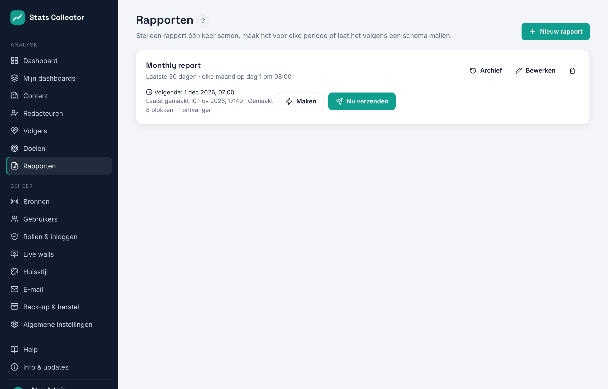
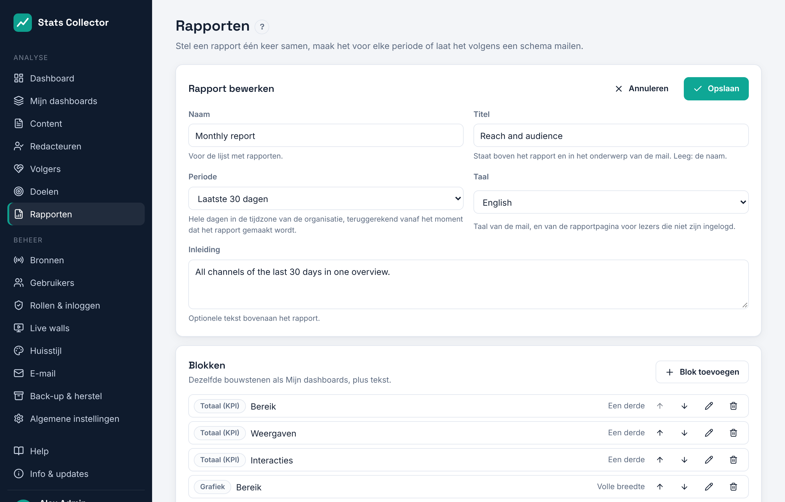
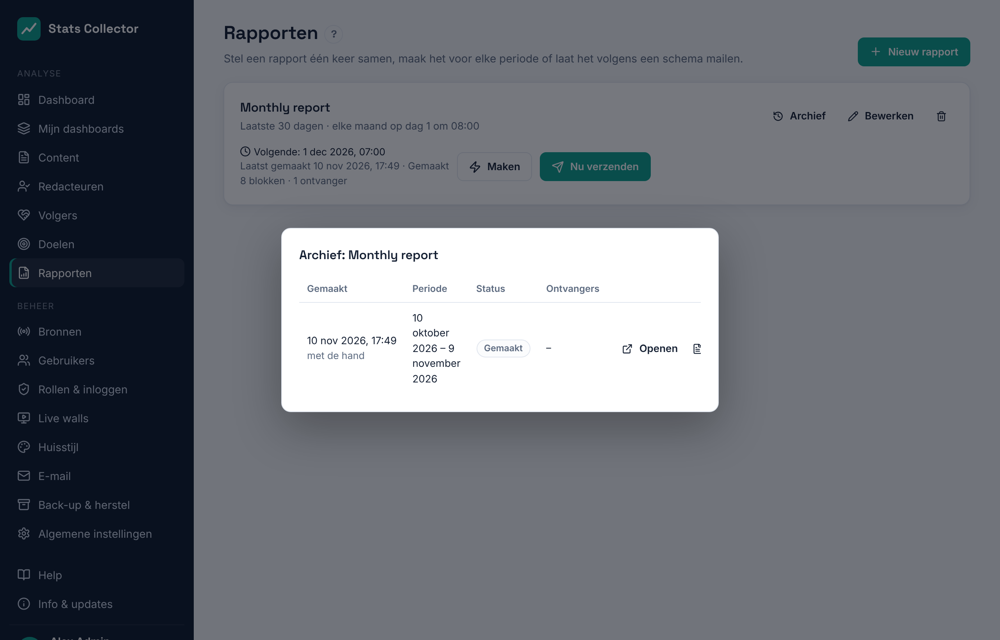
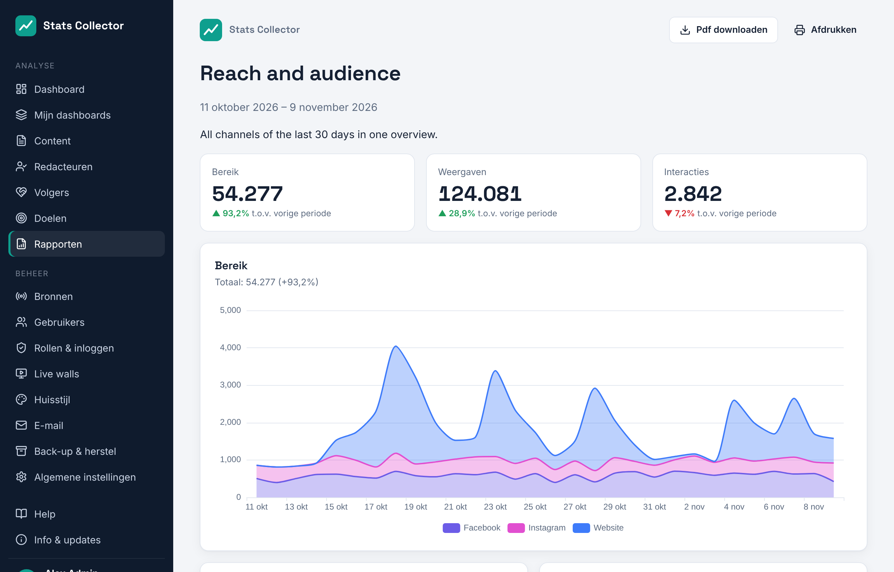

# Rapporten

**Analyse → Rapporten** maakt van de cijfers een rapport dat je kunt openen, afdrukken, als pdf downloaden of volgens een schema laten mailen, bijvoorbeeld een maandrapport aan de directie.

## Wie mag wat

| Rol | Rapporten |
| --- | --- |
| Beheerder, hoofdredacteur | Elk rapport maken, bewerken en verwijderen; nu verzenden; schema; ontvangers; de ranglijst van redacteuren |
| Redacteur | Eigen rapporten maken en openen of downloaden; geen ranglijst van redacteuren, niet verzenden en geen schema |
| Medewerker | Geen rapporten |

## Een rapport maken

Klik op **Nieuw rapport**. Een nieuw rapport begint met bereik, weergaven, interacties, twee grafieken en de topcontent, zodat je het alleen hoeft aan te passen.

| Veld | Uitleg |
| --- | --- |
| Naam | Voor de lijst met rapporten |
| Titel | Staat boven het rapport en in het onderwerp van de mail. Leeg: de naam |
| Periode | **Vorige maand**, **Vorige week (ma–zo)**, **Gisteren**, of de **laatste 7, 30 of 90 dagen**. Hele dagen in de tijdzone van de organisatie, teruggerekend vanaf het moment dat het rapport gemaakt wordt. Een maandrapport dat op de 1e verstuurd wordt, gaat dus over de hele vorige maand. |
| Taal | Taal van de mail, en van de rapportpagina voor lezers die niet zijn ingelogd |
| Inleiding | Optionele tekst bovenaan |

**Blokken** zijn dezelfde bouwstenen als [Mijn dashboards](dashboards.md): totalen (met de verandering ten opzichte van de periode ervoor), grafieken per platform of bron, topcontent, de ranglijst van redacteuren en doelen, plus **tekst** voor je eigen toelichting. Met de pijlen verander je de volgorde, met de grootte (een derde, half, volle breedte) zet je blokken naast elkaar.

## Maken, verzenden en het archief

- **Maken** maakt het rapport nu en opent het in een nieuw tabblad. Er wordt niets verstuurd.
- **Nu verzenden** maakt het rapport en mailt het meteen naar de ontvangers, met of zonder schema.
- **Archief** toont elk gemaakt rapport, met periode, status en ontvangers. **Openen** toont het opnieuw, **PDF** downloadt het.

Een rapport ligt vast op het moment dat het gemaakt wordt: het archief en de link tonen altijd de cijfers van dat moment, ook als gegevens later worden gecorrigeerd.

## De rapportpagina en de pdf

De mail bevat een samenvatting van de totalen, een knop naar het interactieve rapport en het rapport als pdf-bijlage. Het interactieve rapport opent zonder inloggen tot de link verloopt (**Link geldig**, standaard 30 dagen); daarna meldt de pagina dat de link verlopen is. In de app blijft het archief werken.

De pdf is dezelfde pagina, afgedrukt door Chromium op de server (A4). Het installatiescript installeert Chromium; een update installeert het als het ontbreekt.

## Schema en ontvangers

Onder **Verzending** (beheerders en hoofdredacteuren):

| Veld | Uitleg |
| --- | --- |
| Schema | Alleen op verzoek, elke dag, elke week (kies de dag) of elke maand (dag 1 t/m 28) |
| Tijd | In de tijdzone van de organisatie (**Beheer → Algemene instellingen**) |
| Gebruikers | Gebruikers van Stats Collector; de mail gaat naar hun adres |
| Andere e-mailadressen | Iedereen anders, gescheiden door komma's. Elke ontvanger krijgt een eigen mail, zodat adressen niet gedeeld worden |
| Pdf bijvoegen | Standaard aan |
| Schema actief | Een schema pauzeren zonder het kwijt te raken |

De lijst toont wanneer een rapport de volgende keer verstuurd wordt en hoe het de vorige keer ging. Een mislukte verzending toont de reden, bijvoorbeeld een fout van de mailserver; **Nu verzenden** probeert het opnieuw.

!!! note "Ranglijst van redacteuren"
    Een rapport met de ranglijst van redacteuren kan alleen naar hoofdredacteuren en beheerders. Andere gebruikers en externe adressen worden geweigerd, zodat cijfers per redacteur die groep niet verlaten.

Rapporten gaan via de route die onder [E-mail](email.md) is ingesteld: Microsoft 365 (Graph) of SMTP.
