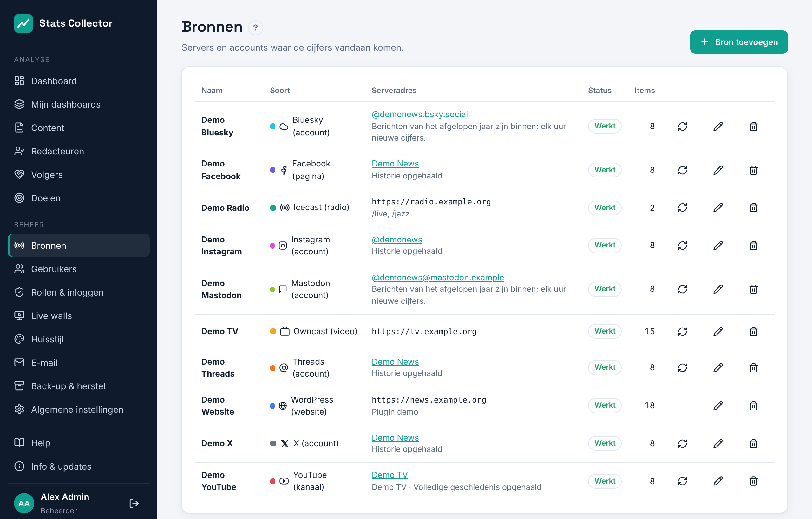

# Bronnen instellen: overzicht

Een **bron** is één website, socialemedia-account of streamingserver waar Stats Collector cijfers van verzamelt. Elke bron voeg je toe onder **Beheer → Bronnen → Bron toevoegen**. Deze pagina vertelt per platform **waar je moet zijn**, wat je nodig hebt voordat je begint en welke waarde in welk veld van Stats Collector komt. Elk platform heeft een eigen pagina met de volledige stap-voor-stap-handleiding.

## Voordat je begint

Controleer dit één keer, voordat je iets koppelt:

1. **Stats Collector heeft zijn openbare `https://`-adres.** Facebook, Instagram, Threads, YouTube en X sturen je na het inloggen terug naar Stats Collector. Ze accepteren alleen een `https://`-adres dat vanaf internet bereikbaar is. Regel dat eerst: zie [Reverse proxy en HTTPS](reverse-proxy.md). Het adres in `SC_PUBLIC_URL` (in `/etc/stats-collector/config.env`) moet precies het adres zijn dat mensen in hun browser typen.
2. **Je bent beheerder in Stats Collector.** Alleen beheerders zien **Beheer → Bronnen**.
3. **Je hebt het juiste account op het platform.** Je moet beheerder zijn van de Facebook-pagina, beheerder of eigenaar van het YouTube-kanaal, eigenaar van het X-account, enzovoort. Het persoonlijke account van een collega is niet genoeg als die geen beheerder van de pagina of het kanaal is.
4. **Gebruik waar het kan een organisatie-account voor ontwikkelaarsapps** (bijvoorbeeld een gedeelde mailbox voor Google Cloud en de Meta-app), zodat de apps niet verdwijnen als iemand vertrekt.

## Welk platform, waar moet je zijn

| Bron | Waar je naartoe gaat | Wat je nodig hebt | Kosten | Beoordeling door het platform | Tijd |
| --- | --- | --- | --- | --- | --- |
| [WordPress](wordpress.md) | Je eigen WordPress-beheer (**Plugins → Nieuwe plugin → Plugin uploaden**) | Beheerder in WordPress | Gratis | Nee | 10 minuten per site |
| [YouTube](youtube.md) | [console.cloud.google.com](https://console.cloud.google.com) | Google-account dat het kanaal beheert | Gratis | Alleen om het opnieuw koppelen na 7 dagen te stoppen (optioneel) | 30 minuten |
| [Facebook](meta.md) | [developers.facebook.com/apps](https://developers.facebook.com/apps) en [business.facebook.com](https://business.facebook.com) | Beheerder van de pagina, geverifieerd Business-portfolio | Gratis | Ja, *advanced access* (dagen tot weken); werkt meteen voor mensen met een rol in de app | 1 uur + beoordeling |
| [Instagram](meta.md) | Dezelfde Meta-app als Facebook | Professioneel Instagram-account gekoppeld aan de pagina | Gratis | Zelfde beoordeling als Facebook | 15 minuten na Facebook |
| [Threads](threads.md) | Dezelfde Meta-app, use case *Access the Threads API* | Het Threads-account (uitnodiging als tester) | Gratis | Ja, *advanced access*; werkt meteen voor testers | 30 minuten |
| [X](x.md) | [console.x.com](https://console.x.com) | Eigenaar van het X-account, betaalkaart | Per gelezen bericht (~$30/maand) | Nee | 30 minuten |
| [Bluesky](bluesky-mastodon.md) | Nergens: alleen de handle | De handle | Gratis | Nee | 2 minuten |
| [Mastodon](bluesky-mastodon.md) | Nergens, of **Voorkeuren → Ontwikkelen** op je Mastodon-server | Het account; soms een toegangstoken | Gratis | Nee | 2–5 minuten |
| [Icecast](owncast-icecast.md) | Je Icecast-server of hostingpartij | Serveradres; beheergebruiker en -wachtwoord voor extra cijfers | Gratis | Nee | 5 minuten |
| [Owncast](owncast-icecast.md) | Je Owncast-beheer (`https://<owncast>/admin`) | Serveradres; beheerwachtwoord (optioneel) | Gratis | Nee | 5 minuten |

Inloggen met Microsoft 365 is geen bron, maar stel je op dezelfde manier in; zie [Microsoft 365](microsoft-365.md).

## Wat komt in welk veld

| Bron | Velden in Stats Collector | Waar je de waarde vindt |
| --- | --- | --- |
| WordPress | Naam, adres van de website | Kies je zelf; het adres van de site |
| | → *je krijgt* adres voor de plugin, sitesleutel, geheim | Plak ze in WordPress onder **Instellingen → Stats Collector** |
| YouTube | Client-ID, Clientgeheim | Google Cloud → **API's en services → Inloggegevens** → je OAuth-client |
| Facebook / Instagram | App-ID, App-geheim, Configuratie-ID (optioneel) | Meta-app → **App settings → Basic**; configuratie onder **Facebook Login for Business → Configurations** |
| Threads | Threads-app-ID, Threads-app-geheim | Meta-app → **Use cases → Access the Threads API → Customize → Settings** (niet het Facebook-app-ID) |
| X | OAuth 2.0 Client ID, OAuth 2.0 Client Secret, maandbudget, lezen elke … uur, prijs per bericht | X-console → je app → **Keys and tokens → OAuth 2.0 Client ID and Client Secret** |
| Bluesky | Bluesky-handle | Het profiel op bsky.app, bijv. `@onsnieuws.bsky.social` |
| Mastodon | Mastodon-account, Toegangstoken (optioneel) | Het profiel, bijv. `@onsnieuws@mastodon.social`; token via **Voorkeuren → Ontwikkelen** |
| Icecast | Serveradres, mountpoints, beheergebruiker, beheerwachtwoord | `icecast.xml` (`<authentication>`), of vraag het je hostingpartij |
| Owncast | Serveradres, beheerwachtwoord | Owncast-beheer → **Configuration → Server setup → Admin password** |

## Terugstuuradressen (redirect)

Bij de platforms waar je inlogt (Google, Meta, Threads, X) moet het platform weten waar het je naar terugstuurt. Stats Collector toont dit **terugstuuradres** in het bronformulier, met een kopieerknop. Kopieer het daar; ze zien er altijd zo uit:

| Platform | Terugstuuradres | Waar je het plakt |
| --- | --- | --- |
| YouTube | `https://<stats-adres>/api/connectors/youtube/callback` | Google Cloud → OAuth-client → **Geautoriseerde omleidings-URI's** |
| Facebook / Instagram | `https://<stats-adres>/api/connectors/meta/callback` | Meta-app → **Facebook Login for Business → Settings → Valid OAuth Redirect URIs** |
| Threads | `https://<stats-adres>/api/connectors/threads/callback` | Meta-app → **Access the Threads API → Settings → Redirect callback URLs** |
| X | `https://<stats-adres>/api/connectors/x/callback` | X-console → app → **User authentication settings → Callback URI / Redirect URL** |

Het adres moet **precies** kloppen: `https`, dezelfde hostnaam, geen schuine streep aan het eind. Verander je later het adres van Stats Collector, pas het dan op elk platform aan.

## Zo gaat het altijd

Elke bron volgt dezelfde stappen:

1. **Bereid het platform voor** (ontwikkelaarsapp, rechten, plugin): zie de pagina van het platform.
2. **Beheer → Bronnen → Bron toevoegen**, kies het soort en geef een duidelijke **naam** (die staat op het dashboard en de livewall, bijvoorbeeld *Facebook IJmond360* of *Radio live*).
3. Vul de waarden uit de tabel hierboven in en klik op **Opslaan**.
4. Bij inlogplatforms klik je op **Koppelen met …** / **Verbinden met …** en log je in op de eigen pagina van het platform. Sta alle rechten toe waar het om vraagt.
5. Gebruik **Verbinding testen** waar die knop er is. De kolom **Status** toont dan **Werkt**, of waarom het misgaat.
6. De historie wordt op de achtergrond opgehaald; het dashboard vult zich binnen enkele minuten (YouTube: uren bij een oud kanaal).

Je kunt zoveel bronnen van één soort toevoegen als je wilt: één per pagina, account, site of stream. Een Meta-, Google- of X-app kun je voor meerdere bronnen gebruiken: vul hetzelfde ID en geheim in.

## Geheimen en veiligheid

- App-geheimen, clientgeheimen, wachtwoorden en tokens worden **versleuteld** opgeslagen en nooit meer getoond. Om er een te wijzigen typ je een nieuwe waarde; laat je het veld leeg, dan blijft de huidige bewaard.
- Stats Collector vraagt alleen **leesrechten**. Het plaatst, reageert of wijzigt nooit iets op een platform.
- Vertrekt iemand die een bron heeft gekoppeld, koppel de bron dan opnieuw met een andere beheerder voordat zijn of haar account wordt verwijderd; anders stopt het verzamelen met *Toegang … is beëindigd*.

## Komt later: LinkedIn en TikTok

Deze zijn nog niet beschikbaar, omdat beide platforms de app eerst beoordelen, en dat duurt weken. Je kunt alvast beginnen:

- **LinkedIn**: maak op [linkedin.com/developers/apps](https://www.linkedin.com/developers/apps) een app die gekoppeld is aan de **LinkedIn-pagina** van de organisatie (een paginabeheerder moet die bevestigen) en vraag onder **Products** de **Community Management API** aan. LinkedIn vraagt een korte schermopname en bedrijfsgegevens.
- **TikTok**: maak op [developers.tiktok.com](https://developers.tiktok.com) een app, voeg de producten **Login Kit** en **Display API** toe met de scopes `user.info.basic`, `user.info.stats` en `video.list`, en dien hem in ter beoordeling.

Bewaar de ID's en geheimen; je hebt ze nodig zodra deze bronnen er zijn.

## Gaat er iets mis?

Elke platformpagina eindigt met een tabel met meldingen en wat je dan doet. De meest voorkomende oorzaken:

| Wat je ziet | Oorzaak |
| --- | --- |
| Het platform zegt dat de redirect-URI niet is toegestaan | Het terugstuuradres op het platform is niet precies het adres dat Stats Collector toont. |
| *Toegang … is beëindigd* | Wie koppelde heeft het wachtwoord veranderd, de rol verloren, of het token is verlopen. Klik opnieuw op **Koppelen met …**. |
| Het werkt bij jou maar stopt na een tijdje | De app staat nog in ontwikkel- of testmodus. Rond de beoordeling af (Meta, Threads) of publiceer de app (Google). |
| Geen cijfers van WordPress | WordPress-cron draait niet; zie [WordPress](wordpress.md). |

Zie ook [Problemen oplossen](troubleshooting.md).
