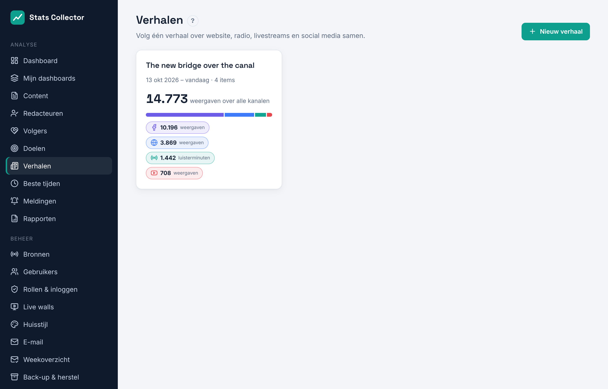
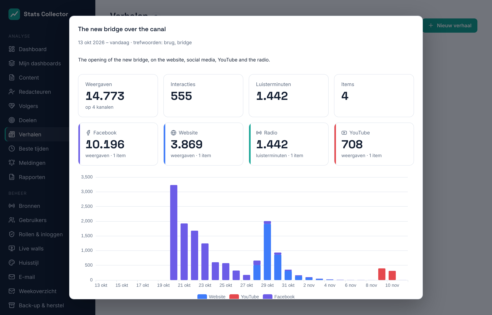

# Verhalen

**Analyse → Verhalen** volgt één onderwerp over alle kanalen samen: de website, social media, YouTube, livestreams en de radio. Iedereen kan de verhalen bekijken; redacteuren, de hoofdredacteur en beheerders kunnen ze maken.

Elke kaart toont de weergaven over alle kanalen, een balk met het aandeel per kanaal en een label per kanaal.

## Wat zit er in een verhaal

- **Items** die je kiest: artikelen, berichten, video's en uitzendingen (zoek op titel of adres).
- Alles wat eraan **gekoppeld** is: berichten en video's die naar een gekozen artikel linken, en het artikel waar een gekozen bericht naar linkt. Dit zijn dezelfde koppelingen als onder [Content](content.md).
- **Trefwoorden**: items uit de periode van het verhaal met een van de woorden in de titel komen mee (minstens drie letters per woord).
- **Radio- en streamfragmenten**: een stream, een begin- en eindtijd en een label, bijvoorbeeld het interview in de uitzending. Ze worden gemeten aan de luisteraars van dat moment: gemiddeld en piek, en luisterminuten.

Een item dat je niet wilt, haal je met **×** uit het verhaal; het blijft eruit, ook als het bij een trefwoord past.

## De cijfers van een verhaal

Klik op een verhaal voor:

- de totalen: weergaven, interacties, luisterminuten en het aantal items;
- een tegel per kanaal;
- een grafiek per dag met een staaf per kanaal;
- de items met waarom ze in het verhaal zitten (*gekozen*, *gekoppeld* of *trefwoord*), en de radiofragmenten.

De cijfers gaan over de periode van het verhaal; zonder einddatum tot vandaag.
