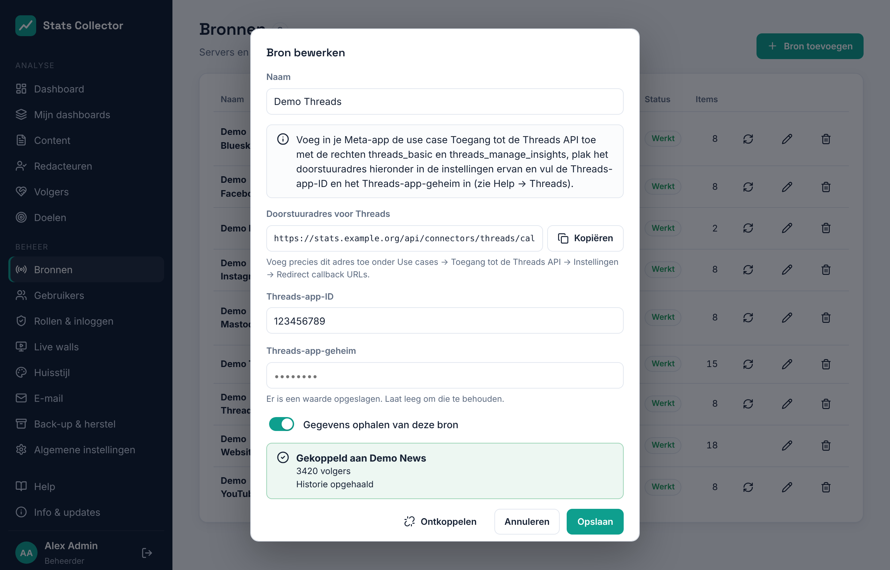

# Threads

Stats Collector leest de cijfers van een **Threads**-account via de Threads API. Het gebruikt dezelfde Meta-app als Facebook en Instagram (zie [Meta: Facebook en Instagram](meta.md)), met één extra use case. Elk Threads-account is een eigen bron.

## Wat wordt verzameld

| | Per dag voor het account | Per bericht |
| --- | --- | --- |
| Threads | Weergaven, likes, antwoorden, reposts, citaten, keren gedeeld, nieuwe volgers (netto), volgers | Weergaven, likes, antwoorden, reposts, citaten, keren gedeeld |

Goed om te weten:

- **Threads heeft geen bereik.** Threads telt mee voor de maten *weergaven*, *interacties* en *volgers*.
- De weergaven per dag van het account komen rechtstreeks van Threads, tot twee jaar terug (Threads bewaart niets van vóór 13 april 2024). Likes, antwoorden, reposts, citaten en keren gedeeld per dag zijn wat de berichten die dag erbij kregen; een bericht dat nieuw is voor Stats Collector krijgt zijn hele totaal op de dag dat het verscheen.
- **Nieuwe volgers (netto)** is de verandering van het aantal volgers van de ene dag op de andere. Het aantal volgers per dag begint op de dag dat je verbindt.
- Berichten van de laatste 7 dagen worden elk uur opnieuw gelezen, berichten van de laatste 30 dagen één keer per dag. Reposts van berichten van anderen tellen niet mee.
- Threads werkt in hele dagen: in de weergave **24 uur** van het dashboard toont het *alleen dagcijfers*.
- Links in een bericht koppelen het aan het websiteartikel waarnaar het verwijst (zie [Content](content.md)).

## 1. De Threads-use case toevoegen aan de Meta-app

1. Open je app op [developers.facebook.com/apps](https://developers.facebook.com/apps) → **Use cases → Use case toevoegen → Toegang tot de Threads API**.
2. Voeg onder **Aanpassen → Rechten** **threads_basic** en **threads_manage_insights** toe.
3. Plak onder **Aanpassen → Instellingen** het **doorstuuradres** dat Stats Collector in het bronformulier toont (het eindigt op `/api/connectors/threads/callback`) bij **Redirect callback URLs**, en ook in de velden voor verwijderen en deïnstalleren. Sla op.
4. Op dezelfde pagina staan de **Threads-app-ID** en het **Threads-app-geheim**. Die zijn anders dan de app-ID en het geheim van Facebook.
5. Voeg onder **App-rollen → Rollen → Threads-testers** het Threads-account toe dat je wilt meten. Ga daarna in de Threads-app of op threads.net naar **Instellingen → Account → Websitemachtigingen → Uitnodigingen** en accepteer de uitnodiging.

Zolang de app in ontwikkelmodus staat, werkt dit voor accounts die tester zijn. Wil je dat het ook zonder dat blijft werken, vraag dan onder **App-review** geavanceerde toegang aan voor beide rechten, met dezelfde beschrijving als voor Facebook.

## 2. De bron toevoegen in Stats Collector

1. **Beheer → Bronnen → Bron toevoegen**, soort **Threads (account)**.
2. Vul een naam, de **Threads-app-ID** en het **Threads-app-geheim** in en sla op.

    

3. Klik op **Verbinden met Threads** en log in met het Threads-account. Sta beide rechten toe.
4. Terug in Stats Collector is het account verbonden en wordt de geschiedenis op de achtergrond opgehaald.

Het token is 60 dagen geldig; Stats Collector vernieuwt het elke week, dus het blijft werken zolang de bron synchroniseert. Staat bij de bron *De toegang tot Threads is verlopen* (bijvoorbeeld na een nieuw wachtwoord), klik dan opnieuw op **Verbinden met Threads**. **Ontkoppelen** vergeet het token; de cijfers die al verzameld zijn blijven bewaard.
