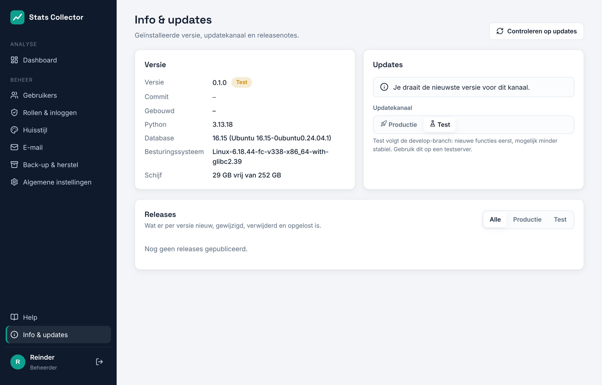

# Info, updates en het productie-/testkanaal

Klik op **Info & updates** onderaan het linkermenu. Een stip ernaast betekent dat er een update is.

## Versie

De kaart **Versie** toont de geïnstalleerde versie, het kanaal, de git-commit, de builddatum en, voor beheerders, de database, het besturingssysteem en de vrije schijfruimte.

## Kanalen

| Kanaal | Volgt | Voor |
| --- | --- | --- |
| Productie | Releases van de `main`-branch | Dagelijks gebruik |
| Test | Testbuilds van de `develop`-branch (en productiereleases) | Een testserver, of nieuwe functies vroeg uitproberen |

Wissel met de knoppen **Productie / Test**. Wisselen verandert alleen welke releases worden aangeboden; er wordt niets geïnstalleerd totdat je op **Nu bijwerken** of **Installeren** klikt.

## Updates zoeken en installeren

**Controleren op updates** vraagt GitHub om de nieuwste releases (anders wordt het resultaat tien minuten bewaard). Is er een nieuwere versie voor je kanaal, dan verschijnt **Nu bijwerken**.

Een update:

1. downloadt de release en controleert de SHA-256-checksum;
2. maakt een databasedump;
3. installeert de nieuwe versie naast de huidige, met een eigen Python-omgeving;
4. voert de databasemigraties uit;
5. schakelt over en herstart de webdienst;
6. controleert dat de nieuwe versie reageert. Zo niet, dan worden de vorige versie en de databasedump automatisch teruggezet.

De pagina toont het logboek terwijl dit loopt en herlaadt als het klaar is. De laatste drie versies blijven op schijf staan.

## Releases en releasenotes

De lijst **Releases** toont elke versie met kanaal en datum. De tabbladen **Nieuw**, **Gewijzigd**, **Verwijderd** en **Opgelost** laten zien wat er veranderd is, in jouw taal. Met **Installeren** zet je elke versie uit de lijst op de server, bijvoorbeeld om van een testbuild terug te gaan naar de nieuwste productierelease. Is de gekozen versie ouder, dan wordt het databaseschema eerst teruggezet.

Dezelfde notes staan in [CHANGELOG.nl.md](https://github.com/rhisijmuiden/stats-collector/blob/develop/CHANGELOG.nl.md) en op de releasepagina van GitHub.
