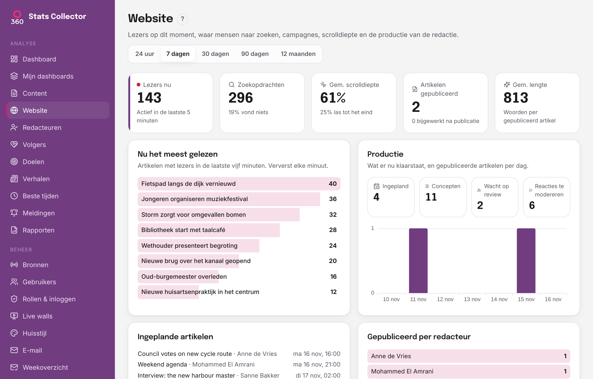
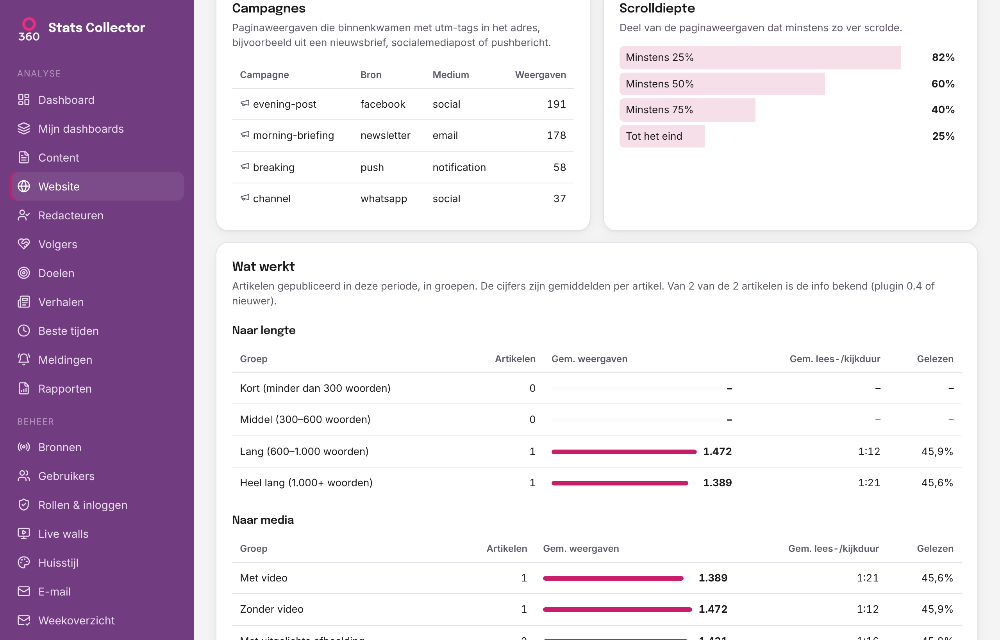
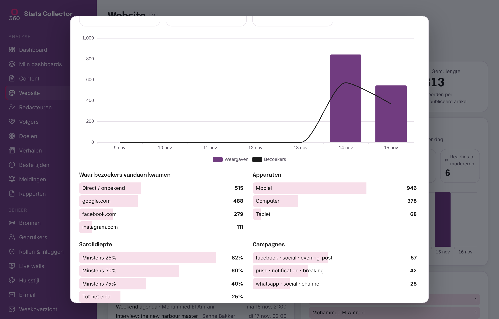

# Website

**Website** in het linkermenu laat zien wat de WordPress-plugin meer vertelt dan paginaweergaven: wie er nu leest, waar bezoekers naar zoeken, welke campagnes lezers opleveren, hoe ver mensen scrollen, wat de redactie klaar heeft staan en wat voor artikel het goed doet.

Alles op deze pagina heeft versie **0.4 of nieuwer** van de Stats Collector-plugin voor WordPress nodig. Met een oudere plugin toont de pagina een melding; download de nieuwe plugin onder **Beheer → Bronnen → je website → WordPress-plugin downloaden** en upload hem in WordPress (**Plugins → Nieuwe plugin → Plugin uploaden**, daarna **Huidige vervangen door geüploade**). De instellingen blijven bewaard.

Kies rechtsboven de periode. Met meer dan één website kies je één site of allemaal.

## De cijfers bovenaan

| Cijfer | Betekenis |
| --- | --- |
| Lezers nu | Bezoekers met een artikel of de voorpagina open die in de laatste vijf minuten actief waren. De pagina ververst dit elke minuut. |
| Zoekopdrachten | Zoekopdrachten in het zoekvak van de website, met het deel dat niets vond. |
| Gem. scrolldiepte | Hoe ver lezers gemiddeld op de pagina kwamen, en het deel dat tot het eind kwam. |
| Artikelen gepubliceerd | Artikelen gepubliceerd in de periode, en hoeveel daarvan meer dan 15 minuten na publicatie zijn bijgewerkt. |
| Gem. lengte | Woorden per artikel dat in de periode is gepubliceerd. |

## Nu het meest gelezen

De artikelen met lezers in de laatste vijf minuten. Klik op een titel om het artikel met al zijn cijfers te openen.

## Productie

Wat er nu klaarstaat: **ingeplande** artikelen, **concepten**, artikelen die **wachten op review** en **reacties te modereren**, met een grafiek van gepubliceerde artikelen per dag. Daaronder de eerstvolgende ingeplande artikelen en, voor Beheerder en Hoofdredacteur, het aantal gepubliceerde artikelen per redacteur.

## Zoeken op de site

**Meest gezocht** zijn de woorden die bezoekers in het zoekvak van de website typten. **Niets gevonden** zijn de zoekopdrachten zonder resultaat: zo zie je waar lezers naar zoeken en wat ze niet vinden. Zoektermen worden in kleine letters geteld; dezelfde bezoeker die binnen 30 minuten opnieuw op hetzelfde woord zoekt, telt één keer.

In zoektermen kunnen namen of andere persoonsgegevens staan die bezoekers intypen. Zet **Zoeken op de site** uit in de plugininstellingen als je ze niet wilt laten tellen.

## Campagnes

Paginaweergaven die binnenkwamen met **utm-tags** in het adres, bijvoorbeeld `https://www.example.org/artikel?utm_source=nieuwsbrief&utm_medium=email&utm_campaign=ochtendbrief`. Zet deze tags op de links in je nieuwsbrief, socialemediaposts en pushberichten om te zien wat elk ervan oplevert. Alleen `utm_source`, `utm_medium` en `utm_campaign` worden gebruikt.

## Scrolldiepte

Het deel van de paginaweergaven dat minstens 25%, 50% of 75% van de pagina doorscrolde, en tot het eind. Alleen weergaven die lang genoeg bleven om iets terug te sturen (ongeveer 15 seconden, of tot de lezer wegging) tellen mee.

## Wat werkt

De artikelen die in de periode zijn gepubliceerd, in groepen, met per groep het aantal artikelen, de gemiddelde weergaven per artikel, de gemiddelde leestijd en het deel dat gelezen is:

- **Naar lengte**: kort (minder dan 300 woorden), middel, lang en heel lang (1.000 woorden of meer).
- **Naar media**: met of zonder video (een ingesloten YouTube-, Vimeo- of Dailymotion-video, of een videoblok), met of zonder uitgelichte afbeelding.
- **Bijgewerkt na publicatie**: artikelen die meer dan 15 minuten nadat ze online gingen zijn aangepast, tegenover de rest.
- **Naar SEO-score**: de score uit **Yoast SEO** of **Rank Math**, als de site een van beide gebruikt, en het aantal artikelen zonder focuszoekwoord.

De cijfers tellen wat elk artikel in de gekozen periode haalde, dus heel nieuwe artikelen hebben minder tijd gehad. Vergelijk groepen over 30 of 90 dagen voor een eerlijk beeld.

## Eén artikel

Als je een artikel opent (hier of onder **Content**) zie je ook de lengte, video en uitgelichte afbeelding, hoe vaak het is bijgewerkt, wanneer het voor het laatst is gewijzigd, het SEO-zoekwoord en de score, de lezers op dit moment, de scrolldiepte en de campagnes die lezers brachten.

## Wie ziet wat

Iedereen kan deze pagina openen. Namen van redacteuren (ingeplande artikelen, gepubliceerd per redacteur) zien alleen Beheerder en Hoofdredacteur, net als op de andere pagina's.
