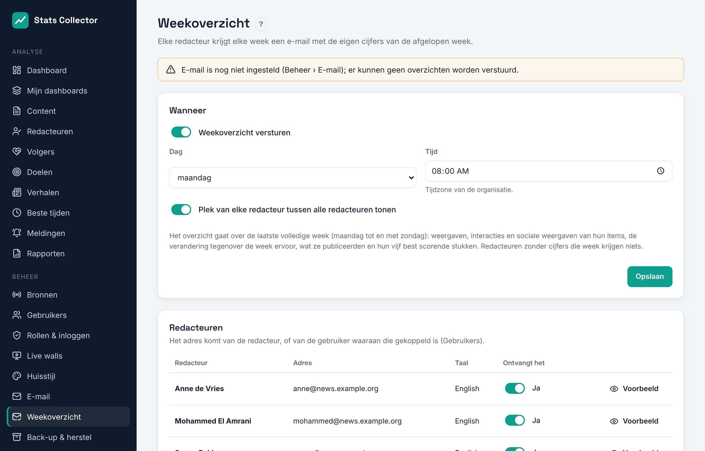
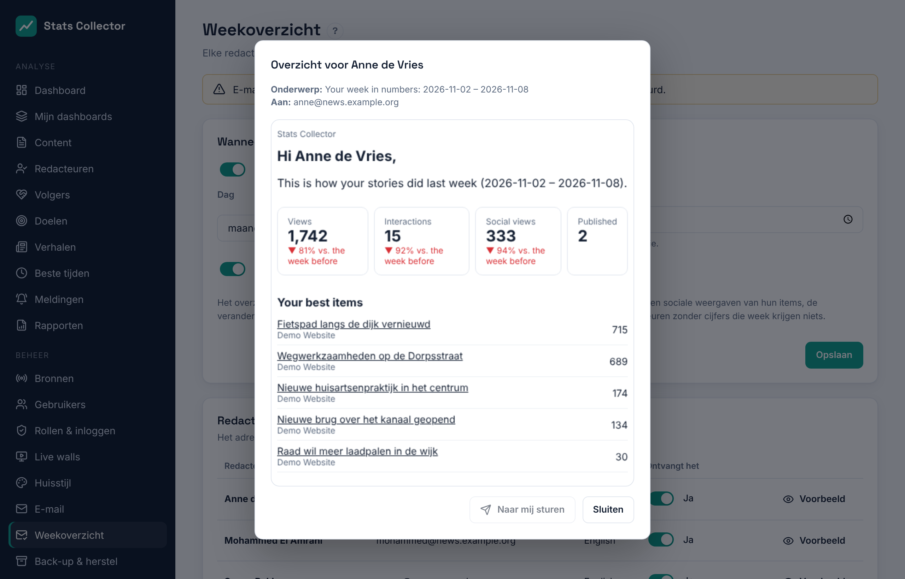

# Weekoverzicht per redacteur

**Beheer → Weekoverzicht** stuurt elke redacteur elke week een e-mail met de eigen cijfers van de afgelopen week. De **hoofdredacteur** en **beheerders** stellen het in.

## Aanzetten

1. Zorg dat e-mail werkt (**Beheer → E-mail**).
2. Zet **Weekoverzicht versturen** aan en kies de dag en tijd (tijdzone van de organisatie), bijvoorbeeld maandag 08:00.
3. Kies of elke redacteur de eigen **plek tussen alle redacteuren** op weergaven ziet.
4. Sla op.

## Wie krijgt het

De lijst **Redacteuren** toont elke redacteur (iemand die bij artikelen als auteur staat) met het adres waar het overzicht heen gaat: het eigen adres van de redacteur, of dat van de gebruiker waaraan die gekoppeld is. Zet **Ontvangt het** uit voor wie het niet moet krijgen. Redacteuren zonder adres, of zonder cijfers die week, krijgen niets.

## Wat staat erin

Het overzicht gaat over de laatste volledige week, maandag tot en met zondag:

- weergaven, interacties en sociale weergaven (berichten die naar hun artikelen linken) van hun items, met de verandering tegenover de week ervoor;
- hoeveel items ze publiceerden;
- hun vijf best scorende stukken met een link;
- eventueel hun plek tussen alle redacteuren;
- een knop naar hun cijfers in Stats Collector.

De e-mail is in de taal van de gekoppelde gebruiker, anders in de standaardtaal (**Beheer → Algemene instellingen**). **Voorbeeld** toont het overzicht van vorige week van een redacteur; **Naar mij sturen** stuurt het naar je eigen adres.
