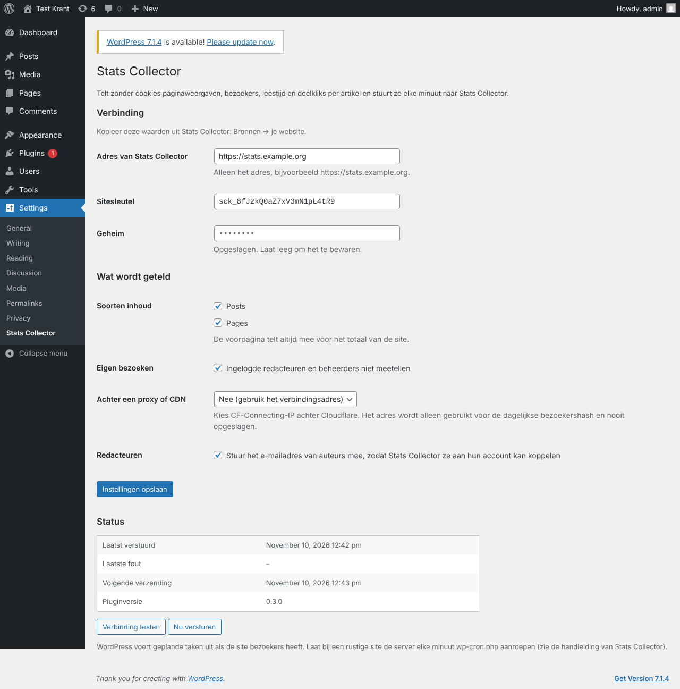

# WordPress

Stats Collector heeft een eigen WordPress-plugin. Die telt per artikel, zonder cookies, hoe vaak het bekeken wordt, door hoeveel bezoekers, hoe lang mensen lezen, of ze het lezen, waar ze vandaan komen (Google, Facebook…), welk apparaat ze gebruiken en hoe vaak er op de deelknoppen wordt geklikt. Elke minuut stuurt de plugin deze cijfers naar Stats Collector, samen met de titel, auteur, categorie en tags van elk artikel, zodat je cijfers per redacteur ziet.

Er is geen cookiebanner nodig: de plugin plaatst geen cookies en slaat geen IP-adressen op. Een bezoeker wordt maar één dag herkend, met een code die gemaakt is van het IP-adres, de browser en een willekeurige waarde die elke nacht verandert. De volgende dag telt dezelfde persoon als nieuwe bezoeker, en de code is nooit terug te rekenen naar een IP-adres.

## Vereisten

- WordPress 6.5 of nieuwer, PHP 8.1 of nieuwer.
- De WordPress-server kan je Stats Collector via HTTPS bereiken (uitgaand).
- Stats Collector is bereikbaar op het openbare adres (zie [Reverse proxy](reverse-proxy.md)).

## Stap 1: de site toevoegen in Stats Collector

1. Ga naar **Beheer → Bronnen → Bron toevoegen** en kies **WordPress (website)**.
2. Vul een naam in (bijvoorbeeld de naam van de website) en het adres van de website. Klik op **Opslaan**.
3. Het venster toont nu drie waarden: het **adres van Stats Collector voor de plugin**, de **sitesleutel** en het **geheim**. Kopieer het geheim meteen: het wordt maar één keer getoond.
4. Klik op **WordPress-plugin downloaden** om `stats-collector-wordpress.zip` te krijgen.

Geheim kwijt? Open de site onder Bronnen en klik op **Nieuwe sleutel en geheim**. De plugin stopt met versturen tot je de nieuwe waarden in WordPress plakt.

## Stap 2: de plugin installeren in WordPress

1. Ga in WordPress naar **Plugins → Nieuwe plugin → Plugin uploaden**, kies `stats-collector-wordpress.zip`, klik op **Nu installeren** en daarna op **Activeren**.
2. Ga naar **Instellingen → Stats Collector**.
3. Vul het **adres van Stats Collector** in (alleen het adres, bijvoorbeeld `https://stats.example.org`), de **sitesleutel** en het **geheim**. Klik op **Instellingen opslaan**.
4. Klik op **Verbinding testen**. Je ziet dan *De verbinding werkt*.

Herhaal dit voor elke website. Elke website is een aparte bron met een eigen sleutel.

## Instellingen van de plugin

| Instelling | Wat het doet |
| --- | --- |
| Soorten inhoud | Welke soorten inhoud per item geteld worden (standaard berichten en pagina's). De voorpagina telt altijd mee voor het totaal van de site. |
| Eigen bezoeken | Staat dit aan (standaard), dan tellen ingelogde redacteuren en beheerders niet mee. |
| Achter een proxy of CDN | Kies `CF-Connecting-IP` als de website achter Cloudflare staat, `X-Forwarded-For` of `X-Real-IP` achter een andere proxy. Anders lijken alle bezoekers hetzelfde en worden unieke bezoekers te laag geteld. |
| Redacteuren | Stuurt het e-mailadres van auteurs mee, zodat Stats Collector ze aan hun account kan koppelen (zie hieronder). |

Het blok **Status** toont wanneer er voor het laatst is verstuurd en de laatste fout. **Nu versturen** verstuurt meteen.

## Wat wordt geteld

| Cijfer | Betekenis |
| --- | --- |
| Weergaven | Elke keer dat een artikel geopend wordt. Herladen door dezelfde bezoeker binnen 30 minuten telt één keer. Zoekmachines en andere bots tellen niet mee. |
| Bezoekers | Verschillende bezoekers. Per dag zijn dit echte unieke bezoekers; over een langere periode worden de dagen opgeteld (dezelfde persoon op twee dagen telt twee keer, omdat de plugin bezoekers elke nacht vergeet). |
| Leestijd | De tijd dat het artikel in beeld was terwijl de lezer actief was (scrollen, muis bewegen, aanraken), maximaal 30 minuten per weergave. **Gem. leestijd** is de leestijd gedeeld door het aantal weergaven. |
| Gelezen | Een weergave waarin iemand minstens 30 seconden las, of in minstens 10 seconden driekwart van de pagina doorscrolde. |
| Gedeeld | Kliks op deellinks voor Facebook, X, WhatsApp, LinkedIn, Telegram, Bluesky, Reddit, Pinterest en e-mail. Je eigen deelknop telt ook mee als die het attribuut `data-sc-share` heeft. |
| Reacties | Goedgekeurde reacties per uur. |
| Verwijzers en apparaten | Per dag de site die de bezoeker stuurde (`direct` als dat onbekend is) en het soort apparaat: mobiel, computer of tablet. |

Terugkerende bezoekers worden niet geteld, omdat dat zonder cookies niet kan.

De plugin bewaart de losse paginaweergaven 35 dagen in een eigen tabel (`wp_sc_views`), zodat hij na een storing opnieuw kan versturen. De cijfers zelf blijven voorgoed in Stats Collector bewaard.

## Redacteuren

Elke WordPress-auteur wordt een redacteur in Stats Collector. Is het e-mailadres van de WordPress-gebruiker gelijk aan dat van een Stats Collector-gebruiker (lokaal of Microsoft 365), dan worden ze gekoppeld: die gebruiker ziet dan de eigen cijfers onder **Redacteuren**. Mede-auteurs worden ondersteund als de plugin *Co-Authors Plus* is geïnstalleerd.

Zie [Content en redacteuren](content.md) voor wat elke rol kan zien.

## Elke minuut versturen

WordPress voert geplande taken uit als iemand de site bezoekt. Op een drukke website is dat toch elke minuut. Laat bij een rustige site de server WordPress elke minuut aanroepen en zet de ingebouwde trigger uit:

1. Zet in `wp-config.php`: `define('DISABLE_WP_CRON', true);`
2. Voeg een cronjob toe op de webserver: `* * * * * curl -fsS https://www.example.org/wp-cron.php?doing_wp_cron >/dev/null`

Is de verbinding een tijdje weg, dan haalt de plugin het zelf in, 24 uur per minuut, tot 35 dagen terug.

## Problemen

| Melding | Oplossing |
| --- | --- |
| *de sitesleutel of het geheim klopt niet* | Kopieer beide opnieuw uit Stats Collector, of maak een nieuwe sleutel en een nieuw geheim. |
| *de klok van deze server loopt meer dan vijf minuten verkeerd* | Zet tijdsynchronisatie (NTP) aan op de webserver. |
| *deze site staat op pauze in Stats Collector* | Zet **Gegevens ophalen van deze bron** weer aan onder Bronnen. |
| Een verbindingsfout (cURL) | De webserver kan Stats Collector niet bereiken: controleer het adres, de firewall en het HTTPS-certificaat. |
| Geen cijfers terwijl de test werkt | Controleer of WordPress-cron draait (**Volgende verzending** in de status hoort binnen een minuut te liggen) en dat je niet test terwijl je als redacteur bent ingelogd. |
